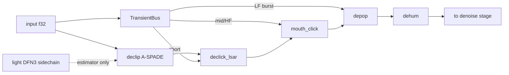
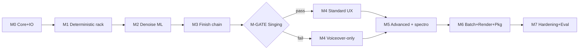

# YesVox v1 - Offline Vocal Restoration Workstation

## Overview

YesVox v1 is a standalone offline desktop app that restores and lightly polishes an already-isolated vocal (voiceover or singing), shipped as part of the music-first "Yes" suite alongside yes-master, YesDAW, and YesStems. It is a thin egui shell over one host-agnostic Rust core crate (`yesvox-core`) whose v1 ML stack is two denoisers (DeepFilterNet3 via `tract`; MossFormer2_SE_48K via vendored static `ort` against ONNX Runtime 1.26.x C++) feeding a deterministic-DSP repair rack (A-SPADE declip, AR/LSAR de-click + mouth-click, IIR notch/comb de-hum, WPE-light de-reverb, split/wide de-ess, breath control, true-peak limiter). Singing is held to the same quality bar as speech via a quantitative release gate placed between rack completion and Standard-UI wiring; if it fails, the toggle is hidden and v1 ships voiceover-only with the singing settings slot pre-reserved so no schema break is needed when v1.x adds it back. The product is offline-only, non-destructive, same-take-same-length, quality-over-realtime, and ships only the restoration + essential-finish identity locked in the product north-star.

## 1. Architecture & the RT-safe host-agnostic core

The whole product is one Rust core crate (`yesvox-core`) plus a thin standalone shell (`yesvox-app`, egui). The shell knows nothing about DSP/ML; the core knows nothing about widgets, file dialogs, or audio devices. v1 ships only the offline render path through this core; the (later) cpal preview path plugs in at the same boundary.

### 1.1 Core boundary

The core exposes one trait, deliberately shaped like a plugin-host contract so we can later drop it into a VST3/AU/CLAP wrapper without refactor:

```rust
pub trait VocalProcessor: Send {
    fn prepare(&mut self, sr: u32, max_block: usize, channels: ChannelLayout) -> PrepareReport;
    fn params(&self) -> &ParamTree;                    // typed, serializable, versioned
    fn set_params(&mut self, patch: ParamPatch);       // sample-accurate at next block
    fn process(&mut self, io: &mut AudioIo) -> ProcessReport; // f32 planar in/out
    fn reset(&mut self);                               // flush all state, per-file
    fn latency_samples(&self) -> u32;                  // reported at input SR
}
```

- `prepare` is the only allocating call; `process` is **alloc-free, lock-free, syscall-free** even though v1 never hits the audio thread - the discipline keeps the door open for preview.
- `AudioIo` is **planar `&mut [&mut [f32]]`** (1 or 2 channels), not interleaved; same buffer in/out is allowed (the limiter and any look-ahead module own their internal delay lines).
- `ParamTree` is versioned (`schema_version: u32`) and reserves the Singing-mode subtree on day one (see §6 release-gate fallback) so the settings file format never breaks.
- `ProcessReport` carries the analysis pane payload (integrated LUFS, true peak, noise floor, clip count, click rate/s, hum F0+harmonics, RT60 estimate, content-type confidence, plus a per-stage `engine_class: {Deterministic, Generative, Mixed}` flag) so the shell never re-measures and so the generative-reconstruction badge (§5.4) has authoritative state.

### 1.2 Internal data contract

- **Format:** `f32` end-to-end; **`f64` only inside the limiter sidechain** (gain computer, true-peak oversampler).
- **Channel topology:** mono in -> mono pipeline; stereo in -> **dual-mono** with a per-module three-state link `stereo_link: {Off, Detector, Full}`. De-reverb and the limiter default to `Detector` (shared sidechain, independent gain) so M/S imaging survives; de-click/de-pop default to `Off`; finish-EQ + leveler default to `Full`. This is the single authoritative definition - §4.1 inherits the same enum and the same de-reverb default.
- **Sample rate:** SR-preserving end-to-end at the host SR (44.1 / 48 / 88.2 / 96 / 176.4 / 192 kHz). The only exception is MossFormer2_SE_48K, which lives behind a resample island:

```
host_sr ── rubato FftFixedInOut (polyphase, Kaiser β≈10) ─► 48 kHz
          ├─► MossFormer2 ONNX (ort, static chunk)
          ◄─ rubato 48 kHz → host_sr ─┘
```

Export SR is locked to input SR; the resample is flagged in the analysis report. No other module changes SR.

- **Bit depth:** decoded via `symphonia` to `f32`; export honors input bit depth unless overridden by the §5.6 Export panel; **TPDF dither** applied on <=24-bit export.

### 1.3 Offline render path (v1)

`yesvox-app` drives one whole file at a time through `render_file()`:

1. Decode -> analyze (whole-file pass, ~20 ms windows) -> emit `AnalysisReport`.
2. `prepare(sr, MAX_BLOCK=4096, layout)`; `reset()` (per-file).
3. Stream the file through `process()` in 4096-sample blocks; non-causal blocks (denoise, de-reverb) buffer internally per §1.4.
4. Atomic write: `tmp_xxxx.partfile` -> `fsync` -> rename to `{name}_yesvox.{ext}` (cancel = delete tmp).

There is no audio callback in v1. The (later) preview path will share the same `process()` but with a 256-512-sample block and the worker pool below; the offline path is what release-gates on quality.

### 1.4 Streamed overlap-add for long files

Non-causal models cannot hold a 30-minute file in RAM. Each such module declares a `ChunkPolicy { chunk_s: 30.0, overlap_s: 2.0, window: Hann² }`. The core chunker:

- preflights RAM as `bytes ≈ chunk_s · sr · 4 · n_channels · K` (K = model working-set multiplier, measured at `prepare`) and warns above 70 % of available RAM,
- runs chunks through the worker pool (§1.5),
- 2 s equal-power crossfades on overlap; bit-exact at silent chunk boundaries (CI null-test against single-shot reference at <=180 s files).

Per-file `reset()` flushes WPE covariances, ONNX KV state, FDN tails, and the limiter look-ahead.

### 1.5 ANIRA-style worker pool

A **static** `WorkerPool` is built once at app start with `num_workers = max(1, physical_cores − 1)`; each worker owns a pinned `ort::Session` (or `tract` runtime for DFN3). Communication is **lock-free SPSC `rtrb` rings**: render thread -> worker (input chunk + job id), worker -> render thread (output chunk + job id). The render thread waits on a `Parker`. Sessions are **never recreated mid-file**; `reset()` only clears tensor state. ONNX Runtime providers negotiated at `prepare`: CoreML -> DirectML -> CPU on macOS/Windows; CPU on Linux v1.x. Cancellation = relaxed `AtomicBool` per job, checked between chunks. On Apple Silicon, P/E-core scheduling is left to the OS in v1 (treating E-cores as workers is an open empirical question - measured at M7).

### 1.6 Two extensibility seams (additive, not rewrites)

```rust
// Seam A: where the vocal comes from. v1 = files/stems on disk.
pub trait VocalSourceProvider: Send + Sync {
    fn id(&self) -> &'static str;                              // "file", future "yesstems", ...
    fn discover(&self, hint: &SourceHint) -> Vec<SourceItem>;  // files, drops, stems
    fn open(&self, item: &SourceItem) -> Result<DecodedTake>;  // f32, SR, channels, provenance
}
pub struct FileProvider;       // v1 impl: symphonia decode of WAV/FLAC (+ optional MP3)

// Seam B: stem hand-off with YesStems (and any future sibling separator).
pub struct StemHandoff {       // serialized as .yesstem.json sidecar next to the WAV
    pub schema_version: u32,
    pub stem_role: StemRole,   // Vocal | Backing | Other
    pub source_sr: u32, pub source_bits: u16, pub channels: u8,
    pub provenance: Provenance,// app, version, separator model id+hash, original file hash
    pub flags: StemFlags,      // contains_bleed: Option<f32>, is_isolated_vocal: bool
}
```

The de-bleed refusal (§4.5) reads `StemHandoff.flags` plus the analyzer's `debleed_residual_db` and short-circuits with the "this looks like a mix, run YesStems first" reject before `process()` is called. Sidecar-vs-BWF-iXML embedding for `StemHandoff` is sized at YesStems handoff sign-off.

### 1.7 Router

```mermaid
flowchart LR
    A[Drag-drop / Open] --> B{VocalSourceProvider}
    B -->|file| C[FileProvider: symphonia decode]
    B -->|.yesstem.json sidecar| D[StemHandoff parse]
    C --> E[Whole-file analyzer<br/>LUFS / TP / noise floor / clicks / hum / RT60 / content]
    D --> E
    E --> F{De-bleed gate}
    F -->|reject| Rj[Block: run YesStems]
    F -->|warn / pass| G[yesvox-core: prepare sr,maxBlock]
    G --> H[Chunker: 30s / 2s xfade<br/>RAM preflight]
    H --> I[process per block<br/>f32 planar, dual-mono]
    I <-->|SPSC rings| W[(Static WorkerPool<br/>ort + tract sessions)]
    I --> J[Atomic write: tmp -> fsync -> rename]
    J --> K[{name}_yesvox.{ext}<br/>match-input SR, metadata preserved]
```

## 2. Denoise & the ML model pipeline

YesVox v1 ships exactly two neural denoisers behind one trait-object boundary. Everything else is deterministic DSP in §3.

### 2.1 Engines and roles

| Engine | Runtime | Role | Latency target | Notes |
|---|---|---|---|---|
| DeepFilterNet3 | `tract` (pure Rust, no ORT) | Responsive / CPU floor / Natural mode / preview meter | <=20 ms RT block; <=0.3× file-time offline on M2 Air | Ships ONNX upstream; opset-17-clean; weights ~6 MB |
| MossFormer2_SE_48K | `ort` 2.0.0-rc.x against vendored ONNX Runtime **1.26.x C++** (statically linked) | Batch quality (Balanced default, Restoration HQ multipass) | Offline only; never on audio callback | 48 kHz native; Apache-2.0 code + weights (verified; provenance archived per §7.5); NO official ONNX -> exported in-house per §2.3 |

Excluded by construction: Mamba/SSM (no opset-17 equivalent), whole-graph diffusion/flow (export one sampler step + drive loop in Rust if ever needed; never a fused multi-step graph).

### 2.2 Engine trait and wiring

```rust
pub trait DenoiseEngine: Send {
    fn prepare(&mut self, sr: u32, max_block: usize, chunk: ChunkSpec) -> Result<()>;
    fn process(&mut self, in_buf: &[f32], out_buf: &mut [f32]) -> Result<()>;
    fn latency_samples(&self) -> usize;
    fn reset(&mut self);
}
```

ORT build flags: `--features load-dynamic=false,copy-dylibs=false`; MSVC/clang-cl on Windows with `-C target-feature=+crt-static`; macOS universal2 static libs. EP floor: **CoreML** (ANE+GPU, fp16 subgraphs) on macOS arm64; **DirectML** on Windows x64; **CPU EP** as guaranteed fallback. CUDA is not a v1 dependency. CI asserts `ort::api().version()` matches the pinned ORT 1.26.x C++ string at app start; an EP-regression suite is in the §7.6 offline matrix.

Warm-up: at app start each registered engine runs a 0.5 s synthetic buffer through `process` on a background thread so the first real render does not pay JIT/EP-graph-compile cost. The actually-selected EP is logged (CoreML silently falls back to CPU on unsupported ops - we want to know).

### 2.3 MossFormer2 ONNX-export discipline

Owned in-repo under `tools/export_mossformer2/`, reproducible from a pinned commit + `make export`. Rules:

1. **STFT**: replace `torch.stft` with `Conv1d(channels=2*n_fft, kernel=n_fft, stride=hop)` holding precomputed `cos`/`sin` windows (Hann, 1920/480 at 48 kHz). Real/imag in the channel dim.
2. **iSTFT**: `ConvTranspose1d` mirroring the analysis kernel, with explicit overlap-add normalisation tensor baked in as a constant.
3. **Attention**: de-fuse `scaled_dot_product_attention` into `Linear -> bmm -> softmax -> bmm` so CoreML/DirectML pattern-match heads. No `flash_attn`, no fused kernels.
4. **Complex tensors**: none - interleaved reals only; magnitude/phase via `sqrt`/`atan2` on real channels.
5. **Opset**: 17 hard. CI fails any node whose `since_version > 17`.
6. **Static chunk length**: fixed 4.0 s @ 48 kHz (192 000 samples), 0.5 s context pad each side, exported as constant `N`. No dynamic axes except batch. This is what lets CoreML/ANE take the graph.
7. **FP16 numerics validation**: export fp32 reference + fp16 variant; CI gate requires per-frame magnitude RMSE <= 1e-3 against fp32 on a 60 s reference vocal, zero `NaN`/`Inf` over the corpus. If fp16 fails on exotic hardware, that EP falls back to fp32 at runtime (logged in the analysis report); the fp32 fallback ships as `pack.mossformer2-fp32`.

Long files: §1.4 streamed overlap-add at the host level (30 s / 2 s crossfade) feeds 4 s chunked graph windows; this also drives the RAM preflight.

### 2.4 Processing-mode -> engine map

Intensity is the **authoritative axis** for engine choice; presets choose the default intensity, but cannot override the engine binding (this preserves §5.5's difference-monitor mode-switch semantics and the slow-hardware fallback logic):

- **Natural** = light deterministic DSP + **DFN3** single pass at intensity-scaled mix. Also the slow-hardware fallback target: Balanced/Restoration HQ downshift to Natural (DFN3) when preflight estimates render > 1.5× the <=45 s render budget on the detected machine class (looked up against the §8.1 M7 SKU benchmark table - never a runtime guess), and the UI shows a persistent **Fast mode** badge with a tooltip explaining the substitution.
- **Balanced** (default) = deterministic chain + **MossFormer2** single pass, intensity-mixed wet/dry post-engine.
- **Restoration HQ** = deterministic chain + **MossFormer2** two-pass: pass 1 at full strength, residual analysis, pass 2 only on frames where the §3 noise-floor estimator still flags >= -55 dBFS broadband noise. Bounded at 2 passes; never 3.

Generative denoise output is **not linearly subtractable**, so reblend on the denoise stage is engine wet/dry, not residual sum; the difference monitor switches to "engine wet/dry" mode automatically when a generative engine is active (deterministic stages keep the linear residual path).

### 2.5 Footprint budget and on-demand packs

Installed-weights ceiling: **<=2 GB total** (CI-enforced in §7). Bundled at install (must work first-launch offline):

- DFN3 (~6 MB)
- MossFormer2_SE_48K fp16 (~280 MB exported; post-defuse size verified at <=350 MB at M2 export, otherwise INT8 quant pass in M7)
- Deterministic-DSP support tables (~negligible)
- Energy-based VAD + cepstral content classifier (deterministic, no shipped weights - see §3 + §4.5)
- Singing-pack reservation: manifest slot only in v1 (see §6 gate); no weights bundled.

Optional **model packs** download on demand into the platform model directory (§7.1) with the same LICENSE + card-YAML archival contract: `pack.mossformer2-fp32` (for users whose hardware fails the fp16 gate). Reserved-for-v1.x slots, **not downloadable in v1** (manifest entries only): `pack.srs-singing` (SRS / Smule Renaissance Small - the singing centerpiece, deferred to v1.x), `pack.ap-bwe` (bandwidth extension, explicitly out of v1 scope per §8.3). Pack downloads are the only network calls the app ever makes outside one-time activation, and they are gated behind an explicit user click - never auto-fetched on a render.

## 3. Deterministic DSP repair modules & the interaction matrix

All six modules live in `yesvox-dsp` (pure Rust, `realfft`/`rustfft`, `fundsp` biquads, `rubato` only at SR boundaries) and implement the same trait so the host can chain, bypass, and null-test them uniformly:

```rust
pub trait RepairModule {
    fn prepare(&mut self, sr: u32, max_block: usize);
    fn process(&mut self, x: &[f32], y: &mut [f32], sc: Option<&[f32]>);
    fn params(&mut self) -> &mut dyn ParamMap;
    fn bypass(&mut self, b: bool);          // sample-accurate, no fade
    fn reset(&mut self);
    fn latency_samples(&self) -> u32;
}
```

Canonical chain order (declip -> de-click/crackle -> de-hum -> denoise -> de-reverb -> de-ess -> breath -> finish -> limiter) is enforced by the host graph in §5. Hum F0 detection is **cepstral / harmonic-product-spectrum based** (no learned model) per master brief §7.9. VAD is **energy + ZCR based** (no learned model); content classification (Voiceover/Singing) is a deterministic feature-vector classifier (HNR, F0 stability, vibrato presence) - this honors brief §6.1's licensing discipline by avoiding shipped learned weights for these gating stages.

### 3.1 Modules

- **`declip` (A-SPADE, brief 7.7).** Constrained OLA solver on 32 ms / 75 % hop frames. Detect saturated runs at |x| >= θ_clip (θ_clip = 0.985 · max(|x|) over a 250 ms window, hysteresis 0.5 dB). ~50 SPADE steps per frame, soft-thresholding STFT magnitude while pinning the unclipped neighborhood. Advanced tunables: clip threshold, max iters, sparsity λ, look-ahead frames (2-4). Inputs from the sidechain rule below, not the main bus.
- **`declick_lsar` (brief 7.6).** AR order **p = 24** (VO) / **p = 40** (Singing), Burg estimator on 30 ms / 75 % overlap. Detection by normalized residual `e[n]/σ_e` with threshold **c = 3.5σ** (VO) / **c = 4.5σ** (Singing). LSAR interpolation up to **L_max = 240 samples @ 48 k (~5 ms)**; longer gaps escalate to `mouth_click`. De-crackle: same block with median |e| over 20 ms and default c = 5σ.
- **`mouth_click`.** Owns sparse transients **>= 3 ms and <= 30 ms** in 1.5-8 kHz that LSAR ignores. Band-limited matched-filter detector (saliva-click template bank, 6 prototypes) -> LSAR repair at p = 60 with 1 ms pre/post context. False-positive guard: voiced-frame gate from 20 ms RMS + ZCR.
- **`dehum` (brief 7.9).** (a) F0 estimator: HPS over a 4 s rolling window, snap to nearest 50/60 Hz ±2 Hz drift. (b) Adaptive IIR notch cascade at kF0 for k = 1..K, K such that kF0 < 0.45 · SR. Pole radius **r in [0.985, 0.999]** (intensity-mapped); comb topology selectable when K > 12. (c) LMS residual canceller (μ = 1e-4) on the sidechain to track slow drift. Tunables: K, r, F0 lock band, comb vs notch.
- **`depop` (brief 7.11).** Transient-triggered 2nd-order LR HPF, **fc swept 80-120 Hz**, attack 2 ms, release 80 ms, armed only when the shared transient detector reports a sub-30-Hz-dominated burst with >= 6 dB low-shelf bias.
- **`deess` (brief 7.10).** Two implementations behind one enum: `Split` (LR4 crossover at **6.5 kHz**, RMS detector with 5 ms attack / 40 ms release, downward expansion 2:1-6:1, level-independent via input-loudness normalization) and `Wide` (multiband dynamic EQ over 4-12 kHz, 6 bands, 12 dB max attenuation). Default `Split` for VO, `Wide` for Singing.

### 3.2 Shared transient detector and collision rules

One detector (`TransientBus`) feeds `declick_lsar`, `mouth_click`, and `depop` so a single sample is never double-counted. It publishes `Event { t0, dur_samples, band_centroid_hz, energy_db, claimed_by }`. Routing:

- `dur < 3 ms` -> `declick_lsar`
- `3 ms <= dur <= 30 ms` AND `1.5 k <= centroid <= 8 k` -> `mouth_click`
- `dur < 10 ms` AND `centroid < 200 Hz` AND `energy_db > -18` -> `depop`



Collision resolutions:

1. **Declip-before-denoise:** A-SPADE's neighborhood estimator subscribes to a sidechain-only DFN3 pass (`yesvox-ml::dfn3_light`, 10 ms frames, gain floor -6 dB). The main signal into `declip` is raw input; the denoised copy is consumed by SPADE's masking step only and discarded after the frame solve. No denoise gain reaches the bus until stage 4.
2. **Mouth-click vs de-click ownership:** duration threshold above is authoritative; `declick_lsar` masks any event already claimed by `mouth_click` via the bus's `claimed_by` field. CI test `tests/transient_no_double_repair.rs` asserts zero overlap on the reference set.
3. **De-hum harmonics not tripping click detection:** `dehum` runs **before** `declick_lsar` so its notch cascade has already removed kF0 energy; in addition, `TransientBus` notches its detection envelope at the locked F0 and its first eight harmonics (raised-cosine 4 Hz wide) so residual hum tone cannot register as a transient.
4. **De-ess -> breath HF handoff:** `deess` writes its gain-reduction envelope to a shared `HfSidechain` ring buffer; the breath module (§4.2) reads it to suppress its own HF attenuation by the dB already removed by `deess`, so the two never double-attenuate the 4-12 kHz band.

### 3.3 Bypass, null, and parameter coverage

- Every module exposes a click-free per-module `bypass` flag, read once at block start, so a block is either fully processed or fully copied (no per-sample branching, no fades). All-bypass means `process` is a `memcpy` from `x` to `y` with zero state mutation.
- **Null gate (CI):** `tests/all_bypass_null.rs` renders the full 20-file reference set with every module bypassed and asserts `max(|y - x|) <= 1e-7` and bit-identical at matching bit-depth with no SR conversion.
- Advanced exposes every parameter above plus per-module wet/dry (deterministic modules only). Parameter-coverage checklist signed off per release in `docs/advanced-param-coverage.md`.

## 4. Restore/finish chain: de-reverb, breath, finish, loudness, de-bleed

Finish exists so the standalone deliverable is publish-impressive on its own (product §10/§11 - YesVox is individually sellable, not only a stage in the suite). This is a positioning constraint, not optional production. All modules behind the same `RepairModule` trait, f32 internal, f64 in the limiter sidechain, dual-mono with the §1.2 `stereo_link: {Off, Detector, Full}` enum (de-reverb defaults to `Detector` to preserve M/S imaging while sharing detection state).

### 4.1 De-reverb (WPE light tier - the v1 line)

Native Rust WPE in `crate::dereverb::wpe`, batched on the offline render path with full-file context. The v1 build ships exactly one de-reverb tier - the light tier - per master brief. There is no "higher-fidelity de-reverb pack" in v1; heavier tiers are reserved as v1.x manifest slots only.

- Multi-frame linear prediction in STFT domain, hop = 256, win = 1024 @ 48 k (Hann, COLA-valid), MDP = 10 frames, iterations = 3, ridge eps = 1e-6.
- **Prediction delay `Δ`** is the direct-path guard: Voiceover default `Δ = 2` frames (~10.7 ms), Singing default `Δ = 4` frames (~21.3 ms). Reducing `Δ` chews into the dry transient; Advanced exposes it as "Direct-path protect (ms)".
- Tail-preservation tier (`TailTier::{Aggressive, Balanced, Preserve, Off}`) caps prediction taps and floors the dereverb gain. **Singing preset defaults to `Preserve`** (taps=8, floor=-6 dB) so sustained-note resonance and reverberant tails survive; Voiceover defaults to `Balanced` (taps=12, floor=-12 dB). Restoration HQ users opt into `Aggressive` deliberately.
- RT60 estimate from §1 analyzer drives a soft auto-bypass: `RT60 < 250 ms -> wet/dry auto-scaled toward 0`.
- Singing-gate constraint: vocal tail must survive >=6 dB above the WPE truncation floor; the singing-mode tier ladder is tuned to clear this with margin.

### 4.2 Breath control

`crate::breath` runs after de-ess on the same HF sidechain bus. Two stages:

1. **Breath classifier** - deterministic feature-vector classifier over 40-band log-mel frames at 25 ms hop: HF flux + spectral flatness + zero-cross slope into a logistic head whose weights are stored as a 3 KB JSON shipped with the binary (treated as code, MIT-licensed in-house, no ONNX export burden, no permissive-corpus question). Outputs `p_breath ∈ [0,1]`.
2. **Transient-gated HF reduction** - when `p_breath > θ` AND a transient flag fires (HF flux > k·MAD over 200 ms rolling window), apply a time-varying HF shelf (corner 4 kHz, max -12 dB) with attack 5 ms / release 80 ms.

Defaults: **Voiceover preset ON** (`θ=0.55`, max reduction -10 dB). **Singing preset OFF by default** (`enabled=false`), exposed in Advanced; opt-in `θ=0.75`, max reduction -4 dB. Breaths are attenuated, never gated to silence - preserve take length and character.

### 4.3 Presence/air + gentle leveling

`crate::finish::tone` applies a fixed-topology, preset-driven static EQ (no user EQ curve in v1 - deferred): low-shelf -1 dB @ 120 Hz (Voiceover only), presence bell +1.5 dB @ 3 kHz Q=0.7, air shelf +2 dB @ 12 kHz. `crate::finish::leveler` is a 3:1 program-dependent leveler with 300 ms attack / 1.2 s release, target -18 LUFS-S floating.

Limiter-pumping guard (hard rule for §4.4):

- Limiter look-ahead **>= 5 ms** (default 8 ms @ 48 k = 384 samples).
- Limiter sidechain HP-filtered above the air-boost band: 2nd-order Butterworth HP at 14 kHz so the +2 dB @ 12 kHz boost cannot drive gain reduction.

### 4.4 Loudness / limiter

`crate::loudness` wraps an ITU-R BS.1770-4 integrated LUFS meter (K-weighting + gated mean) and a true-peak meter (4× oversampled, polyphase FIR). Limiter is an inter-sample-peak look-ahead limiter, f64 sidechain, soft-knee 2 dB, release 80 ms.

| Preset | Integrated target | True-peak ceiling | Tolerance |
|---|---|---|---|
| Podcast/Spoken | -16 LUFS | -1.0 dBTP | ±0.3 LU |
| Streaming/Music | -14 LUFS | -1.0 dBTP | ±0.3 LU |
| Match input | measured input LUFS-I | -1.0 dBTP | ±0.3 LU |
| Peak-normalize | n/a | user-set (default -1.0 dBTP) | n/a |

Two-pass: pass 1 measures integrated LUFS post-finish, pass 2 applies static gain + limiter. If gain-to-target > +6 dB, log a warning ("source quieter than expected"). True-peak ceiling user-overridable to 0.0 dBTP in Advanced.

### 4.5 De-bleed (imported-stem cleanup, refusal-gated)

`crate::debleed` is on by default for imported stems (provider front-end flags the source as separated), off for native single-take files. NOT a separator - notch + spectral-subtract cleanup of residual non-vocal energy, gated by refusal.

Measurement (computed in §1 analyzer, re-checked at de-bleed entry):

- Energy-VAD labels voice-active vs voice-inactive frames.
- In voice-active frames, estimate `E_vocal` from 200 Hz-4 kHz on a vocal-formant mask, `E_nonvocal` from complement (low-rumble + percussive transient bands).
- `bleed_ratio_db = 10·log10(E_nonvocal / E_vocal)`, median over voiced frames.

Refusal ladder (CI-tested with synthetic mixes at known ratios):

```rust
match bleed_ratio_db {
    r if r > -6.0  => Refusal::Block,   // "Looks like a mix — run YesStems first."
    r if r > -12.0 => Refusal::Warn,    // proceed, yellow banner + report entry
    _              => Refusal::Proceed, // silent, clean stem
}
```

`Block` halts the render queue for that file with the actionable error linking to the §8 stem-handoff contract. Proceed runs the cleanup: 60/120/180 Hz comb notch for kick/bass bleed (Q=12), spectral subtraction with oversubtraction α=1.5 and floor β=0.02 against a noise estimate from voice-inactive frames only. Stereo-link forced ON. Threshold constants (-6 / -12 dB) reserved as `debleed.block_db` / `debleed.warn_db` in the versioned settings schema; re-tunable against the singing-gate dataset.

## 5. Standard/Advanced UX, analysis pass, A/B, difference monitor & reblend, presets, state

### 5.1 Analysis pass (blocking, whole-file)

On file open, before any rack is built, run a single-pass analyzer over the whole decoded file. BLOCKING with progress bar - target <=5 s on a 30 s clip on the M2 Air baseline (§8.1 M7); over a hard 10 s budget the UI offers "skip detection, use toggle default."

```rust
struct AnalysisReport {
    integrated_lufs: f32,         // ITU-R BS.1770-4, whole file
    true_peak_dbtp: f32,          // 4x oversample
    noise_floor_dbfs: f32,        // 10th-pct frame RMS over unvoiced frames
    clip_samples: u64,            // |x|>=1.0-1LSB run-length count
    click_rate_per_sec: f32,      // shared AR/LSAR detector, >0.5 ms transients
    hum_f0_hz: Option<f32>,       // cepstral + HPS on unvoiced regions
    hum_harmonics: u8,            // harmonics within 40 dB of F0
    rt60_estimate_ms: Option<f32>,// Schroeder-reverse on voiced offsets
    content: ContentDetection,    // {Voiceover|Singing|Unknown, conf: f32}
    channel_mode: Mono|DualMono,
    debleed_residual_db: f32,     // non-vocal energy vs vocal in voiced regions
    stage_engine_class: [EngineClass; STAGES], // per-stage Deterministic|Generative|Mixed
}
```

The Analysis Report pane is modal-light; confirm auto-arms after render. Reject paths fire here: silence-only, clipping-only (>50% of file), corrupt header, and de-bleed `residual_db > -6 dB` block with the "looks like a mix, run YesStems first" actionable error.

### 5.2 Detection -> toggle handoff

The Voiceover/Singing toggle is always user-authoritative.

- `conf >= 0.70` -> silent apply preset + 5 s "Detected: Singing - undo" toast.
- `conf <  0.70` -> pre-select best guess, highlight toggle, show "Confirm content type" pill. No preset applies until confirmed.
- User flips toggle at any time -> **re-run preset auto-apply** with the new mode (not a relabel). If rack was already in "Modified [Preset]", prompt "Discard Modified [VO Podcast] for new Singing preset?"

If the singing gate fails pre-release: hide the toggle, force `content = Voiceover`, analyzer collapses `Singing -> Unknown -> Voiceover`. Settings schema slot stays.

### 5.3 Standard surface

One preset gallery (grouped by current toggle mode) + one intensity slider `Natural <-> Balanced <-> Restoration HQ` (the §2.4 processing-mode slider, not a separate knob). Preset change resets intensity to the preset's default. Loudness target is a separate dropdown next to Export. Modifying any Advanced param while a preset is loaded clones it into a `Modified [Preset Name]` pseudo-preset (italicized in the gallery, session-only unless Save-As). Revert is explicit and one-click. When the active intensity binds a generative engine (Balanced or Restoration HQ), a small "GEN" badge appears on the active preset card (see §5.4 generative labelling - product principle #3 mandate).

### 5.4 Advanced surface

Full module rack in canonical order. Every engine param exposed - parameter-coverage checklist signed off per module. GPU spectrogram via `egui_wgpu` pinned to the bottom pane, dual layer (input ghost + current chain), bypass-aware overlay. Detected mode (content + per-module auto-on/off decisions) is itself an editable field - flipping it triggers §5.2's re-run path.

**Generative-reconstruction labelling (product principle #3).** Each module header carries an `engine_class` marker derived from `AnalysisReport.stage_engine_class`:

- `Deterministic` - no badge (the default state for declip, de-click, de-hum, de-ess, breath, leveling, limiter).
- `Generative` - persistent amber "GEN" badge on the module header + a row in the render report ("Stage X: generative reconstruction active").
- `Mixed` - the de-reverb case where WPE is linear but mask-coupled - amber "GEN" badge plus tooltip "WPE / linear with non-linear mask".

The badge is not optional and cannot be dismissed; it is the user's primary signal that an output sample was synthesized rather than filtered.

### 5.5 A/B/C, difference monitor, reblend

- A = dry input, B = current chain, C = one pinnable snapshot (preset+params+intensity). All three loudness-matched to B's integrated LUFS via a −inf-to-0 gain offset computed once per snapshot; instant switch, no fades >5 ms.
- **Deterministic modules** (declip, de-click, de-hum, de-ess, breath, leveling, limiter): difference monitor = sample-aligned `input - output` residual after compensating module latency; soloable per module and chain-wide. CI null-test enforces all-bypass diff <= 1 LSB f32.
- **Generative modules** (DFN3, MossFormer2, WPE): a separate per-module wet/dry (0-100%). Reblend slider is hidden for these and replaced by Wet/Dry; tooltip documents the distinction. Deterministic bus reblend remains a single global 0-100% post-rack mix.

### 5.6 Render queue

Non-destructive, off the audio thread, one worker from the §1.5 pool. Operations: pause / resume / cancel (current file) / cancel-all / reorder (drag) / append. Per-file failure = skip, log to `~/.yesvox/logs/render-YYYYMMDD.jsonl`, continue; end-of-batch summary modal lists failures with "retry selected". Writes go to `{out}/.yesvox-tmp/{uuid}.wav.part` then `rename(2)` to `{name}_yesvox.{ext}` (collision -> ` (2)` suffix, never overwrite). Cancel deletes the `.part`. Queue state serialized after each enqueue/state change to `~/.yesvox/queue.json` for crash recovery; on launch, recovered entries land paused with a "resume?" toast.

Export panel exposes:

- **Bit-depth** dropdown: `{Match input (default), 16, 24, 32f}`. TPDF dither applied automatically on <=24-bit export.
- **FLAC compression level** dropdown: `{0..8, default 5}`.
- Output folder, filename pattern `{name}_yesvox.{ext}` (editable), and never-overwrite (auto-suffix).

Both bit-depth and FLAC level persist in `last_state` and are CI-fixtured in §7.6 across (bit-depth × container) combos.

### 5.7 v1 preset taxonomy

Each preset is `{detection_defaults, module_params, intensity_default, loudness_target}`. Restoration always runs (canonical order); finish stage varies. Intensity owns the denoise engine (§2.4); presets cannot override the engine binding.

Voiceover (toggle = VO):

- **Podcast** - WPE light, full de-click + mouth-click, de-hum auto, de-ess broadband, breath -6 dB, presence +1.5 dB @ 4 kHz, leveling med, target -16 LUFS-I. Intensity default = **Balanced** (-> MossFormer2 single pass).
- **Narration** - WPE light, gentler breath (-3 dB), air +1 dB @ 12 kHz, target -16 LUFS-I. Intensity default = **Restoration HQ** (-> MossFormer2 two-pass).
- **Dialogue-cleanup** - aggressive declip + mouth-click + de-hum, WPE medium-tier-within-light-bounds, no presence/air boost, target Match-input. Intensity default = **Balanced** (-> MossFormer2 single pass) - the previous "Restoration HQ default + DFN3" specifier is internally inconsistent and is dropped.

Singing (toggle = Singing) - gated by §6:

- **Lead Vocal** - WPE off by default (tail-preserve tier if on), de-click only (mouth-click off), de-ess multiband, breath off, air +1 dB, target -14 LUFS-I. Intensity default = **Balanced**.
- **Natural Vocal** - WPE off, de-click conservative, de-ess soft, no finish boosts, target Match-input. Intensity default = **Natural** (-> DFN3 single pass).

### 5.8 State / persistence (v1 minimum)

No project file. No sidecars. Single versioned settings file:

```
~/.yesvox/settings.json   { "schema": 1, "last_state": {...}, "recent": [...], "singing": null /* reserved */ }
~/.yesvox/queue.json      crash-recoverable render queue
~/.yesvox/logs/*.jsonl    render + analysis logs
```

`last_state` persists per content mode: last preset, intensity, output folder, loudness target, processing mode, window geometry, A/B/C C-slot snapshot, export bit-depth, FLAC level. `recent` bounded to 32 absolute paths + last-used preset. The `singing` key is reserved as a typed `Option<SingingState>` so adding it later is additive. Multi-file named "sessions" are explicitly v2.

## 6. Singing-as-a-gate & the evaluation protocol

Singing quality is treated as a **release gate**, not a feature flag we hope passes QA. The gate sits between module-rack completion (end of M3 in §8.1, after declip/declick/dehum/denoise/dereverb/deess/breath/loudness are integrated behind the core lib's `process()` boundary) and **before any Standard-UI wiring around the Singing toggle**. Standard-UI work on the Singing path is blocked on a green gate.

### 6.1 Reference set (`refset/singing/`)

- **>=12 isolated stems**, version-controlled by SHA-256 manifest, SATB balanced (>=3 per voice), contemporary + classical split, 44.1/48/96 kHz, 24-bit WAV.
- Each stem carries `defects.toml` with ground-truth annotations: clip-sample ranges, click timestamps, hum F0+harmonics, RT60 estimate, intentional features (vibrato rate/depth, breaths, sustained tails) that the chain must **preserve**.
- Sourcing: prefer **EDB (CC-BY)** and **SingVERSE** for licensable inclusion; internally-recorded stems with signed releases for the rest. License manifest mirrors model-weight discipline.

### 6.2 PASS criteria (ALL must hold; per-stem AND aggregate)

| Metric | Tool | Threshold |
|---|---|---|
| F0 deviation, sustained voiced frames | CREPE/pyin sidecar (eval-only) | **<=3 cents** median, <=5 cents p95 |
| Vibrato rate & depth | Hilbert demod on F0 contour, voiced segments >=300 ms | preserved **±10%** rate AND depth |
| Formant F1/F2 drift | LPC (order 18 @ 48 k) on stable vowels | **<=5%** mean drift |
| Audible warble | Frame-wise HNR (Praat-equivalent) | HNR drop **<=2 dB** vs input on voiced frames |
| Vocal tail survival | Energy in -60..-30 dBFS decay region vs WPE-only baseline | **>=6 dB** above WPE truncation point |
| Blind A/B preference | >=3 engineer ears, randomized, loudness-matched -23 LUFS-S, character+cleanup ballot | **>=66%** prefer processed over input |

`cargo run -p yesvox-eval --bin singing_gate -- refset/singing/` emits `gate_report.json` + static HTML; CI artifact-uploads both. **One stem failing any quantitative row fails the gate.**

### 6.3 Fallback flow (gate red)

1. Flip build-time feature `--no-default-features --features voiceover_only`.
2. **Hide the Singing toggle entirely** in Standard and Advanced - not greyed, not tooltipped, **not rendered**. Detection reports `voiceover` or `unknown -> voiceover-default`.
3. Singing presets and (future) SRS integration remain compiled behind `cfg(feature = "singing_darklaunch")` for continued internal tuning against the same refset; no UI path reaches them.
4. Public copy: **"v1 is voiceover; singing ships in v1.x."** No "coming soon" placeholder, no roadmap teaser in-app.
5. **Settings-schema slot reserved now** (§5.8): `content_mode: enum { Voiceover, Singing }` with `Singing` accepted-but-ignored by the voiceover-only build, and `singing: { preset, intensity, tail_preservation, ... }` block present and round-tripped. v1.x ships singing with **zero settings-file format break**.

### 6.4 Broader evaluation protocol

Buckets (each with its own refset directory, manifest, and CI job):

- `speech_se/` - voiceover restoration (denoise/dereverb/declip).
- `singing_dry/`, `singing_reverberant/` - the gate set plus reverberant variants.
- `localized_repair/` - synthetic-defect set: injected mouth clicks, 50/60 Hz hum + harmonics, A-SPADE-grade clipping, crackle. Ground truth = pre-injection file (enables true SI-SDR).
- `creative_preservation/` - stems where breaths, vibrato, intentional plate/hall reverb **must survive**; pass = preservation.

Datasets: SingVERSE + EDB (CC-BY) for singing; DNS Challenge + EARS for speech; internal synthetic-defect generator for repair; creative set internally curated.

Metrics (always paired with blinded listening): SI-SDR (synthetic-defect), spectral-envelope cosine similarity on dry vocal regions (>=0.95), PESQ (speech only - never sung), STOI (intelligibility), SRMR (dereverb), DNSMOS P.835, NISQA, UTMOS as advisory on singing. POLQA flagged as open question (license cost vs value).

### 6.5 Per-phase release gate

A phase merges to `main` only when, on the relevant buckets: (1) >=1 fidelity metric improves; (2) no intelligibility regression (STOI delta >=-0.01 on speech); (3) blinded listening pass (>=3 ears, loudness-matched, randomized) confirming clean cleanup without consonant chipping, tails preserved, sung vibrato/sustain intact. Failing any of (1)-(3) blocks the merge; results land in `docs/eval/<phase>/report.html` linked from the PR.

## 7. Offline, packaging, licensing, platforms & the CI guarantee tests

### 7.1 Weight bundling & memory-mapped loading

Core weights ship inside the installer - the only true offline guarantee from first launch. Network reserved for one-time activation and explicit-click model-pack downloads.

- **Bundle (installed; ceiling 2.0 GB):** DFN3 (tract, FP32 ~6 MB), MossFormer2_SE_48K (ONNX, FP16 with FP32 fallback as on-demand pack, ~280-350 MB), deterministic VAD/content/hum-F0/breath features (binary-embedded JSON, negligible). **Singing manifest slot reserved** but no weights bundled (singing centerpiece SRS is deferred to v1.x per §8.3 - the v1 singing path, if §6 gate passes, runs on MossFormer2 already in the bundle).
- **Optional packs (in-app download, v1):** `pack.mossformer2-fp32` (for users whose hardware fails the §2.3 fp16 numerics gate). Drop under `~/Library/Application Support/YesVox/Models/` (macOS) or `%LOCALAPPDATA%\YesVox\Models\` (Windows), never inside the app bundle.
- **Reserved-for-v1.x manifest slots (NOT downloadable in v1):** `pack.srs-singing` (Smule Renaissance Small, MIT, singing centerpiece, v1.x ship target), `pack.ap-bwe` (bandwidth extension - explicitly out of v1 scope). Manifest entries are visible to the build-system / licensing audit; the v1 binary literally cannot fetch them.
- **On-disk format:** ONNX external-data with page-aligned tensor offsets (4 KiB x86_64 / 16 KiB Apple Silicon) so `ort` can `mmap` weights. Larger models may ship as ORT-format (pre-optimized) when the EP supports it; both paths must round-trip the null test.
- **Loader contract (behind the model boundary):**

```rust
trait ModelPack {
    fn manifest(&self) -> &Manifest;          // sha256, license_id, opset, ep_targets
    fn load_mmap(&self, id: ModelId) -> Result<Session>;   // lazy, refcounted
    fn evict(&self, id: ModelId);             // explicit, called on idle > 60s
}
```

Per-module sessions are lazy (built on first `process()` that needs them) and dropped after an idle window so a Voiceover-only session never resident-pages MossFormer2 weights.

### 7.2 Activation, pricing, and the suite-bundle deferral

One-time online activation OR offline key file (Ed25519-signed, hardware-fingerprint-bound, hand-emailed for air-gapped studios). Post-activation: zero phone-home, zero entitlement checks, no clock-bomb. License blob lives next to settings; missing/corrupt blob downgrades to a 14-day grace, never blocks export of an in-flight render.

The pricing model (single license vs Yes-suite bundle vs subscription) is an unresolved product-side decision (product §12 / brainstorm open questions). Out of scope for this plan to resolve; in scope to keep deferrable. The key file format carries an `entitlements: ["yesvox", ...]` array so single-app and suite-bundle scenarios resolve to the same activation server, the same key blob, and the same client check - the commercial decision can land at any time without an architecture re-do.

### 7.3 Packaging & signing

**macOS (universal2; arm64 first):** sign inside-out (`codesign --deep` is brittle - walk frameworks first); entitlements include `com.apple.security.cs.allow-jit` only if any EP requires it (CoreML does not). `notarytool submit --wait` against the hardened signed `.app`; staple after acceptance so Gatekeeper clears offline. Weights live outside the bundle per §7.1. Installer: signed DMG; pkg only if a privileged helper is needed (v1: no).

**Windows (x64; arm64 deferred):** Authenticode-sign EXE, all DLLs (`onnxruntime.dll`, `tract`, EP providers), and the MSIX/MSI. EV no longer grants instant SmartScreen reputation - keep ONE publisher identity across all releases so reputation accrues; do not rotate certs for marketing reasons. Prefer MSIX for clean uninstall + delta; fall back to WiX MSI if MSIX EP loading bites.

### 7.4 Platforms & EP matrix

| Platform | Primary EP | Fallback | CPU floor |
|---|---|---|---|
| macOS arm64 | CoreML (ANE+GPU) | Metal via ort | NEON FP32 |
| macOS x86_64 | CoreML CPU | ort CPU | AVX2 FP32 |
| Windows x64 | DirectML (-> WinML when stable) | ort CPU | AVX2 FP32 |
| Linux | *(deferred to v1.x)* | - | - |

Static chunk lengths fixed per model (CoreML/NPU requirement); EP selection is per-session, falls back transparently, and is logged in the analysis report.

### 7.5 Licensing discipline (weights, not just code)

For every shipped model, archive in-repo under `licenses/<model>/`: upstream LICENSE at pinned commit SHA, HuggingFace `model-card` YAML front-matter, a `WEIGHTS_LICENSE.md` stating the weight license explicitly (separate from code).

**v1 inventory:** MossFormer2_SE_48K (Apache-2.0 code + weights, verified); DFN3 (MIT/Apache dual). All deterministic detectors (VAD, content classifier, hum-F0, breath classifier) ship as in-house code with MIT license, no learned-weight licensing question. Additionally archived: `claxon` (FLAC encode, MIT/Apache) - see §8 M0 stack note.

**Explicitly excluded from the binary:** Demucs (weights author-confirmed non-commercial); all unlicensed RoFormer community checkpoints (~20+ on HF, no license file).

CI runs a `cargo-deny`-style **weights audit** that fails the build if any tensor in the bundle lacks a `WEIGHTS_LICENSE.md` row with an SPDX-permissive identifier.

### 7.6 CI guarantee tests

These four tests turn invariants into contracts. They run on every PR, gate release, and are wired against the same reference set as §8.4.

**(a) OFFLINE test - zero network during processing.**
- Linux CI: `unshare --net` runs the full pipeline on a 30 s VO + 30 s singing clip.
- macOS/Windows CI: deny-all firewall profile + `dtrace`/ETW filter on `socket`, `connect`, `sendto`, `getaddrinfo`.
- **Pass = 0 network syscalls** between `prepare()` and final WAV/FLAC write. Activation path is tested separately and must not run on the processing path.

**(b) NULL test - all-bypass is sample-accurate identity.**
- Render the reference set with every module bypassed.
- Assert `max(abs(out − in)) < 1e-7` and per-sample bit-exact for integer-domain export at matching bit-depth.
- Per-module bypass asserted individually so a regression localizes.

**(c) NON-DESTRUCTIVE test - input bytes untouched.**
- SHA-256 the input file before/after a full session (open -> analyze -> preset -> render -> export to new path -> close).
- Hashes match. Output goes to tmpfile + atomic `fs::rename` into `{name}_yesvox.{ext}`; never overwrite.

**(d) SAME-LENGTH test - "same length out" half of the non-destructive guardrail.**
- Render the reference set; assert `output_sample_count == input_sample_count` per channel for the non-resampling path.
- When the MossFormer2 48 kHz polyphase island is engaged, the assertion is `output_sample_count == round(input_sample_count · output_sr / input_sr)` with `output_sr == input_sr` by §1.2, i.e. still bit-equal to input sample count for the export.
- Asserted across mono and dual-mono inputs, all four loudness presets, and Natural/Balanced/Restoration HQ.

**Adjacent assertions in the same CI job:**
- **Loudness tolerance:** integrated LUFS within ±0.3 of preset target; true peak <= -1.0 dBTP unless explicitly overridden; Match-input preserves integrated within ±0.3.
- **Metadata preservation:** WAV `bext` (BWF), `iXML`, and `INFO` LIST chunks round-trip verbatim; unknown chunks passed through; FLAC Vorbis comments + `application` blocks preserved (round-tripped via `claxon` at compression levels 0/5/8). MP3 ID3v2 is best-effort and flagged in the report.
- **Output SR/bit-depth:** matches input unless user overrode; MossFormer2 internal 48 kHz resample is logged in the report and does not change export SR.
- **ORT C++ version pin:** assert `ort::api().version()` matches the pinned 1.26.x C++ string at app start.

## 8. Phased v1 build plan, milestones, risk register & acceptance-criteria matrix

### 8.1 Build sequence



**M0 - Core boundary & I/O skeleton.** `yesvox-core` exposing `prepare/process/params/reset/latency`; `symphonia` decode -> f32 planar; `hound` for WAV write + `claxon` for FLAC encode at input SR/bit-depth (both with the §7.6 metadata round-trip contract); channel handling (mono / dual-mono with three-state link enum); streamed overlap-add scaffold (30 s / 2 s); analysis-report struct; null-test CI + offline-syscall CI + byte-hash CI + same-length CI wired; settings-schema v1 with reserved `singing.*` slot. **Deps:** none.

**M1 - Deterministic DSP rack.** Native STFT/iSTFT, A-SPADE declip, AR/LSAR de-click + de-crackle (shared `TransientBus` with duration thresholds), de-pop, IIR notch/comb de-hum (F0 from analysis), broadband + multiband de-ess (sidechain HP). Per-module bypass + all-bypass null gate hard-wired in CI. **Deps:** M0.

**M2 - Denoise ML pipeline.** DFN3 via `tract` (preview/CPU realtime tier); `ort` 2.0.0-rc.x against vendored ONNX Runtime 1.26.x C++; MossFormer2_SE_48K ONNX export (Conv1d/ConvTranspose1d STFT/iSTFT rewrite, de-fused MHA, opset 17, static chunk, fp16 numerics gate). 48 kHz `rubato` polyphase resample in/out, tagged in report. Wire Natural/Balanced/Restoration HQ engine bindings (§2.4). Spike **export feasibility in week 1** with a PESQ-delta-vs-Torch gate of <=0.05 - fallback path on failure is in the risk register. **Deps:** M1.

**M3 - Finish chain.** WPE light tier with tail-preservation enum; breath control (deterministic classifier + transient-gated HF after de-ess); presence/air shelves; `fundsp` leveling; loudness target (-16 / -14 / Match / Peak) with f64 sidechain true-peak limiter (look-ahead >=5 ms, HP sidechain above air band). De-bleed residual measurement + block/warn thresholds. **Deps:** M2.

**M-GATE - Singing validation.** Run §6 protocol (F0 <=3 cents, vibrato ±10%, F1/F2 <=5%, HNR drop <=2 dB, tail survival >=6 dB above WPE truncation, 3-ear blind A/B >=66%). **Branch:** PASS -> M4 full; FAIL -> M4 voiceover-only, hide Singing toggle, dark-launch behind `singing.enabled=false`, schema slot already reserved.

**M4 - Standard UX.** Analysis pass UI + content detection w/ 0.70 confidence threshold; preset gallery per content mode; intensity slider coupled to preset defaults; toggle override re-runs preset auto-apply. Generative-reconstruction badge wiring (§5.4). **Deps:** M3, M-GATE.

**M5 - Advanced + spectrogram + A/B.** egui rack exposing every param; `egui_wgpu` GPU spectrogram (read-only v1); A=input / B=current / C=pinnable, loudness-matched; difference monitor (linear residual on deterministic; separate wet/dry on generative). "Modified [Preset]" pseudo-preset + Revert. Spike `egui_wgpu` spectrogram week 1 of M5; CPU-rendered tiled bitmap on a worker is the fallback path. **Deps:** M4.

**M6 - Batch, render queue & packaging.** `rtrb`/ANIRA-style worker pool; render queue (pause/cancel/reorder/append, atomic tmpfile+rename, skip-and-log, crash-recoverable); batch per-file detection default + "force preset" mode; Export panel (bit-depth + FLAC level dropdowns persisted in `last_state`); installer with bundled core weights (<=2 GB ceiling); signing (Win Authenticode, macOS notarization); activation per §7.2. **Deps:** M5.

**M7 - Hardening + full eval.** >=20-vocal reference set run; perf budgets on **named reference SKUs**:
- **M2 MacBook Air, 8 GB unified, 256 GB, macOS 14.x** (Apple Silicon baseline; primary EP CoreML).
- **Dell XPS 13 9340, Intel Core Ultra 7 155H, 16 GB LPDDR5x, 512 GB NVMe, Windows 11 23H2** (Windows mid-tier baseline; primary EP DirectML).

Render-time budgets on a 30 s clip on either SKU: total <=60 s drop-to-export (detect <=5 s / render <=45 s / UI <=10 s); Natural auto-downshifts to DFN3 with the persistent fast-mode badge whenever the §2.4 preflight projects render > 1.5 × 45 s on the detected SKU class. Crash/fuzz on corrupt/silent/clipping inputs; stem-handoff round-trip with YesStems contract. **Deps:** M6.

### 8.2 Risk register

| # | Risk | Mitigation |
|---|------|------------|
| R1 | **MossFormer2 ONNX export infeasible** (MHA de-fuse, static chunk, parity loss) | Spike export in M2 week 1 on a 10 s fixture; PESQ delta vs Torch <=0.05; fallback = Balanced/HQ both run DFN3 stacked w/ heavier post + WPE tier-2, drop "true 48 kHz" claim |
| R2 | **Singing gate fails** | M-GATE placed pre-UI; fallback path pre-built (hide toggle, schema slot reserved, dark-launch flag); ship v1 voiceover-first, v1.x singing |
| R3 | **egui spectrogram + `egui_wgpu` is trailblazing** | Read-only v1 (brush-heal already deferred); spike in M5 week 1; fallback = CPU-rendered tiled bitmap on a worker |
| R4 | **`ort` rc churn + ORT 1.26.x C++ regressions** | Pin exact rc crate + pinned C++ vendored statically; abstract behind `InferenceBackend` trait so `tract` (DFN3) or future stable `ort` swap is local; CI version-pin assertion |
| R5 | **Offline footprint > 2 GB** | Tier weights: DFN3 + deterministic rack in installer; MossFormer2 fp32 as on-demand pack; INT8/FP16 quant pass in M7 if over budget |
| R6 | **Mouth-click vs de-click double-fire** | Single shared `TransientBus` w/ `mouth_max_ms` boundary; CI fixture w/ tongue clicks + vinyl crackle, no double-attenuation |
| R7 | **Generative reblend confusion** | Deterministic = linear residual reblend; generative = separate wet/dry + visible "GEN" badge per §5.4 |

### 8.3 Explicitly deferred (NOT in v1; planned for v1.x or later)

Bandwidth extension (AP-BWE); manual production controls (EQ-to-curve, compressor, saturation, designed reverb); pitch/time correction; interactive spectrogram brush-heal; mobile; deep singing-specialized / max-quality generative tiers (SRS / Smule Renaissance Small reserved for v1.x); multi-file "session" project model; second / higher-fidelity de-reverb tier beyond WPE-light.

### 8.3b Permanent non-goals (never in YesVox)

These are scope guards, not delayed features. They are out forever because they belong to other products in (or outside) the Yes suite, and including them would dilute the YesVox identity (product §5):

- **Source / stem separation.** YesVox cleans an already-isolated vocal. The de-bleed module (§4.5) cleans residual non-vocal energy on an imported stem - that is restoration, not separation. Separation belongs to YesStems.
- **Recording / capture.** YesVox is a restoration workstation, not a tracker.
- **Cloud processing / upload.** Offline by identity. The only ever-network calls are one-time activation and explicit-click pack downloads (§7.1, §7.2).
- **Timeline / arrangement editing.** No cutting, trimming silences, comping, fades, or region edits. Same take, same length, out.
- **Mixing / mastering / multitrack / full production.** Loudness-to-target is the only "mix" knob; the finish chain is restoration-grade polish, not designed mastering (that is yes-master).
- **Archival / forensic restoration.** v1's repair rack is tuned for contemporary vocal sources; archival-grade restoration (wax/shellac, severe artifacts, period-specific noise) is a different product.

### 8.4 Acceptance-criteria matrix

| Success criterion / guarantee | Concrete test | Threshold |
|---|---|---|
| (1) Pro-grade output, character intact - speech | Reference set (>=20 vocals) spectral-envelope cosine on dry voiced regions | >=0.95 |
| (1) Pro-grade output - singing held to same bar | M-GATE protocol (§6.2): F0 / vibrato / F1-F2 / HNR / tail / blind A/B | <=3 cents; ±10%; <=5%; HNR drop <=2 dB; tail >=6 dB above WPE; >=66% prefer (3 ears) |
| (1) LUFS-S preservation in voiced regions, Natural@default | LUFS-S delta input vs output on voiced frames | <=1 LU |
| (1) Standalone-impressive finish | Blind A/B vs corrective-only baseline on Podcast/Narration/Lead Vocal presets, loudness-matched -23 LUFS-S | >=66% prefer with-finish output (>=3 ears) |
| (2) Pros trust + control - Advanced parameter coverage | Per-module param checklist sign-off | 100 % engine params exposed |
| (2) Generative-reconstruction labelling | "GEN" badge present in Standard preset card + Advanced module header + render report whenever a generative engine is active on that stage | 100 % coverage on Balanced + Restoration HQ outputs |
| (2) Transparency - null test | All-bypass digital-silence diff | within f32 epsilon |
| (2) Non-destructive - input bytes | SHA-256 of input bytes before vs after open+process+export | identical |
| (2) Non-destructive - same length | Output sample count vs input sample count, per channel | bit-equal (export SR == input SR) |
| (3) Non-engineer <=60 s, named hardware | 30 s reference clip on M2 Air 8GB/256/macOS 14 + Dell XPS 13 9340 Ultra 7 155H/16/512/Win 11 23H2, drop-to-export | total <=60 s (detect <=5 / render <=45 / UI <=10) |
| (3) Non-engineer quality | Blinded 5-clip panel, loudness-matched -23 LUFS-S, >=3 ears, mixed VO + singing if gate passed else VO-only | >=66% prefer processed over input |
| (3) Slow-hardware grace | Natural downshifts to DFN3 + visible "Fast mode" badge | badge shown when preflight projects render > 1.5 × 45 s on detected SKU class |
| (4) Yes-suite fit - stem handoff | YesStems -> YesVox -> yes-master round-trip preserves SR / bit-depth / channels / provenance metadata | bit-exact SR+channels; bext/iXML/WAV INFO carried |
| Offline | Network syscalls during processing (CI w/ network blocked) | 0 |
| Loudness adherence | Integrated LUFS vs preset target; true peak | ±0.3 LU; TP <=-1.0 dBTP (unless overridden); Match-input ±0.3 |
| Footprint | Installed bundled-weights size | <=2 GB |
| ORT C++ pin | `ort::api().version()` matches pinned 1.26.x string at app start | exact match |
| Reject path | Silence-only / clipping-only / corrupt / mix-not-stem inputs | explicit blocking error w/ actionable message |
| De-reverb stereo-link default | At `prepare`, `stereo_link == Detector` for `dereverb` and `limiter` | enforced |

## System-Wide Impact

### Interaction graph (order-of-operations chain)

Files flow through one strictly-ordered pipeline. The `VocalSourceProvider` (§1.6) hands a `DecodedTake` to the whole-file analyzer (§5.1), which populates `AnalysisReport` and arms the de-bleed refusal gate (§4.5). On pass, `prepare(sr, MAX_BLOCK, layout)` is called once, then per-block `process()` walks the canonical chain: **declip (with sidechain DFN3-light estimator) -> de-click/crackle -> mouth-click -> de-pop -> de-hum -> denoise (DFN3 or MossFormer2 per intensity) -> de-reverb (WPE light) -> de-ess (Split/Wide) -> breath control -> finish EQ -> leveler -> loudness/limiter**. The shared `TransientBus`, `HfSidechain`, and `dehum`'s F0 lock all cross between non-adjacent modules; collisions are resolved by ownership rules (§3.2). The denoise engine binding is owned by intensity (§2.4), not by preset (§5.7) - presets only choose the default intensity. The generative-reconstruction badge (§5.4) is the user-visible side-effect of the chain mode mix.

### Error & failure propagation

Five error classes propagate without crashing the queue: (a) **decode failure** (corrupt header) -> file rejected at analyzer, queue continues, jsonl log entry; (b) **silence-only / clipping-only / mix-not-stem** -> analyzer reject with actionable error, queue continues; (c) **ONNX EP fallback** (e.g. CoreML can't take a node) -> transparent fallback to CPU EP, logged in report; (d) **fp16 numerics fail on exotic hardware** -> runtime fallback to fp32 if `pack.mossformer2-fp32` is installed, otherwise downshift to Natural with fast-mode badge; (e) **batch render failure** (any module panic) -> per-file skip, jsonl log, end-of-batch summary modal. The render thread sets a relaxed `AtomicBool` for cancellation; workers check between chunks; partial output is deleted (the `.part` tmpfile is the only state). Nothing in the chain produces partial output visible at `{name}_yesvox.{ext}`.

### State lifecycle risks (partial render, atomic write)

Partial render is the highest-risk state class: the rename is the commit point. Risks and mitigations:

- **Crash mid-render** -> `.yesvox-tmp/{uuid}.wav.part` exists, no rename; on launch, queue.json recovery surfaces a "resume?" toast (resume = restart that file fresh; the partial is deleted).
- **Crash mid-rename** -> `fs::rename` is atomic on POSIX and Win32 (`MOVEFILE_REPLACE_EXISTING` not used; we suffix on collision); either the target exists in full or it does not.
- **Disk full mid-write** -> write returns error; tmpfile deleted; file marked failed in queue; summary modal.
- **Power loss** -> tmpfile is unflushed; same as crash mid-render.
- **Queue.json corruption on flush** -> last known good queue.json is held one rotation back (queue.json.bak); recovery prefers .bak on parse failure.

### API-surface parity (Standard vs Advanced vs core lib must stay in lockstep)

The single source of truth is `ParamTree` in `yesvox-core` (versioned, serializable). Standard and Advanced are two views over the same tree:

- Every Advanced control reads/writes a `ParamPatch` against the tree.
- Every Standard preset is a stored `ParamPatch` plus `intensity_default` and `loudness_target`.
- The CI parameter-coverage checklist (`docs/advanced-param-coverage.md`) is regenerated from the tree's introspection on each PR; a new param without a checklist entry fails the build.
- The settings schema slot for `singing.*` exists in `ParamTree` from M0; both Standard (hidden toggle if voiceover-only build) and Advanced (no UI if voiceover-only build) consume the same tree.
- The render report carries the full effective `ParamPatch` actually used, so the report -> reproducible-render path is closed for support/debug.

### Integration-test scenarios

1. **Full happy path, voiceover, 30 s clip.** Drop a 24-bit 48 k WAV with hum + clicks + light room. Detect (<=5 s, conf >= 0.70 silent apply), Podcast preset, Balanced intensity. Export bit-exact length, hash diff vs input nonzero on bytes, integrated LUFS within ±0.3 of -16, TP <= -1.0 dBTP. Total drop-to-export <=60 s on M2 Air baseline.
2. **Singing gate-passed lead vocal with WPE in `Preserve` tier.** Apply Lead Vocal preset on a SATB tenor stem with sustained tails; assert tail energy at -45 dBFS survives >=6 dB above WPE-only baseline; F0 deviation on sustained voiced frames <=3 cents median; "GEN" badge present.
3. **Stem with bleed, refusal block.** Import a vocal stem with measured `bleed_ratio_db = -4 dB`. Render queue marks file blocked with "Looks like a mix - run YesStems first" error before `process()` is called; queue continues to next file.
4. **All-bypass null + same-length CI gate.** All modules bypassed across the 20-file reference set; max abs diff <1e-7 (f32), bit-identical at matching bit-depth, output sample count equal to input sample count per channel.
5. **Offline + activation interlock.** Run the OFFLINE CI test (network blocked) immediately after fresh activation; assert zero network syscalls during render, asserted across one VO + one singing clip; activation runs in a separate CI job with network unblocked and is not on the processing path.

## Open Questions (resolved or flagged for build)

From product.md §12 and the brainstorm Open Questions:

- **Tech stack final pick (Rust + egui vs C++ + Qt).** **Resolved: Rust + `egui` + `ort` (ONNX Runtime, vendored + statically linked) + `tract`** (master brief §9 lead). Rationale: zero-FFI to the Rust core, matches the Yes suite, offline-clean packaging, and the strongest fit for the read-only spectrogram surface v1 needs. The `InferenceBackend` trait (risk R4) localizes any future engine swap; a C++/Qt pivot would be a full rewrite and is explicitly not taken in v1.
- **De-bleed: pure-DSP vs small ML for v1.** **Resolved: pure-DSP** (comb-notch + spectral subtraction over an energy-VAD noise estimate, §4.5) — no shipped learned weights, honoring the brief §6.1 licensing discipline. A small ML de-bleed is a v1.x option only if measured residual quality demands it.
- **Mobile Standard view for YesVox.** **Flagged / deferred** (§8.3). Desktop is primary for v1; the Standard surface is intentionally designed as the natural future mobile form (product §6), so the seam is preserved without building it.
- **Singing as v1 feature vs v1.x.** **Resolved (gate-conditional).** Held to the same bar as speech via the §6 quantitative release gate. Gate timing = between rack completion (M3) and Standard-UI wiring (M4). Fallback flow is voiceover-only ship with the `singing.*` schema slot reserved and dark-launch flag pre-built.
- **Source separator inside YesVox.** **Resolved: never.** §8.3b permanent non-goal. De-bleed (§4.5) is restoration on an imported stem, not separation. The `VocalSourceProvider` seam (§1.6) means a future in-app separator would be an additional implementation, not a rewrite.
- **Pricing model and Yes-suite bundle relationship.** **Flagged.** Unresolved product-side. §7.2 keeps it deferrable: the activation key carries an `entitlements: ["yesvox", ...]` array so single-app and suite-bundle modes resolve through the same activation server, key format, and client check.
- **Bundled-weights footprint ceiling.** **Resolved: <=2 GB** (CI-enforced in §7.5/§7.6). Drives the choice to keep MossFormer2_SE_48K bundled fp16 and ship `pack.mossformer2-fp32` on demand.
- **Demucs / non-permissive separator weights.** **Resolved: excluded.** Demucs weights are author-confirmed non-commercial; the bundle excludes them and the weights audit in CI enforces the exclusion.
- **CoreML / ANE viability for MossFormer2.** **Resolved (export-conditional).** §2.3 rules + fp16 numerics gate + static chunk are the conditions; fallback path on a failed export is in the R1 risk row.
- **Spectrogram interactivity.** **Resolved: read-only in v1.** Brush-heal is on the deferred list (§8.3).
- **Linux v1 ship.** **Flagged for v1.x.** §7.4 deferred.
- **`.yesstem.json` sidecar vs BWF iXML embedding for the stem-handoff contract.** **Flagged.** Decision at YesStems handoff sign-off; the `StemHandoff` struct is versioned either way.
- **Apple notarization SLA assumption for release cadence.** **Flagged.** No mitigation in plan; budget pad in release calendar.
- **De-bleed block/warn thresholds (-6 / -12 dB).** **Flagged.** Re-tunable against the §6.1 reference set after first measurements; reserved as `debleed.block_db` / `debleed.warn_db`.
- **`depop` manual transient list in Advanced.** **Flagged.** Defer until the M7 false-positive rate is measured.
- **Third Singing preset ("Vocal Restoration" archival/defective).** **Flagged.** Defer until M-GATE data lands.
- **P/E-core scheduling on Apple Silicon (treat E-cores as workers vs skip).** **Flagged.** Measured at M7 against the named baseline SKU.
- **POLQA licensing cost vs value.** **Flagged.** Evaluation metric only, not on the ship-blocker path; decision can land late.

## Sources & References

- Origin brainstorm: `docs/brainstorms/2026-06-29-yesvox-product-definition-brainstorm.md` - carried-forward decisions: (1) two-surface (Standard + Advanced) over one engine, mirroring yes-master; (2) explicit Voiceover/Singing toggle with user authority + smart pre-selection; (3) singing-as-a-release-gate strategy with voiceover-first fallback path and reserved schema slot; (4) host-agnostic core lib + two extensibility seams (VocalSourceProvider + stem-handoff contract) so v1 standalone reuses verbatim in future plugin/separator scenarios.
- Product north-star: `docs/product.md` (identity, non-goals, success criteria, deferred list, open questions).
- Master technical brief: `docs/research/consolidated-voice-restoration-research.md` (DSP math in §7, model tables in §4-§5, licensing audit in §6/§14, phase plan in §12).
