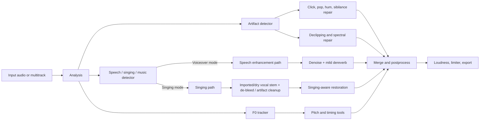
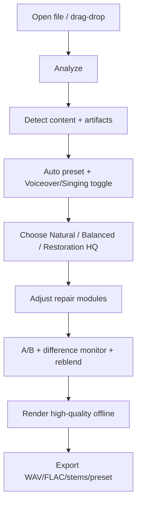

# MASTER BRIEF — YesVox: Offline Vocal Restoration & Polish (Research → Architecture → Implementation Groundwork)

> Product name: **YesVox** (repo `yes-voice`). A standalone, offline vocal restoration/polish app for an already-isolated vocal (voiceover or singing).

Status: **Master / working brief.** Last revised: 2026-06-29. This is the single source of truth, meant to guide architecture, the phased implementation plan, and any downstream planning. It merges all prior research passes (including Codex's consolidation) with the 5th pass (newest mid-2026 tech, verified licensing, DSP math, pinned stack), reconciles contradictions, and bakes in the locked product decisions.

Source passes (kept for citation depth and source trails):
- `voice restoration research.md`
- `Offline Voice Restoration Tech Stack.md`
- `3rd deep research voice restoration.md`
- `openai voice restoration deep research2.md`
- **`5th-deep-research-newest-tech-and-dsp-math.md`** (most detailed and current — full source links, extended model rosters, and the DSP math; refer here for citations).

Confidence convention: **[verified]** = primary source read (LICENSE file, model-card YAML, repo, paper); **[reported]** = single credible source; **[blog-grade]** = secondary/anecdotal.

---

## 0. Decisions locked (this revision)

1. **Scope: voiceover AND singing, equal priority** — with an **auto-detected content-type router** and a **manual "Voiceover / Singing" toggle**. The chain genuinely differs: speech-trained models damage vibrato, sustained notes, and harmonic richness (empirically confirmed by SingVERSE, §4.5). The toggle is both a UX affordance and a correctness safeguard.
2. **Standalone-first, and standalone-only for v1.** The DAW-plugin path (and ARA) is deferred. We keep the DSP/ML engine as a **host-agnostic core** purely as cheap future insurance, imposing **no plugin/real-time constraints** on v1.
3. **Offline-only** (local model weights, no cloud/upload, works with no internet).
4. **Quality > real-time.** Batch/offline file rendering is the primary mode; near-real-time preview is a later tier.
5. **Commercial distribution** → model-*weights* licensing is a first-class gating constraint (§6, §14).
6. **Input = an already-isolated vocal; no bundled separator (primary scope).** YesVox restores a vocal the user already has — a dry recording or a stem separated elsewhere — and does **not** de-mix songs. Full stem separation is a different product category (the market treats it as such — see §4.5/§11); excluding it keeps the build small and **removes the worst weights-licensing risk** (Demucs non-commercial / unlicensed RoFormer / MUSDB taint all evaporate). Keep a narrow **de-bleed / separation-artifact cleanup** module (on by default) because separated stems arrive with residual bleed/musical-noise/chirp that polish genuinely fixes.
7. **Suite-friendly, and architected to keep the door open.** *Minimum:* support a clean **handoff** so a separate stem-separator app can "bounce to YesVox" (drag-drop a stem, a documented stem-exchange/CLI/project contract, batch a folder). *Maximum:* keep the pipeline's front end a **pluggable "vocal source provider"** so an in-app separator *could* be added later without a rewrite — a neutral baseline, not a v1 feature. Standalone YesVox remains primary; cross-app compatibility is a watch-item, not a v1 deliverable.

---

## 1. Executive Summary

The best foundation is **not one monolithic model** but a **modular restoration pipeline that routes audio by content and artifact type**:

- Low-latency speech enhancement for preview and spoken voiceover.
- Heavier batch enhancement for final render/export.
- Music-aware source separation for sung vocals embedded in accompaniment.
- Deterministic DSP repair for localized defects (clicks, crackle, plosives, clipping, hum, sibilance, dropouts, spectral damage).
- Pitch/time tools only after reliable F0 estimation.

The product shape is a **file-first, project-based, non-destructive, spectrogram-native restoration workstation** — open a take, inspect the spectrogram, run analysis, apply a chain preset, audition the delta, override where automation fails, render nondestructively. This fits the algorithms, which want random access to the whole clip rather than a strict real-time buffer.

Two findings most shape the plan, both sharpened in this revision:

- **Model *weights* licensing — not code — is the real gate.** Many SOTA models are "permissive code / non-commercial-or-unreleased weights." Two concrete consequences that **correct earlier drafts**: **Demucs weights are author-confirmed non-commercial** (so Demucs is *not* a safe v1 separator despite MIT code), and the high-quality RoFormer community checkpoints almost all have *no license at all*. The clean long-term path is to **train your own separator on permissively-licensed multitracks**.
- **ONNX-export discipline is the #1 engineering risk.** ONNX has an `STFT` op but **no `ISTFT` and no usable complex support**; diffusion/flow models must export *one sampler step* with the loop in host code; **Mamba/SSM models effectively cannot be exported**. This rules some attractive models out and steers choice toward conv/attention nets with clean STFT front-ends.

Highest-confidence v1: a **standalone offline desktop workstation** centered on **DeepFilterNet3** (preview/CPU; ships ONNX) + **MossFormer2_SE_48K** (batch-quality denoise; Apache-2.0 code+weights), **deterministic AR/SPADE repair** for clicks/clipping and localized DSP for plosives/hum/sibilance, **BS PolarFormer** for sung-vocal separation, **SRS** for singing restoration, **SwiftF0/RMVPE + Signalsmith/WORLD** for pitch/time, and **AP-BWE** for bandwidth extension. It distinguishes "remove unwanted energy" (regression enhancement is usually enough) from "reconstruct missing content" (generative models earn their keep on packet loss, bandwidth extension, clipped/missing content, severe restoration).

Strongest implementation direction: a **Rust standalone app** with an isolated native audio/ML engine, **`ort` (ONNX Runtime)** as the default inference path (CPU + CoreML + DirectML/CUDA), and a **Rust-native `egui`** spectrogram editor (zero-FFI to the Rust core; proven by Rerun). **Qt 6 (`QRhiWidget`)** is the strongest C++ alternative for the richest editor chrome. The product's center of gravity decides the language: if it stays a modern standalone in the existing Rust ecosystem, Rust+egui; if it aspires to a flagship pro-audio editor with eventual plugin/ARA, a C++20 core with Qt/JUCE deserves equal weight — but that ambition is **deferred** per the locked decisions.

---

## 2. Product Assumptions

- Windows + macOS first; Linux feasible later.
- Offline-only execution with local model files.
- Mixed workload, **equally weighted**: spoken voiceover, podcast/dialog cleanup, dry sung vocals, sung vocals inside full mixes.
- File-based rendering first; optional near-real-time preview later.
- Commercial distribution → licenses matter at both code and weights level.
- Broad consumer hardware: CPU-first workflows stay useful even when GPU acceleration exists.

---

## 3. Core Architecture — the content/artifact router

Classify the input first, then choose the route. Denoising, dereverberation, separation, click repair, declipping, spectral inpainting, pitch correction, and loudness/export are different problems; one "enhance" op yields worse, less controllable results. The product is **file-first, non-destructive, spectrogram-native** — a restoration workstation, not a live insert.

**Voiceover/Singing toggle (locked).** The detector auto-selects a route, but the user can force **Voiceover mode** (speech-tuned denoise/dereverb, firmer de-ess/de-pop) or **Singing mode** (singing-tuned restoration that *preserves* vibrato/sustain/breath, gentler de-ess). A speech denoiser applied to sung vocals damages the features that define singing. **Both modes treat the voice as the wanted signal and assume an already-isolated vocal track on input** — the app does not de-mix songs (decision §0.6). When the input is an AI-separated stem, the **de-bleed / artifact-cleanup** module handles residual instrumental leakage and musical noise (a restoration task, not separation).

The route keeps the product honest — causal models power responsive preview; non-causal batch models + deterministic repair handle hard cases at export. It also preserves the key distinction between **removing unwanted energy** (regression enhancement is often enough for noise/reverb) and **reconstructing missing content** (generative models become useful for packet loss, bandwidth extension, clipped/missing content, severe restoration). Heavy ML never runs on the audio callback (§8).

---

## 4. Artifact Classes and Best-Fit Methods

The deterministic modules' *math* is in §7. The ML choices are mid-2026-current and license-checked (§5, §14).

### 4.1 Broadband noise & mild reverberation (denoise)

Enhancers operate in the STFT domain (masks, complex spectra, time-frequency filters). DeepFilterNet pairs a coarse ERB-band envelope stage with low-frequency complex deep filtering, preserving periodicity while staying CPU-efficient.

| Method | Best fit | Notes |
|---|---|---|
| **DeepFilterNet3** | Real-time preview, CPU tier | MIT∨Apache code+weights, 48 kHz, ~2.1 M, **ships ONNX + Rust `tract`** — the only full-band enhancer deployable out of the box. |
| **MossFormer2_SE_48K** | Batch-quality denoise | Apache-2.0 **code and weights [verified]**, true 48 kHz, VB+DEMAND **PESQ ≈ 3.15** (beats DFN 3.03, Resemble 2.84). **No official ONNX → export yourself.** |
| DPDFNet | Causal alternative | DeepFilterNet-derived; ONNX/TFLite appeal — benchmark vs DFN3. |
| RNNoise | Ultra-light fallback | BSD; tiny; lower ceiling. |
| MP-SENet / MossFormerGAN_SE_16K | 16 kHz quality refs | PESQ 3.60 / 3.47; band-extend after. |
| Resemble Enhance / VoiceFixer | General one-click polish (44.1 kHz) | MIT; denoise + distortion repair + BWE. |
| VoiceRestore / flow-matching restoration | Broad degraded-recording restoration | Promising frontier; verify maturity/licensing. |
| SGMSE+ / StoRM / MeanFlowSE | "Max quality" offline denoise | Generative; MeanFlowSE is 1-step, MIT code/CC-BY weights, NCSN++ → ONNX-friendly. Keep sampler loop in host code. |
| UniPASE / USEMamba / Miipher-style | Strategic future universal restoration | Track; not a v1 dependency (license/export risks). |

Classical spectral subtraction / Wiener / log-MMSE (§7.1–7.5) remain a CPU-only fallback and surgical hiss tool, not the quality ceiling.

### 4.2 Clicks, crackle, clipping, localized damage (deterministic)

Sparse structural defects → deterministic repair beats a generative denoiser, predictably and without hallucination. Math in §7.6–7.7.
- **AR/LSAR click & crackle repair** (Janssen): detect impulsive outliers via whitened prediction error; reconstruct from both-sided context.
- **Sparse declipping (A-SPADE / RBAR)**: unclipped samples fixed; clipped samples inferred under sparsity + clip bounds. APPLADE-style plug-and-play hybrids are an interesting research target.
- **Spectral inpainting** for user-brushed/marked time-frequency damage.
- **Low-frequency pulse/thump** handled separately (long transient tails need a detection/removal pass before interpolation).
Expose these as controllable repair tools, not hidden side-effects.

### 4.3 Plosives, hum, sibilance (deterministic)

Precise DSP beats ML (§7.9–7.11):
- **De-pop**: localized linear-phase HPF / transient-triggered dynamic low-cut ~80–120 Hz over the plosive region only.
- **De-hum**: adaptive harmonic notch/comb, or LMS cancellation that tracks drift.
- **De-ess**: split-band or wide-band sidechain dynamics; level-independent (spectral-shape) detection for consistency across soft/loud passages.

### 4.4 Dereverberation (flagship feature)

Hybrid (§7.8):
- **WPE** for transparent light–moderate dereverb (the "safe" tier).
- **Generative (SGMSE+/StoRM, or 1-step Schrödinger-bridge/flow)** for hard single-channel cases (premium offline render). **BUDDy-style** blind systems that jointly estimate room acoustics and restore the dry signal are worth prototyping. The few-step revolution (MeanFlowSE, SB-UFOGen, ROSE-CD) cuts NFE counts from ~30–60 to 1–5, making generative dereverb increasingly practical offline.
- Evaluate **singing dereverb separately** (sustained notes/vibrato break speech-trained dereverb); train with ReverbFX plugin-derived RIRs against **anechoic-clean** targets (per NVIDIA RE-USE).
- License watch: Hamburg streaming successors (**StreamFM**) are **AGPL-3.0 — commercially hostile**; Microsoft's 20 ms restoration is a blueprint with no released weights.

### 4.5 Singing & vocal stems

Singing is its own restoration domain. **Scope (decision §0.6): the app does NOT separate songs into stems** — the user brings an isolated vocal (recorded dry, or an already-separated stem from a tool they own). The app's jobs are (a) **singing-aware restoration** that preserves vibrato/sustain/breath, and (b) a **de-bleed / separation-artifact cleanup** module for stems that arrive watery/chirpy with residual instrumental leakage. Distinguish dry/near-dry vocals (restore directly, with care) from heavily-effected vocals (don't over-clean intentional reverb/distortion/breath/vibrato). The separator rows below are kept **for reference only** (e.g., an optional "clean my separated stem" preset tuned to a given separator's artifacts) — they are **out of core scope**, and bundling their weights is explicitly avoided.

| Component | Best fit | Notes |
|---|---|---|
| **De-bleed / artifact cleanup** | **In-scope (core singing module)** | Cleans residual instrumental leakage, musical noise, and chirpy/watery-S artifacts on imported separated stems. Restoration in purpose, narrow-isolation in mechanism (cf. RX De-bleed reference-free ML mode). Set expectation: cleans residue/artifacts, not heavy leftover instrumentation. |
| ~~BS PolarFormer~~ | **Out of scope (user supplies separation)** | Reference only: SOTA-class isolator, ~11–12 dB vocal SDR, 51 M, reported MIT, ONNX shipped (103/201 MB). Useful to know if building an optional separator-specific "clean my stem" preset, but **not bundled** (decision §0.6). |
| KimberleyJSN Mel-Band RoFormer | Alternative separator | **MIT weights [verified]** — the one independently-confirmed clean checkpoint. |
| SCNet-large/XL | Compact 4-stem option | MIT code; weights license unstated → verify. |
| **SRS (Smule Renaissance Small)** | **Singing restoration centerpiece** | **MIT code+weights [verified]**, 10.4 M, 48 kHz, 10.5× real-time on phone CPU; conventional ops → ONNX-traceable. |
| MBTFNet-style vocal enhancement | Singing enhancement (≠ separation) | Reminder that vocal enhancement and stem isolation are related but distinct. |
| SingVERSE + EDB | Evaluation | Real-world paired singing benchmark (CC-BY-4.0) proving speech models degrade on singing (22/27 significant). |
| ~~Demucs v4 / HTDemucs~~ | **Do NOT bundle weights** | MIT *code* but **weights author-confirmed "scientific/non-commercial"**. Code usable; weights are not. *(Corrects earlier "safest v1 separator" framing.)* |
| AnyEnhance | Blocked (full model) | Best singing-capable universal model but **CC-BY-NC-ND**; only the 82 M MIT *challenge baseline* is bundleable. |

Expectation-setting: v1 will be markedly better on voiceover and dry-vocal cleanup than on full-mix singing unless we invest in singing-specific data + evaluation.

### 4.6 Pitch correction & time manipulation

Estimate F0, then modify pitch preserving time/formants/timbre; downstream of repair. Fully permissive stack now available:

| Component | Best fit | License |
|---|---|---|
| **SwiftF0** | Primary F0 (robust, fast) | **MIT code+weights, ONNX-native** |
| FCPE | Best singing-accuracy F0 | MIT code; weights unconfirmed → export from code |
| RMVPE | Vocals inside un-separated mixes | Apache-2.0 |
| YIN/pYIN / Basic Pitch | Baseline F0 / pitch-MIDI | permissive |
| **Signalsmith Stretch** | Pitch-shift / time-stretch + formants | **MIT**, formant-aware (`setFormantBase`) |
| **WORLD** | Formant-preserving resynthesis/correction | modified-BSD, patent-free |
| PSOLA | Monophonic time-domain edits | classic |
| Rubber Band | Premium shift fidelity | GPL **or** commercial (£590 standard) |

Formant shift is negligible within ±100 cents, so gentle auto-tune often needs no formant preservation; reserve WORLD/Signalsmith for larger transpositions.

### 4.7 Bandwidth extension / restoration

| Component | Best fit | License |
|---|---|---|
| **AP-BWE** | **Primary BWE** | **dual-MIT [verified, dedicated weights license]**, 48 kHz, all-conv → ONNX-friendly, ~18× real-time CPU. Avoids the blocked AudioSR. |
| UniverSR | Higher-quality generative BWE | MIT code / CC-BY-4.0 weights, vocoder-free flow, 48 kHz |
| LavaSR | Clean baseline that **ships ONNX** | Apache-2.0 code+weights, 48 kHz, ~50 MB |
| MossFormer2_SR_48K | Pairs with MossFormer2 denoise | Apache-2.0 (run denoise first) |
| NU-Wave2 | Tiny diffusion BWE | BSD-3 code; weights unstated → retrain |
| ~~AudioSR~~ | **Blocked** | CC-BY-NC AudioLDM lineage |

### 4.8 Artificial reverb after cleanup (creative)

Separate "remove bad room" from "add chosen space." **FDN** (unitary feedback matrix + per-line damping) and **partitioned convolution** with measured IRs (§7.12). Creative post-processing, not restoration core.

---

## 5. Master Component Table (verified licenses)

✅ bundleable in a paid closed-source app · ⚠️ verify · ❌ blocked.

Note: the **separation** rows (BS PolarFormer, KimberleyJSN, SCNet, Demucs, viperx) are **out of core scope (decision §0.6)** — retained for reference / an optional "clean my separated stem" preset only; **none are bundled**. The in-scope adjacent module is **de-bleed / separation-artifact cleanup** (in-house DSP/ML).

| Component | Role | Code | Weights | Ship? |
|---|---|---|---|:--:|
| MossFormer2_SE_48K / SR_48K | Denoise / BWE (48 kHz) | Apache-2.0 | **Apache-2.0** [verified] | ✅ |
| DeepFilterNet3 | Denoise preview (48 kHz, ONNX) | MIT∨Apache | same [verified] | ✅ |
| DPDFNet | Causal denoise (ONNX/TFLite) | Apache-2.0 | verify | ⚠️ |
| GTCRN | Ultra-light denoise (16 kHz, ONNX) | MIT | MIT [verified] | ✅ |
| MP-SENet | Denoise quality ref (16 kHz) | MIT | MIT [verified] | ✅ |
| Resemble Enhance / VoiceFixer | General polish / BWE (44.1 kHz) | MIT | MIT | ✅ |
| AP-BWE | Bandwidth extension (48 kHz) | MIT | **MIT** (dedicated weights license) | ✅ |
| UniverSR / LavaSR | Generative / ONNX BWE (48 kHz) | MIT / Apache | CC-BY-4.0 / Apache | ✅ |
| MeanFlowSE | 1-step generative denoise | MIT | CC-BY-4.0 | ✅ |
| SGMSE+/StoRM / BUDDy | Diffusion denoise/dereverb | MIT (SGMSE) | check checkpoints | ⚠️ |
| SRS (Smule Renaissance Small) | Singing restoration (48 kHz) | MIT | **MIT** [verified] | ✅ |
| BS PolarFormer | Vocal separation (ONNX shipped) | MIT [reported] | MIT [reported] | ⚠️ verify card |
| KimberleyJSN Mel-Band RoFormer | Vocal separation | MIT | **MIT** [verified] | ✅ |
| SCNet-large/XL | Vocal/4-stem separation | MIT | unstated | ⚠️ |
| Demucs v4 / HTDemucs | Vocal separation | MIT | **non-commercial** [verified] | ❌ weights |
| viperx / UVR / ZFTurbo-zoo checkpoints | Separation | (MIT) | **no license** | ❌ |
| Apollo | Stem/codec restoration | open | **CC-BY-SA 4.0** | ⚠️ copyleft |
| SwiftF0 / RMVPE / Basic Pitch | F0 / pitch | MIT / Apache | MIT / Apache | ✅ |
| Signalsmith Stretch / WORLD | Pitch/time + formants | MIT / BSD | n/a | ✅ |
| Rubber Band | Pitch/time (premium) | GPL **or** commercial | n/a | ⚠️ buy £590+ |
| AnyEnhance (full 363 M) / challenge baseline (82 M) | Universal (singing) | CC-BY-NC-ND / **MIT** | same | ❌ / ✅ |
| A2SB / AudioSR / StreamFM / RE-USE | Restoration | NVIDIA-NC / CC-BY-NC / **AGPL** / NSCLv1 | same | ❌ |
| UniPASE | Universal restoration (48 kHz) | CC-BY-4.0 | CC-BY-4.0 | ✅ (heavy) |
| Mamba SE (SEMamba etc.) | Denoise | usually MIT | unconfirmed/NC | ❌ (+ no ONNX) |
| AR click / A-SPADE / notch / de-ess / FDN | Deterministic DSP | in-house | n/a | ✅ |
| ort / ONNX Runtime / tract / candle / cpal / symphonia / rubato / realfft / fundsp | Engine + DSP | permissive | n/a | ✅ |

**Operating rule:** pin exact commits and **archive each LICENSE + HF card YAML**; prefer a permissive license *and* disclosed permissive training data, or train your own.

---

## 6. The two gating constraints (read before locking models)

### 6.1 Weights-licensing reality
- Architecture *code* is almost universally MIT; the **weights** are the problem.
- **Demucs weights** = author-confirmed research/non-commercial. **~20+ RoFormer community checkpoints** (viperx, UVR catalog, ZFTurbo zoo) = `license: None` (all-rights-reserved). **MUSDB18** is non-commercial (MedleyDB CC-BY-NC-SA lineage), tainting models trained on it.
- Only **KimberleyJSN Mel-Band RoFormer** (MIT) and **BS PolarFormer** (reported MIT) are cleanly bundleable high-quality separators. The universal-restoration frontier (AnyEnhance-363M, RE-USE, Metis, Miipher-2, VoiceBridge) is mostly non-commercial or unreleased.
- **Cleanest path:** train/commission a separator on owned/permissive multitracks (excluding MUSDB18) using the MIT architecture code → own the weights outright.

### 6.2 ONNX-export discipline
- ONNX has `STFT` (opset 17) but **no `ISTFT`** and **no usable complex support**. Fixes: rewrite `torch.stft` → `Conv1d(sin/cos)`; iSTFT → `ConvTranspose1d`; de-fuse `aten::_native_multi_head_attention` → `Linear`/`bmm`/`softmax`; strip `Fraction`/`random` from traced paths; target opset 17 with the legacy exporter; fix a chunk length (CoreML/NPUs want static shapes).
- **Diffusion / flow-matching:** export *one sampler step*; run the predictor-corrector / ODE loop in **Rust host code**.
- **Mamba/SSM models do not export** (selective-scan kernels; silent numerical errors when forced) — avoid, or reimplement the scan in C.
- **Consequence:** prefer conv/attention nets with clean in-graph STFT. Ships-ONNX today: DeepFilterNet3, BS PolarFormer, GTCRN, LavaSR. Export-yourself (conventional, feasible): MossFormer2_SE_48K, SRS, AP-BWE.

---

## 7. DSP Math Reference

Notation: `x[n]` clean, `d[n]` noise, `y[n]=x[n]+d[n]`; `Y(t,f)` STFT; `f_s` sample rate. Three cores: **(A) STFT-domain gain estimation**, **(B) linear-prediction/AR modeling**, **(C) constrained reconstruction**.

### 7.0 STFT, COLA, perfect reconstruction
`Y(t,f) = Σ_n w[n]·y[tH+n]·exp(-j2πfn/N)`. WOLA resynthesis with synthesis window `s[n]`. **COLA:** `Σ_t w[n-tH]·s[n-tH] = C`. Default: **√Hann analysis+synthesis at 75% overlap** (`H=N/4`). Window length `N` sets the time/frequency tradeoff — large `N` (4096–8192 @ 48 kHz) for hiss/hum/sung notes, small `N` (256–512) for clicks/plosives; **run multiple resolutions.** Magnitude methods reuse noisy phase → the magnitude-only ceiling (§7.13).

### 7.1 Spectral subtraction (Boll)
`|X̂|^p = max(|Y|^p − α|D̂|^p, β|Y|^p)`, reuse `∠Y`. `α≥1` over-subtraction; `β∈[0,1)` floor. Half-wave rectification → musical noise. CPU fallback only.

### 7.2 Wiener
`G_W = S_x/(S_x+S_d) = ξ/(1+ξ)`, `ξ` = a-priori SNR. Needs `S_x` → decision-directed (§7.3).

### 7.3 Ephraim–Malah MMSE-STSA / log-MMSE
`γ=|Y|²/λ_d`, `ξ=λ_x/λ_d`, `ν=ξ/(1+ξ)·γ`.
- **MMSE-STSA:** `G = (√π/2)·(√ν/γ)·exp(−ν/2)·[(1+ν)I₀(ν/2)+νI₁(ν/2)]` (verified vs Loizou).
- **log-MMSE:** `G = ξ/(1+ξ)·exp(½·E₁(ν))`, `E₁(ν)=∫_ν^∞ (e^{−t}/t)dt`.
- **Decision-directed a-priori SNR:** `ξ̂(t) = α·|X̂(t−1)|²/λ_d + (1−α)·max(γ(t)−1,0)`, `α≈0.98` — temporal smoothing that kills musical noise. Precompute `G` on a 2-D `(ξ,γ)` lookup grid.

### 7.4 Noise PSD tracking
**Minimum Statistics** (sliding-min of smoothed periodogram + bias compensation) or **IMCRA** (recursive averaging weighted by speech-absence probability). Standard pairing with log-MMSE.

### 7.5 Spectral gating (RX-style)
Per-bin threshold `T(f)=mean+k·std` from a noise profile; attenuate below it to `g_min` (e.g. −24 dB, not 0); **smooth the mask** in time+frequency. Expose: profile capture, reduction, threshold offset, smoothing radii.

### 7.6 De-click / de-crackle — AR + LSAR (core B)
AR model `x[n]=Σ_{k=1}^p a_k x[n−k]+e[n]` (`p≈20–50` @ 48 kHz; Burg). Detect: whitened residual `e[n]`, flag `|e[n]|>c·σ_e` (`c≈3–5`). Reconstruct (LSAR): with prediction-error filter `b=[1,−a_1,…]` and Toeplitz convolution matrix `A`, minimize `xᵀRx` (`R=AᵀA`) over corrupted set `U` → **normal equations `R_UU·x_U = −R_UK·x_K`** (both-sided). **Janssen** iterates (estimate `a` → solve `x_U` → repeat). Crackle = same detector, finer threshold.

### 7.7 Declip — A-SPADE (core C)
Clipped samples known above `θ` with sign. `min‖z‖₀ s.t. x=Dz` and consistency (`x=y` on reliable, `x≥θ`/`x≤−θ` on clipped). ADMM + hard thresholding, relaxing sparsity until consistent. Cannot invent energy contradicting survivors/bounds.

### 7.8 Dereverb — WPE (core B)
`y_t = d_t + Σ_{τ=Δ}^{Δ+L−1} g_τ*·y_{t−τ}`. `Δ` = prediction delay protecting the direct path (key knob). Minimize variance-weighted prediction error `Σ_t |y_t−Σ_τ g_τ* y_{t−τ}|²/λ_t`; alternate (estimate `λ_t=|d_t|²` → solve `g` → subtract → repeat).

### 7.9 De-hum (core A/B)
IIR notch `H_k(z)=(1−2cosω_k z⁻¹+z⁻²)/(1−2r cosω_k z⁻¹+r²z⁻²)`, `r→1⁻` narrows (BW≈`(1−r)f_s/π`); cascade harmonics. Comb `H(z)=(1−z^{−M})/(1−r z^{−M})`, `M=f_s/f₀`. Or adaptive LMS `ĥ[n]=Σ_k(a_k cosω_k n+b_k sinω_k n)`, `a_k[n+1]=a_k[n]+μe[n]cosω_k n`.

### 7.10 De-ess (core A)
Sidechain band-pass → `L_sb`; `GR_dB=min(0,(T−L_sb_dB)(1−1/R))`; wide-band (solo lead) or split-band (buses). Level-independent: gate on high-band-to-total energy ratio normalized by level.

### 7.11 De-pop (core A)
LF burst <~120 Hz. Detect LP-sidechain spike; over the plosive region only apply linear-phase FIR HPF (~80–120 Hz) or transient-triggered dynamic low-cut.

### 7.12 Reverb synthesis
Convolution `y=x*h` (partitioned FFT; offline → big partitions). FDN: `s_i(n)=x b_i+Σ_j A_ij g_j s_j(n−m_j)`, `A` unitary (Householder `I−(2/N)11ᵀ` / Hadamard), `g_i=10^(−3 m_i/(f_s·RT60))`, per-line LP for frequency-dependent decay, mutually-prime `m_i`. Schroeder comb `z^{−m}/(1−g z^{−m})`, allpass `(−g+z^{−m})/(1−g z^{−m})`.

### 7.13 Phase reconstruction
Griffin–Lim (poor); **cIRM** `M_r=(Y_rS_r+Y_iS_i)/(Y_r²+Y_i²)`, `M_i=(Y_rS_i−Y_iS_r)/(Y_r²+Y_i²)`, `Ŝ=M⊙Y`; **deep filtering** `Ŝ(t,f)=Σ_i C_i(t,f)Y(t−i+l,f)`. Magnitude DSP for surgical/local/structural defects; neural complex/generative for broadband/phase-coupled/ill-posed restoration.

### 7.14 Perceptual scales
`Mel=2595log10(1+f/700)`; `Bark=13arctan(0.00076f)+3.5arctan((f/7500)²)`; `ERB=24.7(4.37f/1000+1)`. Coarse perceptual-band gains capture most audible structure cheaply; simultaneous masking sets how hard to denoise.

### 7.15 Evaluation metrics
SI-SDR (fidelity), PESQ/POLQA (speech quality — saturates on generative output), STOI/ESTOI (intelligibility), SRMR (reference-free reverb), DNSMOS/NISQA/UTMOS (no-reference MOS), SDR/SIR/SAR (separation). Generative restoration can raise MOS while lowering SI-SDR; always pair with blinded listening for clicks, clipped consonants, reverb tails, and **sung vibrato/sustain** (no good objective metric exists).

---

## 8. Desktop runtime, threading, packaging

**Keep heavy ML off the audio callback.** Governing rule (Bencina): nothing unbounded on the callback — no locks, allocation, syscalls, or cross-thread waits. RADSan analysis (ANIRA) confirms every engine (ONNX Runtime, LibTorch, TFLite) allocates/locks inside inference; warm-up required.

**Reference design (ANIRA):** audio callback reads/writes preallocated buffers only; a **lock-free SPSC ring buffer** (`rtrb`/`ringbuf`) ferries frames to a **static worker thread pool**; all allocation at construction; chunk audio independently of host buffer; compute and report added latency; warm up before audio starts. UI receives downsampled telemetry, not raw high-rate arrays. **Offline render path has no RT constraint** — run big non-causal models on background threads with full file context; this is the primary path given "quality > real-time."

**Inference engine:** `ort` (ONNX Runtime Rust) default — broadest reach (CPU floor + CoreML on macOS + DirectML/CUDA on Windows + CUDA/CPU on Linux). Still **2.0.0-rc** — pin the rc, **disable build-time binary download, vendor/static-link** the runtime. `tract` (pure-Rust) for DeepFilterNet3/small CPU models; `candle` for big diffusion/transformer when hand-writing the sampler loop; `tch-rs` only as a heavy last resort. CoreML uses `MLProgram` + static shapes + validated FP16; DirectML is in "sustained engineering" → architect toward WinML. TFLite/LiteRT only when a model ships a high-quality TFLite export.

**Packaging:** bundle weights in the installer (the only true offline guarantee; optional model packs as in-app downloads). Ship **page-aligned ONNX external-data** (or ORT format) and load via path with mmap (cuts RAM + cold start; default conversion is *not* aligned — convert with alignment). Lazy per-module loading; FP16 variants where quality holds. macOS: notarize, sign inside-out, staple (offline Gatekeeper); budget hours for multi-GB. Windows: Authenticode; EV no longer grants instant SmartScreen reputation — keep the same identity. Place weights outside the executable bundle (Tauri `resources` / Electron `extraResources` / Qt external files) for mmap + delta-update potential.

---

## 9. Application Stack (standalone-first; pinned mid-2026 versions)

**Primary (recommended): Rust-native standalone.**
- Inference: `ort` (pinned rc, vendored ORT 1.26/1.27) + `tract` for DFN3.
- DSP: `realfft` 3.5 / `rustfft` 6.4, `rubato` 3.0, `symphonia` 0.6 (+`hound` for WAV write), `fundsp` 0.23; implement STFT/ISTFT, AR declick, WPE, notch, FDN/convolution natively. (`dasp` is stale — avoid.)
- I/O: `cpal` 0.18; threading: `rtrb`/`ringbuf` + ANIRA-style pool.
- **UI: `egui`** spectrogram editor — immediate-mode fits constant custom hit-testing; GPU spectrogram via `egui_wgpu` texture/callback; zero-FFI to the Rust core; proven at scale by Rerun. Gaps: native macOS menus (`muda`), file dialogs (`rfd`).

**C++ alternative: Qt 6 (`QRhiWidget`).** Strongest *cross-platform* GPU spectrogram path (one Vulkan/Metal/D3D shader path), richest editor chrome, DaVinci Resolve precedent; Rust DSP bridges via CXX-Qt. Cost: LGPLv3 obligations (dynamic-link, provide Qt source, no static link) or unpublished commercial (~$3.6–4k/dev/yr); LTS patches commercial-only.

**Other options (not recommended for v1):** Electron (guaranteed WebGPU + N-API for a C++ core, but 150–250 MB); **Tauri** (small Rust app, but **WebGPU-on-WKWebView unconfirmed** in 2026 + slow JSON IPC for spectrogram data → engineer a custom-protocol/tiled path; a real R&D risk for the heavy editor); JUCE (only if plugin-first — out of scope). Flutter/Dioxus weaker for this editor.

| Stack | Core | UI | Pros | Cons |
|---|---|---|---|---|
| **Rust-native (lead)** | `ort`/`tract` + Rust DSP | egui | Small, safe, zero-FFI, offline-clean, matches Rust suite | Trailblazing the egui spectrogram editor; `ort` pre-stable |
| C++ premium editor | ONNX Runtime C++ + Eigen/libsndfile/xsimd DSP | Qt 6 RHI | Best cross-platform GPU canvas + editor chrome; proven (Resolve) | Heavier; Qt licensing; diverges from Rust suite |
| C++ + future plugin | C++20 core | Qt now / JUCE later | Strongest path to pro-audio editor + eventual plugin/ARA | Two surfaces; only if plugin becomes a goal |
| Web-velocity | C++/Rust addon | Electron | Fastest UI iteration, guaranteed WebGPU | 150–250 MB, ~400 MB RAM |

---

## 10. Suggested UX Workflow

Key behaviors:
- Default to automatic routing; reveal module-level controls.
- **Voiceover / Singing toggle** drives preset routing (locked decision).
- **Processing modes:** *Natural* (conservative DSP + light ML), *Balanced* (default smart chain), *Restoration HQ* (slower multi-pass/generative rendering).
- Keep preview responsive (need not equal final render); allow bypass/reduce per module.
- A/B with gain matching; **difference monitor + reblend** so users hear what was removed and can restore some ambience/noise when cleanup feels overdone.
- Nondestructive render; presets for novices + advanced panels for specialists.
- Label generative output as reconstructive for archival/forensic use.

---

## 11. Competitive Landscape

- **iZotope RX** (RX 12) remains the reference for visual spectrogram repair: De-click/De-hum/Spectral Repair stay classical; Dialogue Isolate/De-Reverb/Music Rebalance go neural. No longer dominant on hard offline jobs.
- **Adobe Podcast Enhance** is cloud generative — our **offline/private/local positioning is the differentiator**.
- **Supertone Clear, dxRevive, Acon, Accentize, Waves Clarity, CEDAR** show the same split: neural for denoise/dereverb/separation/restoration; deterministic DSP for surgical repair. The 2025 dialogue-shootout winners (Hush Pro, dxRevive Pro, Supertone Clear) are all newer neural tools.

The opportunity is a **premium local workflow** combining surgical deterministic modules, neural batch quality, privacy, and clean UX.

---

## 12. Phased Implementation Plan (architecture groundwork)

**Architecture invariant across phases:** a host-agnostic DSP/ML **core library** exposing `prepare(sr,maxBlock)` / `process(buffer)` / params / reset / latency, RT-safe, with all model I/O behind one boundary. Standalone YesVox = thin wrapper feeding whole files through `process` offline. Keeps a future plugin cheap without imposing plugin constraints now.

**Two extensibility seams (decision §0.7), both additive, not rewrites:**
- **Vocal source provider** — the pipeline's front end is an interface ("supply a vocal buffer"), implemented in v1 by *file/stem import*. A future in-app separator is just another implementation of the same interface; nothing downstream changes.
- **Stem-handoff contract** — a documented way for the separate stem-separator app to feed YesVox: drag-drop a stem, "bounce to YesVox" command, a shared stem-exchange/project format, and folder batch. This is the "suite-friendly minimum" and reuses the source-provider seam.

### Phase 1 — File-based restoration MVP
- WAV/FLAC import/export; spectrogram + waveform editor.
- Denoise: **DeepFilterNet3** (preview/CPU) + **MossFormer2_SE_48K** (batch quality).
- Deterministic: **AR/LSAR de-click/de-crackle, A-SPADE declip, de-pop, de-hum, de-ess** (zero-license-risk differentiators).
- Convolution + FDN reverb (creative); loudness normalization + limiter.
- A/B (gain-matched), **difference monitor + reblend**, **Natural/Balanced/Restoration HQ modes**, **Voiceover/Singing toggle**; nondestructive render queue.
- Goal: prove the restoration UX, offline packaging, and the RT-safe core boundary.

### Phase 2 — Singing & stem-cleanup workflows
- **Stem-import path + de-bleed / separation-artifact cleanup** module (on by default) — cleans residual instrumental leakage, musical noise, and chirpy-S on imported separated stems. **No in-app separator** (decision §0.6).
- **SRS** singing restoration; WPE + diffusion/BUDDy-style singing dereverb (ReverbFX-trained, anechoic-clean targets).
- **SwiftF0 / RMVPE** analysis; **WORLD / Signalsmith** (or licensed Rubber Band / PSOLA) pitch/time.
- Singing eval set (**SingVERSE + EDB**). Treat singing as its own domain.

### Phase 3 — Bandwidth extension & advanced batch
- **AP-BWE** (and/or UniverSR/LavaSR) BWE; **Resemble Enhance / VoiceFixer / VoiceRestore** multi-distortion one-click.
- "Max quality" generative denoise/dereverb (SGMSE+/StoRM or 1-step MeanFlowSE) as optional render engines; evaluate UniPASE/USEMamba/Miipher-style universal restorers.
- Begin training a **license-clean separator** on permissive multitracks (removes the BS PolarFormer weight-license dependency).

### Phase 4 — Low-latency preview (optional)
- Causal DFN3 preview on worker threads; device settings; ring-buffered exchange; preview intentionally simpler than render.

### Phase 5 — Plugin / ARA (deferred, only if the market demands it)
- Wrap the existing core as **CLAP** → VST3/AU via `clap-wrapper` (or JUCE). For serious DAW restoration, **ARA** is the strategic fit (random clip access, offline analysis, richer host exchange) over a simple live insert. Not in v1 scope.

**Release gate (each phase):** improvement on ≥1 fidelity metric per eval bucket; no catastrophic intelligibility regressions; blinded listening checks for mouth clicks, clipped consonants, reverb tails, and **sung-vibrato preservation**.

---

## 13. Evaluation Protocol

Buckets: speech SE; singing (dry + reverberant); vocal-in-mix separation; localized repair (clipping/clicks/dropouts/bandwidth/erasures); creative preservation (breath/vibrato/intentional & added reverb). Metrics per §7.15. Datasets: DNS/EARS, **URGENT-style multi-distortion** (noise/reverb/clipping/BWE/codec/packet-loss/wind), **SingVERSE + EDB** (singing), ReverbFX/SingingReverbFX (vocal reverb), MUSDB18-HQ (separation), internal synthetic-defect sets. Release gate per §12.

---

## 14. Licensing & Commercial Risk

Commercially friendly (✅, MIT/Apache/BSD): DeepFilterNet, DPDFNet, MossFormer2_SE/SR_48K, GTCRN, MP-SENet, Resemble Enhance/VoiceFixer, AP-BWE, UniverSR/LavaSR, SRS, KimberleyJSN Mel-Band RoFormer, SwiftF0/RMVPE/Basic Pitch, Signalsmith Stretch, WORLD, ONNX Runtime/`ort`/tract, cpal/RtAudio, symphonia (MPL-2.0), C++ infra (Eigen/libsndfile/xsimd).

Friction / blocked: **Demucs weights non-commercial** (corrects earlier "commercially friendly" listing — code is MIT, weights are not); most RoFormer community checkpoints unlicensed (MUSDB18 taint); `facebookresearch/denoiser` non-commercial; Rubber Band GPL-or-commercial (£590+); JUCE AGPL-or-commercial; Qt LGPL-or-commercial; Apollo CC-BY-SA (copyleft); AnyEnhance-363M CC-BY-NC-ND; A2SB/AudioSR/RE-USE non-commercial; StreamFM AGPL; ReverbFX dataset framed non-commercial in the OpenAI pass (don't train a shipping model on it without clearing rights); Miipher-2 not open-weight; Mamba SE weights unconfirmed (+ no ONNX). **Verify every dependency at code *and* weights level; archive licenses.**

---

## 15. Open Questions

- Confirm **BS PolarFormer weights** license directly (only KimberleyJSN independently verified MIT).
- Own the **ONNX export** for MossFormer2_SE_48K and SRS; validate FP16 numerics for generative/iterative models.
- Confirm the **ReverbFX dataset** license (CC0 vs CC-BY-NC) before training shipped singing-dereverb weights.
- Minimum supported CPU-only hardware; acceptable model-download size; how much manual spectral editing to expose.
- When (if ever) to invest in training a license-clean separator vs. shipping BS PolarFormer.
- Product identity / language: Rust/`egui` suite app vs. C++/Qt workstation (drives the stack; plugin/ARA deferred either way).
- Can diffusion models export cleanly (single-step + host loop), or is a `candle`/`tch-rs` fallback needed for specific modules?

---

## 16. Final Recommendation

Build **Vocal Polish v1** as a standalone, offline, modular, spectrogram-native restoration workstation with a host-agnostic DSP/ML core:

1. **DeepFilterNet3** (preview/CPU, ships ONNX) + **MossFormer2_SE_48K** (batch quality) for denoise; classical log-MMSE fallback.
2. Deterministic **AR/LSAR declick, A-SPADE declip, de-pop, de-hum, de-ess** as first-class modules (§7).
3. **WPE** light dereverb + a generative "deep dereverb" (SGMSE+/StoRM/BUDDy or 1-step) for the offline max-quality path.
4. **No bundled separator** (decision §0.6) — the user brings an isolated vocal and owns a separator. Provide a **stem-import path + de-bleed / separation-artifact cleanup** module, then **SRS** singing restoration. This sidesteps the Demucs-NC / unlicensed-RoFormer / MUSDB licensing landmine entirely.
5. **AP-BWE** bandwidth extension (not AudioSR); **SwiftF0 + Signalsmith + WORLD** pitch/time.
6. **`ort`** default inference + `tract` for DFN3; ANIRA-style worker pool; never run inference on the audio callback; offline render runs big models freely.
7. **Rust + `egui`** standalone (or **Qt 6 RHI** if C++). JUCE/plugins/ARA explicitly deferred.
8. Drive everything through the **content router + Voiceover/Singing toggle** with **Natural/Balanced/Restoration HQ** modes and **difference/reblend** monitoring; gate releases on fidelity metrics + blinded listening (esp. sung-vibrato preservation).

This gives the strongest path through current tradeoffs: good offline quality, commercially safer dependencies, responsive preview, deterministic repair for local defects, and a future path toward heavier universal restoration once their deployment maturity catches up. For full source links and extended detail, see `5th-deep-research-newest-tech-and-dsp-math.md` and the earlier pass documents.
