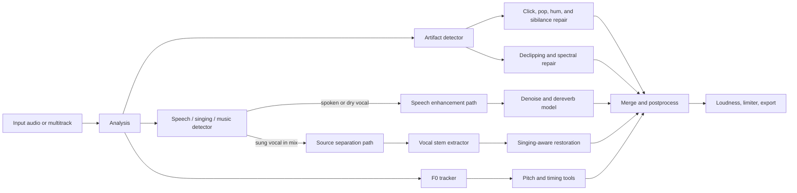
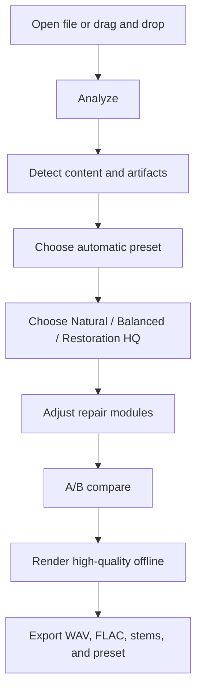

# Consolidated Offline Voice Restoration Research

Last consolidated: June 29, 2026

This document deduplicates and combines the four research findings:

- `voice restoration research.md`
- `Offline Voice Restoration Tech Stack.md`
- `3rd deep research voice restoration.md`
- `openai voice restoration deep research2.md`

The original files contain more source-level detail and citation trails. This consolidated version is intended to be the working product/architecture brief.

## Executive Summary

The best foundation for an offline "Vocal Polish" product is not one monolithic model. The strongest architecture is a modular restoration pipeline that routes audio by content and artifact type:

- Low-latency speech enhancement for preview and spoken voiceover.
- Heavier batch enhancement for final render/export.
- Music-aware source separation for sung vocals embedded in accompaniment.
- Deterministic DSP repair for localized defects such as clicks, crackle, plosives, clipping, hum, sibilance, dropouts, and marked spectral damage.
- Pitch and time tools only after reliable F0 estimation.

The highest-confidence v1 product should be a standalone offline desktop app, not a plugin-first product. It should center on DeepFilterNet or DPDFNet for preview, AR/SPADE-style deterministic repair for clicks and clipping, localized DSP for plosives/de-essing/de-hum, Demucs or a license-verified RoFormer model for sung vocals in mixes, RMVPE or Basic Pitch for pitch tracking, and a heavier batch enhancer such as Resemble Enhance for final spoken-voice polishing.

The strongest desktop implementation direction depends on the expected product center of gravity. If the app is primarily a modern standalone product in the user's existing Rust/Tauri ecosystem, use a Rust/Tauri shell with an isolated native audio/ML engine. If the app is intended to become a flagship pro-audio restoration editor with plugin/ARA ambitions, a C++20 core with JUCE or Qt deserves equal consideration. ONNX Runtime via `ort` or the C++ API is the safest default inference path for production model execution because it provides one route to CPU, CUDA, DirectML, TensorRT, CoreML/Metal, and OpenVINO acceleration. tract is attractive where binary control matters more than peak backend coverage, especially for DeepFilterNet-style CPU inference.

Licensing is a gating constraint. Commercially friendly candidates include DeepFilterNet, DPDFNet, RNNoise, Resemble Enhance, SGMSE code, Demucs code, many RoFormer implementations, Basic Pitch, RMVPE, SRS if its MIT release is verified in the target artifact, ONNX Runtime, CPAL/RtAudio, C++ infrastructure such as Eigen/libsndfile/xsimd, and WORLD. AudioSR should be treated as blocked for commercial bundling because of AudioLDM / CC-BY-NC lineage. VoiceFixer weights, individual Demucs/RoFormer checkpoints, ReverbFX data, and any newer model weights need artifact-level verification rather than repo-level assumptions.

## Product Assumptions

The recommendations assume:

- Windows and macOS first, Linux feasible later.
- Offline-only execution with local model files.
- A mixed workload: spoken voiceover, podcast/dialog cleanup, dry sung vocals, and sung vocals inside full mixes.
- File-based rendering first, optional near-real-time preview later.
- Commercial distribution, so licenses matter.
- Broad consumer hardware support, meaning CPU-first workflows must remain useful even when GPU acceleration is available.

## Core Architecture

The product should classify the input first, then choose the processing route. Speech denoising, dereverberation, source separation, click repair, declipping, spectral inpainting, pitch correction, and loudness/export are different problems. Treating them as a single "enhance" operation will create worse results and less controllable UX.

The product shape should be file-first, project-based, non-destructive, and spectrogram-native. Think restoration workstation rather than live insert plugin: open a take, inspect the spectrogram, run analysis, apply a chain preset, audition the delta, manually override where automation fails, then render nondestructively. This fits the underlying algorithms because the best restoration work often needs random access to the whole clip instead of a strict real-time buffer.

This route keeps the product honest: causal models can power responsive preview, while non-causal batch models and deterministic repair can handle harder cases during export. It also preserves the important distinction between "remove unwanted energy" and "reconstruct missing content." Regression-style enhancement is often enough for noise/reverb reduction, while generative models become more useful for packet loss, bandwidth extension, clipped/missing content, and severe restoration.

## Artifact Classes And Best-Fit Methods

### Broadband Noise And Mild Reverberation

Modern speech enhancers mostly operate in the STFT domain, either predicting masks, complex spectrograms, or time-frequency filters. DeepFilterNet is especially relevant because it combines a coarse ERB-band spectral envelope stage with low-frequency complex deep filtering. That design preserves speech periodicity better than simple masking while staying efficient enough for real-time CPU use.

Recommended options:

| Method | Best fit | Notes |
|---|---|---|
| DeepFilterNet | Real-time preview and speech cleanup | Mature, CPU-friendly, Rust core, suitable first default. |
| DPDFNet | Newer causal speech enhancement | DeepFilterNet-derived direction with ONNX/TFLite deployment appeal. |
| RNNoise | Ultra-light fallback | Tiny, robust, lower quality ceiling. |
| Resemble Enhance | Batch spoken-voice polish | Better suited to export than strict low-latency monitoring. |
| VoiceFixer | Batch restoration and bandwidth repair | Useful for speech restoration, larger model footprint. |
| VoiceRestore / flow-matching restoration | Broad degraded-recording restoration | Promising frontier direction; verify maturity and licensing before depending on it. |
| Diffusion / Schrödinger bridge enhancers | Future batch quality path | High research ceiling, usually heavier and less product-ready. |
| UniPASE / USEMamba / Miipher-style systems | Strategic future universal restoration | Important to track, but not yet the safest v1 dependency. |

Classical spectral subtraction, Wiener filtering, and Ephraim-Malah-style MMSE estimators are still useful background methods and baselines, but they should not be the product's main quality differentiator.

### Clicks, Crackle, Clipping, And Localized Damage

Localized audio damage should not be delegated only to a generative denoiser. Clicks, pops, clipped peaks, and short gaps are sparse, structural defects that deterministic algorithms can repair more predictably.

Recommended methods:

- Autoregressive click/pop repair: detect impulsive outliers with local prediction error, then reconstruct corrupted samples from surrounding context.
- Sparse declipping: use SPADE/RBAR-style constrained reconstruction where unclipped samples remain fixed and clipped samples are inferred in a sparse transform domain.
- Spectral inpainting: repair selected time-frequency regions, especially when a detector or user brush marks unreliable bins.
- Low-frequency pulse/thump handling: treat separately from high-frequency clicks because long transient tails often need a detection/removal pass before interpolation.

These modules should be exposed as controllable repair tools, not hidden side effects of a black-box enhancer.

### Plosives, Hum, And Sibilance

Some common "voice polish" tasks are better handled with precise DSP than with ML:

- De-pop / plosive repair: detect localized low-frequency bursts from air movement, then apply a short-window high-pass or dynamic EQ around roughly 80-120 Hz. Use linear-phase filtering or carefully shaped automation only over the plosive region so the rest of the voice keeps its body.
- De-hum: detect mains hum and harmonics, then apply adaptive harmonic notch filtering. This is low-risk, explainable, and commercially simple.
- De-ess: isolate the sibilant band, usually around 3-10 kHz, with sidechain detection and apply either wide-band or split-band gain reduction. Split-band de-essing avoids darkening the entire vocal; wide-band de-essing can sound more natural on solo voice when tuned well.

These should be implemented as first-class deterministic modules. ML may help classify difficult cases, but it is not needed for the core signal processing.

### Dereverberation

Dereverberation deserves its own product tier because it is both technically hard and commercially valuable.

Use a hybrid approach:

- WPE for transparent light-to-moderate dereverberation, especially where multichannel or well-behaved single-channel material is available.
- Neural or generative dereverberation for hard single-channel cases, where WPE leaves too much room tail or damages the direct path.
- Singing-specific dereverberation should be evaluated separately from speech dereverberation because sustained notes and vibrato can be damaged by speech-trained systems.

Diffusion and Schrodinger-bridge methods such as SGMSE+/StoRM-style approaches are strong candidates for "maximum quality" offline dereverb. BUDDy-style systems are also worth prototyping because they jointly estimate room acoustics and restore the dry signal. These should not be forced into live preview; use them as premium batch render options when processing time is acceptable.

### Singing And Vocals Inside Music

Singing is not just "speech with pitch." Speech enhancers can mistake sustained notes, vibrato, and expressive dynamics for artifacts. The product should distinguish:

- Dry or near-dry sung vocals: restore directly with singing-aware caution.
- Sung vocals inside full mixes: separate the vocal stem first, then restore.
- Heavily effected vocals: avoid over-cleaning intentional reverb, distortion, breath, vibrato, and modulation.

Recommended options:

| Component | Best fit | Notes |
|---|---|---|
| Demucs v4 / Hybrid Transformer Demucs | First production source separator | Most mature open-source option for offline vocal extraction. |
| BS-RoFormer / Mel-Band RoFormer | Higher research ceiling | Strong reported separation quality, less standardized packaging. |
| MBTFNet-style vocal enhancement | Singing enhancement, not just source separation | Useful reminder that vocal enhancement and stem isolation are related but not identical. |
| SingVERSE benchmark | Singing enhancement evaluation | Important because it exposes speech-to-singing domain mismatch. |
| SRS / Smule Renaissance Small | Singing restoration candidate | Reported as compact and MIT in the third research doc; verify exact model artifact before bundling. |
| ReverbFX / Singing-ReverbFX | Singing dereverb research path | Useful direction for plugin-style vocal reverb, but dataset license needs confirmation. |
| AnyEnhance-style models | Future unified speech/singing restoration | Promising direction, but benchmark before product commitment. |

For v1, expect better results on voiceover and dry vocal cleanup than on full-mix singing restoration unless the team invests in singing-specific data and evaluation.

### Pitch Correction And Time Manipulation

Pitch correction is two problems: estimate F0, then modify pitch while preserving time, formants, and timbre.

Recommended options:

| Component | Best fit | Notes |
|---|---|---|
| YIN / pYIN | Transparent CPU baseline | Useful for clean monophonic voice. |
| RMVPE | Singing F0 estimation | Strong fit for polyphonic or noisy vocal contexts. |
| Basic Pitch | Lightweight pitch/MIDI/bend extraction | Very small model footprint and broad export formats. |
| WORLD | Speech-style analysis/resynthesis | Useful for voice-like pitch/formant workflows. |
| PSOLA | Monophonic time-domain pitch edits | Classic and efficient for simple voice cases. |
| Rubber Band | Production-grade time-stretch/pitch-shift | High quality, but commercial licensing must be handled. |

Pitch correction should be downstream of content classification and repair. Clipped consonants, clicks, and severe noise can destabilize F0 tracking if they are not addressed first.

### Artificial Reverb After Cleanup

After unwanted room sound is reduced, users may want a controlled replacement space. Feedback Delay Networks are the strongest classical architecture for efficient synthetic reverb. A Householder or other unitary feedback matrix can create dense, stable tails, while per-delay filters control frequency-dependent decay.

This belongs in the creative post-processing section of the product, not in the restoration core. The app should separate "remove bad room" from "add chosen space."

## Consolidated Offline Component Table

| Component | Best use | Offline readiness | License posture | Product note |
|---|---|---:|---|---|
| DeepFilterNet | Real-time speech denoise / mild dereverb | High | MIT / Apache-2.0 | Best first preview engine. |
| DPDFNet | Causal speech enhancement | High | Apache-2.0 | Attractive ONNX/TFLite path; benchmark against DeepFilterNet. |
| RNNoise | Tiny fallback denoiser | High | BSD-3-Clause | Keep for low-end hardware or fallback mode. |
| Resemble Enhance | Batch speech denoise/enhance | Medium-high | MIT | Export-only polish candidate. |
| VoiceFixer | Speech restoration / bandwidth repair | Medium | Code MIT; weights need review | Useful, but footprint and model license need confirmation. |
| VoiceRestore / flow-matching transformers | Broad restoration | Medium | Verify code and weights | Promising for multi-distortion restoration; not a v1 anchor yet. |
| ClearerVoice-Studio | Speech toolbox/model zoo | High | Apache-2.0 | Good research and comparison source. |
| SGMSE / StoRM-style diffusion | High-quality denoise/dereverb | Medium | MIT for SGMSE code; checkpoints must be checked | Good candidate for slow "maximum quality" render paths. |
| BUDDy-style diffusion dereverb | Blind single-channel dereverb | Low-medium | Verify artifact | Research prototype target for HQ dereverb comparisons. |
| Demucs v4 | Vocal stem extraction | High | MIT | Safest v1 separator for singing-in-mix. |
| BS-RoFormer / Mel-Band RoFormer | Higher-end source separation | Medium | Varies by implementation | Consider after Demucs baseline. |
| MBTFNet-style singing enhancement | Singing-vocal enhancement | Low-medium | Verify artifact | Consider as a singing enhancement benchmark, not a separator replacement. |
| SRS / Smule Renaissance Small | Singing restoration | Medium-high | Reported MIT; verify artifact | Potential centerpiece for singing path if license and quality hold. |
| RMVPE | Singing F0 | High | Apache-2.0 | Strong pitch-tracking candidate. |
| Basic Pitch | Lightweight pitch/MIDI/bends | High | Apache-2.0 | Tiny, deployable, useful analysis layer. |
| WORLD | Speech resynthesis | High | Modified BSD | Useful for pitch/formant workflows. |
| Rubber Band | Time-stretch/pitch-shift | High | GPL-2.0 or commercial | Needs commercial license for closed-source app. |
| Spectral-subtraction / Wiener / log-MMSE | Surgical broadband hiss reduction | High | In-house DSP | Useful fallback/baseline, but not the main quality ceiling. |
| SPADE / sparse declipping | Declipping | High | Implementation-dependent, MIT options exist | Deterministic repair module. |
| APPLADE-style plug-and-play declipping | Hybrid declipping | Low-medium | Verify artifact | Interesting hybrid of sparse optimization and learned priors. |
| AR click repair / Janssen-style inpainting | Clicks, pops, marked spectral defects | High | Implementation-dependent | Product-critical repair path. |
| Adaptive harmonic notch | Hum removal | High | In-house DSP | Low-risk pure DSP module. |
| Dynamic EQ / split-band de-esser | Sibilance reduction | High | In-house DSP | Product-basic vocal polish tool. |
| Convolution reverb / FDN | Add controlled reverb | High | In-house DSP or permissive libraries | Creative post-cleanup module, not restoration core. |
| AudioSR | Audio super-resolution | Low for commercial bundling | CC-BY-NC lineage risk | Avoid bundling unless licensing changes. |
| ONNX Runtime | Cross-platform inference | High | MIT | Default inference runtime. |
| tract | Rust-native inference | Medium-high | Apache-2.0 / MIT ecosystem | Smaller dependency surface, less backend breadth. |
| RTNeural | Real-time-safe small neural nets | Medium | BSD-3-Clause | Good for tiny audio-thread-safe networks, not big generative models. |

## Desktop Runtime And Threading

The app should not run heavy ML directly on a real-time audio callback. ONNX Runtime and similar engines can allocate memory, invoke thread schedulers, and trigger OS-level scheduling behavior that risks dropouts. Use an audio-thread-safe design:

- Audio callback reads/writes preallocated buffers only.
- Inference runs on worker threads with stable queues.
- Lock-free ring buffers or bounded queues pass frames between audio and ML workers.
- UI receives downsampled telemetry, not raw high-rate audio arrays.
- Offline render can use larger buffers and heavier models because it is not constrained by real-time playback.

ONNX Runtime is the most practical default because it supports cross-platform deployment, quantization, and multiple acceleration providers. Target CoreML/Metal on Apple Silicon, DirectML or CUDA/TensorRT on Windows, CUDA or CPU on Linux, and always keep CPU fallback. TFLite/LiteRT remains valuable when a model already ships a high-quality TFLite export or when future mobile deployment matters. tract is worth evaluating for Rust-native builds where a smaller runtime and tighter dependency control matter.

For model packaging, prefer ONNX files with optional FP16 variants where quality holds. Use lazy per-module loading, memory mapping where possible, and first-run downloads only for very large optional models. Expect the model footprint to range from tiny fallback tools to hundreds of megabytes for diffusion/vocoder pipelines.

## Application Stack Recommendation

### Standalone First

The first product should be standalone. That keeps the architecture simpler, allows batch-first quality, avoids DAW host edge cases, and gives room for larger model files and export queues.

Recommended standalone stacks:

| Stack | Strengths | Weaknesses | Fit |
|---|---|---|---|
| Rust + Tauri + `cpal` + `symphonia` + `ort`/tract | Small binaries, memory safety, modern UI, strong offline story | More custom work for pro-audio UX and waveform editing | Best fit if plugin export is not required for v1. |
| C++20 + JUCE + ONNX Runtime + Eigen/libsndfile/SIMD | Strongest path to pro-audio editor plus future plugins | Licensing/UI constraints and less alignment with Rust app suite | Best fit if long-term DAW/plugin/ARA integration is a major goal. |
| C++ core + Qt UI + later JUCE/iPlug2 wrapper | Richer editor UX with high-performance native engine | Two UI/plugin surfaces to maintain | Best fit for a deep workstation-style editor. |
| Qt / PySide or C++ Qt + ONNX Runtime | Mature desktop UI and media controls | Heavier packaging; Python route can bloat | Strong if the team wants traditional desktop tooling quickly. |
| JUCE standalone | Best audio-device/plugin ecosystem | Commercial licensing and older UI stack tradeoffs | Best when DAW plugin export is near-term. |
| Electron + native engine | Fast web UI iteration | Larger memory/bundle footprint | Acceptable only if web UI velocity dominates. |

For the Rust path, the likely native crates are `realfft` or `rustfft` for FFT work, `rubato` for sample-rate conversion, `symphonia` for decoding, `dasp` for sample/frame primitives, `fundsp` for filter graphs, `cpal` for audio I/O, and `ort` for ONNX Runtime. Keep high-resolution spectrogram rendering in the frontend canvas/WebGL layer and send only downsampled analysis data over the Tauri IPC bridge.

### Plugin Later

If plugin support becomes essential, keep the DSP/ML engine separable and wrap it with JUCE or iPlug2 later. A plugin-first design imposes stricter real-time safety, host compatibility, automation, preset, and licensing constraints. Those are valuable for DAW users, but they are unnecessary friction for the first offline restoration product.

For serious DAW restoration workflows, ARA is more strategically aligned than a simple live insert. Restoration benefits from random access to the whole clip, offline analysis, and exchange of richer timing/content information with the host. VST3 and CLAP are useful for broad compatibility, but ARA is the better long-term fit if the product becomes a clip-based restoration companion.

## Suggested UX Workflow

Key product behaviors:

- Default to automatic routing, then reveal module-level controls.
- Keep preview responsive even if it is not identical to final render.
- Let users bypass or reduce modules to preserve performance character.
- Provide A/B comparison and loudness-matched auditioning.
- Preserve originals and render nondestructively.
- Offer presets for novice users and advanced panels for repair specialists.
- Include difference monitoring and reblend controls so users can hear what was removed and restore some ambience/noise when the cleanup feels overdone.
- Split processing into Natural, Balanced, and Restoration HQ modes. Natural should lean on conservative DSP and lighter ML, Balanced should be the default smart chain, and Restoration HQ should allow slower multi-pass/generative rendering.
- Label generative restoration as reconstructive, especially for archival or forensic contexts.

## Competitive Landscape

The third research doc reinforces a clear market pattern:

- iZotope RX remains the reference product for visual spectrogram repair and modular restoration, but it increasingly mixes neural modules with classical DSP. De-click, de-hum, and spectral repair remain classical in spirit, while dialogue isolate, de-reverb, music rebalance, and stem workflows are increasingly neural.
- Adobe Podcast Enhance is cloud-based generative speech restoration, so offline/private/local processing is a real differentiator.
- Supertone Clear, dxRevive, Acon Digital, Accentize, Waves Clarity, and CEDAR show the same split: neural for hard denoise/dereverb/separation/restoration; deterministic DSP for surgical repair.

The product opportunity is not "all DSP" or "all AI." It is a premium local workflow that combines surgical deterministic modules, neural batch quality, privacy, and clean UX.

## Recommended Product Stacks

| Stack option | Core engine | Frontend | Best segment | Pros | Cons |
|---|---|---|---|---|---|
| Minimal CPU-only | DeepFilterNet or DPDFNet, AR click repair, SPADE declip, Basic Pitch/pYIN | Tauri or Qt | Podcasters, voiceover editors | Fast, offline, permissive, low hardware burden | Limited singing-in-mix quality. |
| Balanced creator stack | DeepFilterNet/DPDFNet preview, Resemble batch, AR/LSAR repair, WPE plus SGMSE-style dereverb, Demucs, RMVPE, WORLD or licensed Rubber Band | Tauri or Qt | Voiceover plus singer-songwriters | Best v1 all-around fit | More routing and packaging work. |
| GPU pro stack | Causal preview, heavier universal batch model, diffusion dereverb, Demucs/RoFormer, SRS-style singing restoration, RMVPE, spectral inpainting | Qt or JUCE standalone | Studios and power users | Highest quality ceiling | More compute, packaging, and model-risk burden. |
| Rust-native offline | ONNX Runtime via `ort` or tract, Rust/C++ DSP modules | Tauri | Distribution-focused team | Small, safe, clean offline story | Fewer mature audio-ML examples than Python/C++. |
| Plugin-first | Shared DSP/ML core wrapped in JUCE | JUCE | DAW users | DAW automation and plugin formats | Highest real-time and licensing complexity. |

The best recommendation is the balanced creator stack, implemented standalone first.

## Roadmap

### Phase 1: File-Based Restoration MVP

Ship a standalone batch app with:

- Import/export for WAV and FLAC.
- Denoise and mild dereverb using DeepFilterNet or DPDFNet.
- Click/pop repair.
- Sparse declipping.
- De-pop, de-hum, and de-ess.
- Convolution or FDN reverb as controlled post-cleanup ambience.
- Basic loudness normalization and limiter.
- A/B compare with gain matching.
- Difference monitor and reblend control.
- Natural / Balanced / Restoration HQ processing modes.
- Nondestructive render queue.

This phase should prove the restoration UX and offline packaging before adding heavier creative workflows.

### Phase 2: Singing And Stem Workflows

Add:

- Demucs-based vocal extraction from full mixes, with RoFormer-family models evaluated once checkpoint licensing is verified.
- Dry-vocal restoration path that avoids unnecessary separation.
- SRS-style singing restoration if the exact model artifact is commercially usable and beats the baseline.
- WPE plus SGMSE/ReverbFX-style singing dereverb after license review.
- RMVPE or Basic Pitch analysis.
- WORLD, PSOLA, or licensed Rubber Band pitch/time controls.
- Singing-specific evaluation set.

The product should treat singing as its own domain, not as a minor variant of speech.

### Phase 3: Low-Latency Preview

Add:

- Real-time or near-real-time audition using causal models.
- Audio device settings and robust driver handling.
- Background inference threads and ring-buffered audio exchange.
- Clear separation between preview quality and final render quality.

Live preview should be intentionally simpler than offline render.

### Phase 4: Advanced Batch Models

Evaluate:

- UniPASE, Miipher-style, USEMamba, or later universal restorers.
- VoiceRestore / flow-matching transformer restoration.
- Diffusion or flow-matching restoration for extreme damage.
- BUDDy-style blind dereverberation.
- LavaSR/NU-Wave/flow-matching-style super-resolution for bandwidth-limited recordings.
- RoFormer-family separators if they beat Demucs in internal benchmarks.

These should remain optional render engines until they prove stable, local, and commercially deployable.

Do not bundle AudioSR unless its commercial licensing is resolved independently; the safer path is a license-clean bandwidth extension model or an internally trained model.

## Evaluation Protocol

Use separate evaluation buckets:

- Speech enhancement: noisy/reverberant spoken voice.
- Singing enhancement: dry and reverberant singing.
- Vocal-in-mix separation: full musical mixes.
- Localized repair: clipping, clicks, pops, packet loss, and spectrogram erasures.
- Creative preservation: breath, vibrato, intentional distortion, and artificial reverb.

Metrics:

- SI-SDR for reconstruction fidelity.
- PESQ for speech quality, with exact implementation/version logged.
- STOI for intelligibility.
- SRMR for reverberation-sensitive reference-free checks.
- DNSMOS and NISQA-style non-intrusive quality checks for automated regression screening.
- SDR-family source-separation metrics for stems, with listening tests because metric/perception alignment varies by stem.

Datasets and test sources:

- DNS/EARS-style speech enhancement sets.
- URGENT-style multi-distortion evaluation for additive noise, reverb, clipping, bandwidth extension, codec artifacts, packet loss, and wind noise.
- SingVERSE for singing enhancement and speech-to-singing mismatch.
- ReverbFX / SingingReverbFX for vocal reverb behavior.
- MUSDB18HQ for music source separation.
- Internal synthetic defect sets made by injecting controlled clipping, clicks, pops, dropouts, bandwidth limits, and reverberation into clean material.
- Extreme-degradation singing/speech benchmarks such as EDB if the SRS artifact and benchmark are available under acceptable terms.

A release gate should require improvement on at least one fidelity metric per bucket, no catastrophic intelligibility regressions, and blinded listening checks for mouth clicks, clipped consonants, reverb tails, and sung-vibrato preservation.

## Licensing And Commercial Risk

The most commercially friendly route favors MIT, Apache, and BSD components:

- DeepFilterNet
- DPDFNet
- Demucs
- Basic Pitch
- RMVPE
- RNNoise
- ONNX Runtime
- RtAudio or CPAL
- WORLD

Known friction points:

- JUCE is excellent for plugins, but closed-source commercial products require attention to its commercial/AGPL licensing model.
- Rubber Band is GPL-2.0 unless commercially licensed.
- Some model weights may carry different terms than code repositories.
- `facebookresearch/denoiser` is non-commercially licensed and should not be a core commercial dependency.
- VoiceFixer-style repos and mirrored weights need explicit confirmation before distribution.
- AudioSR should be treated as commercially blocked because of AudioLDM / CC-BY-NC lineage unless a separate clean license is obtained.
- ReverbFX may have conflicting repo-versus-paper license signals; treat the dataset as potentially non-commercial until confirmed directly. The newer OpenAI research doc specifically frames SingingReverbFX/ReverbFX as non-commercial research material, so do not train a shipping commercial model on it without clearing rights.
- Individual Demucs/RoFormer checkpoints can have different licenses than their training code.
- Miipher-2 is strategically important but not open-weight in the primary research path.

Before locking the stack, verify every dependency at both code and model-weight levels.

## Open Questions

- Which user segment is primary: podcasters, voiceover editors, musicians, restoration specialists, or DAW users?
- Is v1 allowed to be batch-only, or must it support live monitoring?
- What are the minimum supported machines for CPU-only inference?
- How large can model downloads be?
- Should the app include creative reverb and pitch correction in v1, or stay restoration-only?
- How much manual spectral editing should be exposed?
- Will commercial licensing budget cover JUCE and Rubber Band if needed?
- Which model-weight licenses are acceptable for redistribution?
- Does v1 need plugin formats within six months? If yes, JUCE moves from future option to primary architecture.
- Can diffusion models be exported cleanly to ONNX, or is a `candle`/`tch-rs` fallback needed for those modules?
- Is the desired product identity closer to a Rust/Tauri suite app, a pro-audio C++/JUCE editor, or a C++ core with Qt workstation UI?
- Is long-term DAW integration a simple VST3/CLAP convenience path, or a serious ARA clip-restoration workflow?

## Final Recommendation

Build Vocal Polish v1 as a standalone, offline, modular desktop app:

1. Use DeepFilterNet or DPDFNet for fast speech preview and baseline cleanup.
2. Add deterministic AR/LSAR click repair, sparse declipping, de-pop, de-hum, and de-ess as first-class modules.
3. Use WPE for light dereverb and an SGMSE/StoRM-style diffusion path for premium offline dereverb after checkpoint licensing and export are verified.
4. Use Demucs for sung vocals inside mixes, then evaluate RoFormer and SRS-style singing restoration once exact artifacts are license-clean.
5. Use RMVPE or Basic Pitch for pitch analysis, then WORLD/PSOLA or licensed Rubber Band for pitch/time manipulation.
6. Use ONNX Runtime as the default inference runtime, with a native worker-thread architecture that keeps ML out of the audio callback.
7. Choose Rust/Tauri for a small modern standalone app, or choose C++20 with JUCE/Qt if the product is aiming for a deeper pro-audio editor and future plugin/ARA integration.
8. Build the UX around a spectrogram-native restoration workstation with Natural, Balanced, and Restoration HQ modes plus difference/reblend controls.
9. Keep plugin support and universal generative restorers on the roadmap rather than making them v1 constraints.

This gives the product the strongest path through the current tradeoffs: good offline quality, commercially safer dependencies, responsive preview, deterministic repair for local defects, and a future path toward heavier universal restoration models once their deployment maturity catches up to their research promise.
