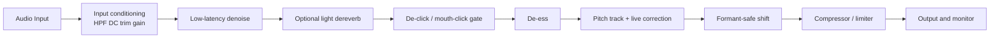
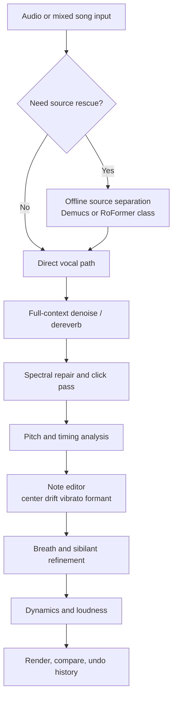
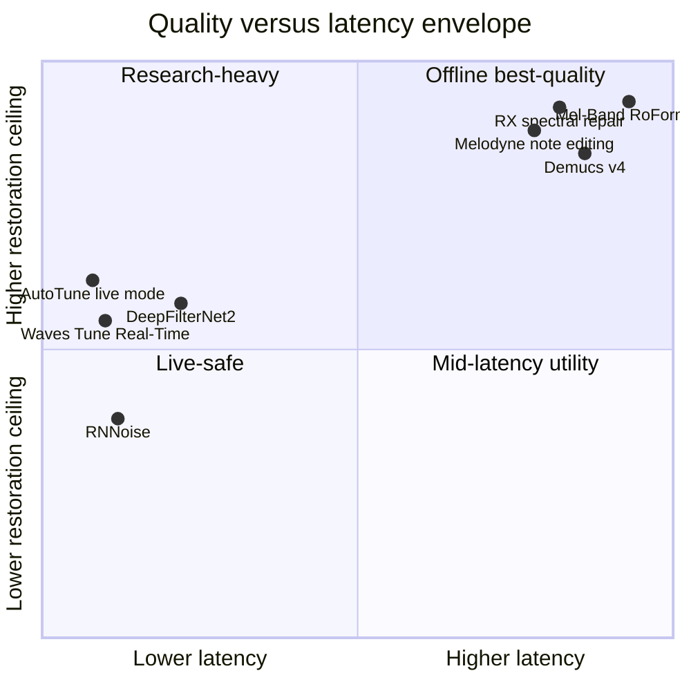

# Modern Vocal Restoration for Singing

## Executive summary

The most effective **standalone app strategy for singing restoration and polish in 2026 is not a single “AI vocal cleaner,” but a layered system**: a fast causal front end for live monitoring and tracking, plus higher-quality offline refinement modules for surgical cleanup, stem work, and note-level editing. In practice, the best modern products and papers converge on a hybrid pattern: classic DSP where phase coherence, transient handling, and latency dominate; learned models where source disentanglement, dereverberation, denoising, or note inference benefit from data-driven priors; and human-editable views for the last 10–20% of quality that automation still misses. citeturn29view0turn30search1turn32search3turn34search4turn35search0turn14search3

For **singing specifically**, the highest-value distinction is that many “voice cleanup” models are optimized for **dialogue or speech**, while top music tools are optimized for **pitch-continuous material, vibrato, sustained harmonics, consonant/sibilant regions, and accompaniment leakage**. That mismatch matters. A singing app should therefore separate its pipeline into at least four semantic regimes: broadband cleanup, transient/click repair, note-aware pitch/timing/formant control, and optional source separation or ambience decomposition. Speech-first denoisers can still be very useful, but they should be placed conservatively and exposed with mix controls because over-attenuation can flatten consonants, breath texture, and vibrato detail. citeturn34search2turn34search4turn43search0turn43search8turn14search1turn15search0turn15search13

If the goal is to build a product that competes credibly with modern professional workflows, the strongest reference stack today is: **RX/SpectraLayers-style spectral editing and repair**, **Melodyne/RePitch/Auto-Tune-style note editing and tuning**, **Clarity/Acon-style learned denoise and dereverb**, and **Demucs/BS-RoFormer/Mel-Band-RoFormer-class source separation** for vocal/instrument or ambience-aware preprocessing. Among open, implementation-friendly building blocks, **RNNoise** and **DeepFilterNet2** are the best templates for tiny/real-time enhancement; **Rubber Band**, **WORLD**, and **pYIN/RMVPE** are high-value pitch/formant primitives; and **Demucs/Open-Unmix** remain practical baselines for music separation, while **BS-RoFormer** and **Mel-Band RoFormer** represent the higher-quality research frontier. citeturn26search0turn29view0turn17search0turn18search1turn18search5turn27search23turn27search0turn23search0turn24search5turn24search0

The practical product recommendation is therefore two architectures. For **real time**, build a causal, CPU-first chain centered on low-latency denoise, optional light dereverb, de-ess, de-breath, pitch correction, and dynamics, with sub-10 ms algorithmic latency as the hard target for monitor comfort and live use. For **offline**, add chunked or full-context ML modules, spectral repair, advanced stem separation, and note-aware editing with editable confidence masks. This split tracks how current commercial tools themselves divide the work: Auto-Tune and Waves Tune Real-Time are explicitly optimized for live/low-latency workflows, while Melodyne, RX, SpectraLayers, and many separation systems are strongest offline or ARA-style in an edit context. citeturn13search2turn13search4turn13search19turn31search0turn15search15turn32search3turn8search4

## What the app must solve for singing

A singing-restoration app should treat the input not as generic “voice,” but as a **musically structured, partly periodic, partly noisy signal**. Sustained vowels are close to harmonic-plus-noise signals; consonants, sibilants, breaths, mouth clicks, and room tails are not. The core failure mode of many restoration tools is that they suppress those non-stationary details too aggressively, which makes a vocal sound “clean but dead.” In note-editing tools, the equivalent failure is forcing the instantaneous pitch curve to a target center without preserving modulation and drift, producing flattened vibrato or robotic transitions. Melodyne’s separation of **pitch center**, **pitch modulation**, and **pitch drift**, and its explicit **sibilant range** handling, is a strong product proof that singing workflows need this separation in the UI and in the DSP/ML representation. RePitch similarly distinguishes note editing from edits to **unvoiced audio** and exposes vibrato-shaping workflows; Antares differentiates live low-latency tuning from higher-quality modes. citeturn14search9turn14search1turn14search4turn15search12turn15search13turn13search4turn13search19

The following capability split is the most implementation-relevant way to decompose the problem:

| Capability | Why it matters for singing | Best technical family today | Real-time suitability | Notes |
|---|---|---|---|---|
| Broadband denoise | HVAC, fan, preamp hiss, room rumble, computer noise | Hybrid DSP+ML suppressors or learned masking filters | Strong | RNNoise- and DeepFilterNet-class systems are the most practical causal templates. citeturn25search1turn26search1turn29view0 |
| De-ess | Harsh “s/sh/ch” energy rises after compression/saturation | Intelligent de-esser, band-limited compression, source-like component analysis | Strong | FabFilter Pro-DS, Waves Sibilance, and Melodyne’s sibilant-aware editing illustrate modern control expectations. citeturn39search1turn39search6turn39search9turn14search4 |
| De-click / mouth click repair | Lip smacks and saliva clicks are common in close-mic singing | Impulse detection + interpolation / spectral inpainting | Moderate to strong | RX De-click and Mouth De-click, Acon DeClick, and CEDAR Manual Declick cover different click durations. citeturn41search0turn41search8turn41search12turn41search3turn41search13 |
| Dereverb / de-room | Small-room boxiness and long tails hurt modern pop vocal aesthetics | WPE-like dereverb, learned direct/reverb decomposition | Moderate | Works best before heavy pitch processing; speech-first dereverb must be tuned gently on singing. citeturn37search9turn34search4turn43search8 |
| De-breath | Excess inhalation and phrase noise | Breath classifier + attenuation / masking | Strong | Should usually reduce, not remove, to preserve realism. citeturn39search2turn39search18turn43search3 |
| Pitch correction / Auto-Tune | Intonation polish, stylistic hard-tune, harmony lock-in | F0 tracking + pitch warping or note-aware editing | Strong to moderate | Live mode and offline note mode should be separate products inside one app. citeturn13search2turn13search4turn14search3turn15search13 |
| Formant preservation | Avoid “chipmunk” or hollow tone during tuning / shifting | Formant-aware pitch shifting, vocoder decomposition | Moderate | Rubber Band, WORLD, Melodyne-style formant tools are key references. citeturn17search0turn18search1turn15search0 |
| Source separation | Vocal/instrument split, leakage suppression, karaoke, rescue workflows | Music separation models such as Demucs, Open-Unmix, BS-RoFormer | Weak in real time, excellent offline | Use offline or coarse-preview mode unless quality expectations are low. citeturn27search0turn23search0turn24search5turn24search0 |
| Spectral repair | Singular noises, clipped syllables, coughs, headset bumps | Spectral editing / inpainting | Offline | Essential for “save the take” workflows. citeturn32search2turn8search4 |

A second key requirement is **progressive disclosure in the interface**. Quick one-knob cleanup is valuable, but advanced users expect at least three edit paradigms because current professional tools have trained the market to think this way: a **spectral canvas** for surgical repair, a **note editor** for musical correction, and **stem/layer controls** for separation and ambience balance. RX and SpectraLayers establish the spectral paradigm; Melodyne and RePitch establish the note paradigm; Acon Remix and RX/Music Rebalance establish the stem-fader paradigm. citeturn32search2turn8search4turn14search3turn15search13turn35search0turn32search0

## Methods and algorithms that matter most

The most durable DSP baseline for denoising remains the family rooted in **spectral subtraction** and its descendants. Boll’s original spectral subtraction work is still conceptually important because it formalized the noise-profile-and-subtract pattern and the trade-off between suppression and musical noise. In modern singing apps, its direct descendants appear less as standalone user-facing algorithms and more inside heuristics, residual controls, or support features around adaptive masking and gating. Its strengths are low cost and predictability; its weaknesses are residual musical noise and poor handling of strongly non-stationary interference. citeturn38search0turn38search9

For **pitch correction and time/pitch reshaping**, classic DSP still matters. **PSOLA** remains a reference for low-latency or moderate-shift voice-oriented pitch and duration modification because it manipulates pitch-synchronous segments directly and can preserve naturalness well for moderate edits. **Phase-vocoder-style** and related frequency-domain methods remain useful when larger stretches are needed, but they demand more care around transient preservation and phase coherence. **Rubber Band** is a practical production-grade library reference because it explicitly targets high-quality time-stretching and pitch-shifting and is widely used in apps; **WORLD** is especially useful when you want explicit control over **F0**, spectral envelope, and aperiodicity in a vocoder style that naturally supports formant-aware manipulations and can serve as a backbone for hybrid restoration models. citeturn37search1turn17search0turn17search6turn18search1turn18search18

For **dereverberation**, the most important classical reference is **Weighted Prediction Error**. WPE models late reverberation as predictable from delayed past frames and subtracts it in the STFT domain; it has by now become the canonical classical dereverb baseline and underlies a lot of later speech dereverb thinking. Its advantages are interpretability and no training requirement. Its limits for singing are that it is better at late tail suppression than at semantically separating direct sound from reverb in a fully musical way, especially in single-channel, mixed, or heavily accompanied material. This is why current commercial tools increasingly market learned direct/reverb decomposition instead of only classical dereverb. citeturn37search6turn37search9turn37search20turn34search4turn43search8

Modern **real-time denoise** is dominated by **hybrid DSP/ML architectures** rather than giant end-to-end waveform generators. **RNNoise** is still foundational because it deliberately combines classical signal processing with a small recurrent neural network so that it stays fast enough for CPU deployment; the project explicitly emphasizes real-time use and even Raspberry Pi-class deployment. **DeepFilterNet2** is the more modern reference for higher-quality full-band enhancement in a still real-time-friendly frame, and its paper reports state-of-the-art speech enhancement performance while reducing the real-time factor enough for embedded use. The implementation lesson is clear: for live singing, use small causal models that operate on meaningful DSP features or deep filtering targets, not giant non-causal separators. citeturn25search1turn26search1turn29view0

For **music source separation**, the quality frontier has moved decisively toward **hybrid and transformer-based models**. **Demucs v4** combines waveform and spectrogram paths with transformer components; **Open-Unmix** remains the most reproducible baseline; **BSRNN** moved the field toward frequency-band-specialized modeling; **BS-RoFormer** and **Mel-Band RoFormer** pushed that further and are widely regarded as state-of-the-art research references for high-quality separation on MUSDB18-HQ. In a singing-restoration product, these models are less about karaoke gimmicks and more about rescue workflows: separate the lead vocal first, then restore it, then optionally remix it against the accompaniment. citeturn27search0turn23search0turn23search1turn25search18turn24search5turn24search0turn19search8

For **singing-specific pitch and beautification research**, the field is still less mature than commercial product stacks. **Deep Autotuner** approached pitch correction as a learned prediction problem based on the relationship between singing and accompaniment rather than fixed semitone snapping. **Diff-Pitcher** uses diffusion and a source-filter framing to improve pitch correction quality and reduce artifacts from resynthesis. **Neural Singing Voice Beautifier** and **ConTuner** broaden the task from intonation correction to expressive “beautification,” while the 2026 self-supervised restoration work reframes the problem as “undo pitch-shift artifacts while preserving melody and timing.” These are important because they point to the next generation of pitch polish, but today they are better used as **offline R&D inspiration** than as the first real-time shipping core. citeturn30search4turn30search12turn30search1turn30search9turn30search10turn30search18turn30search2turn30search5

A concise algorithm trade-off view:

| Method family | Short description | Technical approach | Pros | Cons | Latency / performance | License / availability | Implementation notes |
|---|---|---|---|---|---|---|---|
| Spectral subtraction | Classical profile-based denoising | STFT noise estimate and spectral attenuation | Cheap, explainable, deterministic | Musical noise, weak on non-stationary interference | Excellent for real time | Classical method | Best as a fallback or support stage, not your flagship cleaner. citeturn38search0turn38search9 |
| RNNoise | Tiny real-time suppressor | Hybrid DSP + small RNN | Very fast, good CPU story | Speech-biased; may oversimplify singing texture | Real time on modest CPUs | BSD-3-Clause repo | Strong mobile or monitor-path candidate. citeturn25search1turn26search1 |
| DeepFilterNet2 | Higher-fidelity causal enhancement | Deep filtering with optimized real-time design | Better quality ceiling than tiny suppressors | Still speech-oriented; needs tuning for singing | Paper reports real-time factor 0.04 on notebook Core i5 | Open-source framework | Best modern open starting point for live enhancement. citeturn29view0 |
| WPE dereverb | Classical late-reverb suppression | Delayed linear prediction in STFT domain | No training, interpretable | Limited semantic understanding of room/direct sound | Real-time feasible in constrained forms | Open implementations available | Useful as a baseline or auxiliary dereverb stage. citeturn37search6turn37search9 |
| PSOLA / formant-aware pitch shift | Time-domain pitch correction | Pitch-synchronous overlap-add | Low latency, natural for moderate edits | Fails on large shifts / poor F0 tracking | Excellent | Classical method; many implementations | Useful for live mode and consonant-safe short-range tuning. citeturn37search1turn37search7 |
| WORLD vocoder | Parameterized voice decomposition | Explicit F0, spectral envelope, aperiodicity | Formant-aware control and hybrid-ML compatibility | Not fully transparent at all styles/settings | Offline to near-real-time depending on chain | Modified BSD | Strong offline backbone for singing-aware restoration R&D. citeturn18search1turn18search18 |
| Demucs v4 | Practical high-quality music separation | Hybrid waveform/spectrogram U-Net + transformer | Strong quality, mature ecosystem | Too heavy for strict low-latency live use | Offline preferred | Open-source repo | Best pragmatic offline vocal isolation baseline. citeturn27search0 |
| Open-Unmix | Reproducible separation baseline | DNN reference model trained on MUSDB18 | Stable, reproducible, easy baseline | Below current frontier quality | Offline | Open source | Excellent benchmark and fallback model. citeturn23search0turn23search1 |
| BS-RoFormer / Mel-Band RoFormer | Research frontier MSS | Band-split transformer with RoPE / mel-band projection | Very high separation quality | Heavy compute, more complex deployment | Offline | Paper-first; code ecosystem is fragmented | Use if separation quality is core to product value. citeturn24search5turn24search0 |

Selected foundational patents worth reading during implementation review:

| Patent | What it covers | Why it matters |
|---|---|---|
| Antares **US5973252A** | Real-time pitch detection and intonation correction for solo instruments and vocals; explicitly mentions real-time vibrato generation | Still the canonical reference point for automatic pitch correction product design. citeturn16search0 |
| Celemony **US8022286B2** | Note-object-oriented processing of polyphonic sound material | Important for understanding note-level object editing concepts behind Melodyne/DNA-like workflows. citeturn16search1 |

## Commercial products and open-source building blocks

The current commercial ecosystem is fragmented in a useful way: no single tool is best at everything. **RX 12 Advanced** is strongest as a restoration toolkit and standalone editor, with spectral repair, mouth de-click, music rebalance, stem-oriented workflows, and rebuilt breath-control style tools. **SpectraLayers 12** is especially strong when you want layer-based spectral editing and modern unmixing. **Melodyne 5 Studio** remains the benchmark for musical pitch/timing/formant work and vibrato-aware editing. **Auto-Tune Pro X / AutoTune 2026** and **Waves Tune Real-Time** are the low-latency tuning references. **RePitch** is an increasingly strong note-editor alternative with a workflow many engineers find faster for detailed pitch and vibrato shaping. citeturn33search7turn33search9turn32search0turn8search4turn14search8turn14search3turn11search5turn13search2turn13search4turn43search2turn15search5turn15search13

For noise, room, and vocal cleanup, the most relevant commercial references are **Waves Clarity Vx / DeReverb**, **Acon Extract:Dialogue 2 / DeVerberate 3**, **Waves DeBreath**, **FabFilter Pro-DS**, and **CEDAR** for specialist restoration. These products are not all singing-native, but they expose the right control surfaces: voice/noise separation, reverb reduction bands, independent ambience or noise balancing, and transparent de-essing. In other words, even where the model training was speech-heavy, the UI ideas and module boundaries are highly reusable for a singing app. citeturn43search0turn43search8turn34search2turn34search4turn43search3turn40search0turn41search3

A practical comparison set:

| Product | Short description | Technical approach | Pros | Cons | Latency / performance | Licensing / cost | Docs / paper | Implementation notes |
|---|---|---|---|---|---|---|---|---|
| RX 12 Advanced | Broad restoration suite and standalone editor | Hybrid spectral tools, ML modules, stem-aware workflows | Spectral repair, de-click, breath work, music rebalance, mature editor | Not a single unified singing workflow; some modules are offline-oriented | Mixed real-time/offline, depending on module | Commercial; $1,399 list on NI pricing page | citeturn33search7turn32search5turn41search17turn32search2 | Best reference for “save the take” editing and QA workflows. |
| SpectraLayers 12 Pro | Layer-based spectral editing and unmixing | Spectral layers + AI unmix functions | Excellent visual repair and layer logic | Less pitch-centric than Melodyne; not a live tool | Offline/editor-first | Commercial; $349.99 list | citeturn8search4turn7search3 | Strong inspiration for spectral UX and layer routing. |
| Melodyne 5 Studio | Gold-standard note-aware editing | Note extraction, pitch/timing/formant/sibilant editing, DNA | Best-in-class manual musical correction | Not intended as live autotune | Offline / ARA workflow | Commercial; €649 web shop price | citeturn14search8turn14search3turn15search0turn14search1turn14search10 | Essential benchmark for vibrato/drift/formant handling. |
| Auto-Tune Pro X / 2026 | Industry-standard automatic pitch correction | Real-time pitch correction with low-latency and higher-quality modes | Live-ready, familiar workflow, huge market recognition | Less surgical than Melodyne for detailed edits | 2026 best-practices page reports 2.3 ms Modern / 0.77 ms Classic at 48 kHz in low-latency mode | Subscription or perpetual; official FAQ confirms both models | citeturn11search5turn13search2turn13search4turn13search19 | Benchmark for live tuning feel and monitor-path constraints. |
| Waves Tune Real-Time | Lower-cost live pitch correction | Real-time autotune-style correction | Simple, popular, stage and tracking oriented | Less detailed editability than note editors | Marketed specifically for live/studio real-time use | Commercial; $39.99 current sale, $199 MSRP snippet | citeturn31search0turn43search2turn31search1 | Good reference for a “tracking mode” SKU. |
| RePitch Standard | Transparent note editor for pitch/timing/vibrato | Note-level editing with manual and macro operations | Fast editing, natural feel, good unvoiced handling | Less ubiquitous than Melodyne | Non-realtime/editor-style | Commercial; $149 USD | citeturn15search5turn15search13turn9search8 | Strong reference for modern pitch-editor UX. |
| Waves Clarity Vx / DeReverb | Real-time AI cleanup for vocals/voice | Neural voice/noise and voice/reverb separation | Fast cleanup, real-time workflow | Speech/voice orientation can over-clean singing | Real time; Waves publishes plugin latency chart | Commercial; sale pricing around $34.99–$39.99 on current pages | citeturn43search0turn43search1turn43search4turn43search8turn31search1 | Useful reference for one-knob and multiband dereverb controls. |
| Acon Extract:Dialogue 2 | Voice/noise/reverb/ambience balancing | AI dialogue cleaning with real-time reverb reduction and separate controls | Separates voice, reverb, noise, ambience-like elements in one UI | Dialogue-focused training | Real time; Acon markets CPU efficiency | Commercial; $99 | citeturn34search2turn34search15turn34search17 | Excellent reference for layer-separation UI and independent EQ. |
| Acon DeVerberate 3 | Learned dereverb | Deep-learning reverb reduction, plus traditional controls | Strong focused dereverb module | Not a full restoration suite | Real time / plugin use | Commercial; $99 | citeturn34search1turn34search4 | Good benchmark for de-room/de-tail behavior. |
| Acon Remix | Real-time five-stem music separation | AI stem separation into vocals, piano, bass, drums, other | Real-time stem faders, multiple outputs | Likely below best offline separators in ultimate quality | Real time with minimal latency claim | Commercial; $49 | citeturn35search0turn35search6 | Great reference for “rescue the mix around the vocal” workflows. |
| Waves DeBreath | Automatic breath detection/suppression | Breath profile matching and attenuation | Very usable dedicated de-breath tool | Can sound unnatural if overdone | Real time plugin workflow | Commercial; $39.99 current sale, $99 list | citeturn9search7turn43search3turn43search6 | Good benchmark for breath detection UX. |
| FabFilter Pro-DS | Transparent de-esser | Intelligent vocal detection and program-dependent compression | Excellent sibilance control, pro-standard UX | Not a full vocal suite | Real-time friendly; oversampling trades CPU for quality | Commercial; $199 | citeturn40search1turn39search1turn40search4 | Strong reference for de-ess visualization and control ranges. |
| CEDAR Manual Declick | Specialist long-click repair | Advanced manual declick for long events and scratches | Handles longer defects other tools miss | Specialist, restoration-centric | Offline / manual repair | Commercial; trial available; pricing is channel-specific | citeturn41search3turn41search13 | Useful benchmark for hard, extended click repair. |

Open-source blocks worth serious consideration in a standalone app:

| Open source / library | Role | Technical value | Real-time fit | License / docs |
|---|---|---|---|---|
| RNNoise | Tiny denoise baseline | Proven hybrid DSP+RNN architecture | Excellent | BSD-3-Clause. citeturn25search1turn26search1 |
| DeepFilterNet2 | Higher-quality causal enhancement | Strong real-time paper baseline | Excellent | Open-source framework; real-time paper. citeturn29view0 |
| Demucs | Offline vocal/instrument separation | Strong quality and ecosystem | Weak for strict live use | Open repo. citeturn27search0 |
| Open-Unmix | Separation baseline | Reproducible reference baseline | Offline | Open repo. citeturn23search0turn23search1 |
| Rubber Band | Pitch shift / time stretch | High-quality production-grade library | Good | Official library and repo. citeturn17search0turn17search6 |
| WORLD | Vocoder decomposition | Explicit F0/envelope/aperiodicity control | Moderate | Modified BSD. citeturn18search1 |
| pYIN / librosa | F0 baseline | Classical probabilistic F0 estimation | Moderate | Research + docs. citeturn18search5turn18search9turn17search2 |
| RMVPE | Vocal pitch estimation | Vocal/polyphonic-aware pitch estimator | Moderate | Open repo. citeturn27search23 |
| DDSP | Hybrid ML+DSP experimentation | Useful for research prototyping of controllable resynthesis | Mostly offline R&D | Open repo and paper. citeturn18search3turn18search10 |

## Recommended app architectures

The cleanest product strategy is to ship **two processing graphs over one shared asset system**: a low-latency graph for monitoring/tracking/live use, and a high-quality graph for render/export. They should share the same preset semantics but not the same algorithms or buffer constraints.

This **real-time chain** should use causal or near-causal blocks only. A small RNNoise- or DeepFilterNet-class suppressor, a conservative de-esser, a transient-safe click suppressor, and a PSOLA- or similar short-range pitch corrector are the right center. If dereverb is offered live, it should be explicitly labeled “light” or “tracking” and disabled by default for very wet sources. Antares’ low-latency guidance, Waves Tune Real-Time’s live positioning, and modern real-time suppressors all point to the same product lesson: if you miss the latency target, the whole chain becomes unusable no matter how good the offline quality is. citeturn13search2turn13search4turn31search0turn29view0turn25search1

The **offline graph** should be chunked but full-context where possible. This is where you can afford heavier separators, non-causal dereverb, spectral repair, note-aware correction, and the UI features that make professionals trust the app. ARA-style behavior is a good mental model even in a standalone editor: preserve analysis metadata, confidence masks, syllable/note boundaries, and edit history so the user can move between waveform, note, and spectrogram views without destructive re-analysis. Melodyne’s ARA ecosystem and SpectraLayers/RX workflow patterns are strong references here. citeturn15search3turn15search7turn15search15turn32search3turn8search4

A deployment sketch for desktop and mobile:

| Target | Feasible stack | What to ship first | Why |
|---|---|---|---|
| Desktop offline | JUCE app + ONNX Runtime / native ML backend + full editor | Full restoration suite plus separation preview | Desktop has the memory and CPU/GPU headroom for spectral tools and larger models. citeturn36search3turn36search15turn36search22 |
| Desktop real time | JUCE + native DSP + small causal model | Tracking/live mode | Lowest integration friction and broad OS reach. citeturn36search3turn36search15turn29view0 |
| iOS / Apple Silicon | Core ML or ONNX Runtime mobile | Cleanup + live pitch + light repair, not full separation | Apple’s stack is strong for on-device inference, but large separation models still stress memory and thermals. citeturn36search1turn36search17turn36search20turn36search4 |
| Android | TFLite or ONNX Runtime mobile | Cleanup + tracking tools first | Quantization and reduced runtimes help, but you should avoid transformer-heavy offline models on-device unless heavily pruned. citeturn36search2turn36search4turn36search13 |

A conceptual quality/latency map synthesized from current product docs and papers:

That chart is intentionally conceptual rather than benchmark-grade; it summarizes the direction implied by the linked papers and official product positioning. citeturn26search1turn29view0turn13search4turn31search0turn14search3turn32search2turn27search0turn24search0

## Training data, evaluation, and model strategy

Training data should be assembled as **task-specific corpora**, not one monolithic pool. For source separation and vocal/instrument rescue, **MUSDB18-HQ** is still the standard open benchmark and exists precisely to avoid the bandwidth limitations of compressed MUSDB18. **Open-Unmix**, **Demucs**, and later separation papers all anchor themselves in that ecosystem. For larger-scale synthetic augmentation, **Slakh2100** is useful, though it is instrumental/synthetic rather than singer-centric. For singing-specific pitch behavior, vibrato, and technique diversity, **VocalSet** is the most important open singing dataset to have in your stack; **MIR-1K**, **MedleyDB**, and **DAMP/Smule corpora** help with singing separation and real-world karaoke-style recordings. For enhancement pretraining, the **DNS Challenge** ecosystem remains valuable, but it is a speech-domain dataset and should not be assumed to transfer perfectly to sung material. citeturn19search8turn19search12turn23search1turn27search0turn19search9turn19search2turn19search6turn20search6turn19search3turn20search7turn20search0

A good training strategy is therefore staged. Start with **speech/voice enhancement pretraining** for general denoise and dereverb robustness, then fine-tune on **curated sung vocals** with wide variation in gender, register, style, vibrato rate/depth, breathiness, consonant density, room type, and accompaniment leakage. For pitch models, pair clean singing with semitone-shifted or micro-shifted corruptions, and include target labels not only for note center but also for modulation region masks, unvoiced masks, and formant stability. Recent singing-beautification and restoration papers support this move toward richer conditioning rather than naive semitone snapping. citeturn20search0turn19search2turn30search2turn30search5

Evaluation should also be split by task. For **source separation**, use **SDR** and the museval/BSSEval ecosystem, with SI-SDR as a useful supplementary metric when gain invariance matters. For **full-reference audio quality**, **ViSQOL** is a strong general perceptual-quality estimator, and **PESQ** or **DNSMOS** can be informative for enhancement-style experiments, though they are speech-centric and can be gamed or misaligned with singing aesthetics. For subjective testing, use **MUSHRA** as the main listening-test design and add discrimination-style spot checks where needed. Most importantly, run **paired singing-specific listening sessions** that explicitly score pitch naturalness, vibrato preservation, consonant integrity, room realism, and artifact audibility, because generic speech metrics are not enough. citeturn21search0turn21search12turn42search4turn21search1turn21search13turn21search18turn21search3turn20search4turn42search0turn42search3

A recommended evaluation matrix:

| Dimension | Objective metrics | Perceptual test | What to listen for |
|---|---|---|---|
| Denoise / de-room | ViSQOL, DNSMOS, PESQ, residual-noise energy | MUSHRA | Noise reduction versus vocal dulling, breath/consonant survival. citeturn21search1turn21search3turn21search18turn20search4turn42search0 |
| Source separation | SDR via museval, optional SI-SDR | MUSHRA or AB preference | Leakage, musical noise, stem completeness, reverberant smear. citeturn21search0turn21search12turn42search4turn42search0 |
| Pitch correction | Note error, raw pitch accuracy, modulation deviation, formant drift | Singing-specific panel | Vibrato flattening, note transition realism, consonant safety. citeturn18search5turn27search23turn14search1turn15search12 |
| Click repair | Click detection recall / precision on labeled events | AB preference | Whether attacks or mouth texture were damaged. citeturn41search0turn41search8turn41search13 |

For **user controls**, the strongest modern pattern is a three-layer UI. First, **Quick Repair**: a few high-level controls like Clean, Room, Breath, Sibilance, and Tune. Second, **Musical Edit**: note blobs with pitch center, modulation, drift, timing, and formant sliders. Third, **Surgical View**: spectrogram, brush tools, harmonic selection, and split-layer routing. This mirrors what users already understand from Clarity/Acon, Melodyne/RePitch, and RX/SpectraLayers. citeturn34search2turn43search0turn14search1turn15search13turn32search2turn8search4

## Prioritized roadmap for development

The first shipping version should **not** try to solve every restoration problem with a single general model. A better roadmap is modular.

**Phase one** should target the highest-frequency wins: low-latency denoise, conservative de-ess, mouth-click suppression, de-breath, live pitch correction, and light dynamics. This is the minimum viable tracking and polishing chain. The right open references are RNNoise or DeepFilterNet-class enhancement, a high-quality de-esser design inspired by Pro-DS or Sibilance, and a live pitch path modeled after Auto-Tune 2026 / Waves Tune Real-Time. citeturn25search1turn29view0turn40search1turn39search6turn13search4turn43search2

**Phase two** should add the offline editor: waveform plus spectrogram, spectral repair, full click repair, note analysis, and manual note editing with separate controls for pitch center, modulation, drift, and formant. If this phase is done well, the app immediately becomes far more credible for professional singing work, because that is where users rescue borderline but emotionally valuable takes. Melodyne, RePitch, RX, and SpectraLayers are the right benchmarks here. citeturn14search3turn14search1turn15search13turn32search2turn8search4

**Phase three** should add offline source separation and mix rescue. Start with Open-Unmix or Demucs for engineering simplicity and reproducibility, then evaluate whether a RoFormer-class model is worth the additional deployment cost. This phase is especially valuable if the product vision includes stem-based remixing, karaoke, vocal isolation from legacy mixes, or accompaniment-aware pitch polishing. citeturn23search1turn27search0turn24search5turn24search0

**Phase four** should be differentiated R&D: singing-specific beautification models, self-supervised artifact restoration after pitch shift, ambience-aware decomposition, and ranking models that predict when automation will fail and should hand off to manual editing. That is where recent singing-specific papers become strategically useful. citeturn30search1turn30search2turn30search5turn30search10

A concrete build order:

| Priority | Deliverable | Success criterion |
|---|---|---|
| Highest | Real-time cleanup + live tune | Feels monitor-safe, defaults sound conservative, CPU use is stable across multiple instances. citeturn13search2turn13search4turn10search12 |
| High | Offline note editor + spectral editor | Can rescue takes better than generic one-knob AI cleaners. citeturn14search3turn32search2turn8search4 |
| Medium | Offline source separation and layer routing | Useful for stem rescue and accompaniment-aware workflows. citeturn27search0turn35search0 |
| Medium | Mobile companion | Supports light cleanup, preview tuning, and capture, but not full offline heavy editing. citeturn36search4turn36search2turn36search20 |
| Long-term | Singing-specific beautification / restoration models | Clear measurable gains in vibrato preservation and subjective naturalness over classical note correction alone. citeturn30search2turn30search5 |

## Open questions and limitations

A few boundaries remain important.

First, **many of the best commercial cleanup tools document performance for dialogue or generic vocals, not explicitly for high-fidelity sung lead vocals**, so some singing-specific recommendations here are engineering extrapolations from the underlying method, UI, and positioning rather than public singer-only benchmarks. That is especially true for denoise and dereverb plugins. citeturn34search2turn43search0turn43search8

Second, **public official documentation rarely publishes exact checkpoint sizes, memory footprints, or per-platform throughput for research models**, so deployment planning still requires your own profiling after export and quantization. The strongest official guidance available is usually at the runtime level: ONNX Runtime mobile, TFLite, and Core ML all emphasize reduced model formats, operator reduction, or quantization to reduce binary size and memory pressure. citeturn36search0turn36search4turn36search7turn36search10turn36search20

Third, **objective metrics remain imperfect for singing**. The field has good source-separation and speech-quality metrics, but not a single objective score that faithfully captures “does this vocal still feel sung by the same person with the same emotion, but cleaned up and in tune?” That is why your evaluation plan should include MUSHRA-style listening tests focused on vibrato, consonants, breaths, and phrasing rather than only relying on SDR, PESQ, or DNSMOS. citeturn21search0turn21search1turn20search4turn42search0

The bottom line is straightforward: **build a hybrid app, not a monolith**. Use small causal models and classic DSP for live usability, reserve large-context ML and spectral/note editing for offline quality, and treat singing as its own domain with explicit protection for vibrato, formants, consonants, and breaths. That combination is where the best evidence from current products, open implementations, patents, and recent papers most strongly points. citeturn29view0turn14search1turn15search0turn27search0turn24search0turn32search2