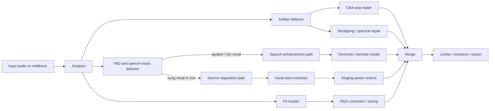
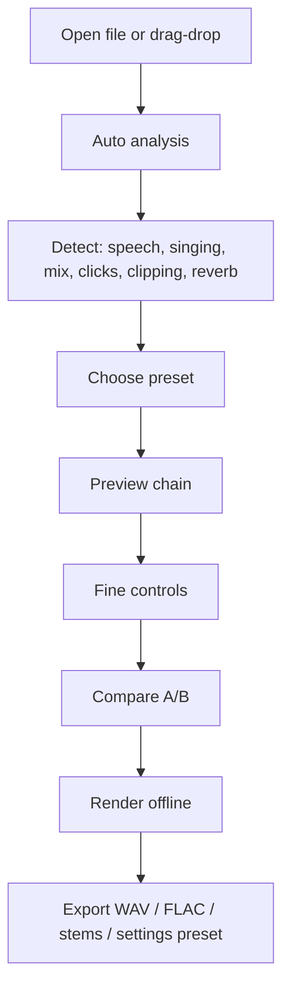

# Offline Voice Restoration for Vocal Polish

## Executive summary

“Vocal Polish” should not be built around a single monolithic model. The most robust offline architecture, as of June 29, 2026, is a **modular restoration pipeline** with **task routing**: a lightweight real-time speech enhancer for live preview and spoken voiceover, a stronger batch enhancer for offline export, a music-aware source separator for sung vocals embedded in accompaniment, and classical DSP repair modules for localized defects such as clicks, pops, clipping, and short spectral dropouts. The newest research in universal speech enhancement is impressive, but the most product-ready offline stack still comes from combining mature open-source models with deterministic DSP tools. citeturn38academia18turn18search0turn4search0turn32view0turn32view2turn37view0turn26search0turn7search0turn25academia10

For **spoken voiceover**, the highest-confidence practical options are **DeepFilterNet** for low-latency enhancement, **DPDFNet** as a newer DeepFilterNet2-derived causal model with ONNX and TFLite export, and **RNNoise** as an ultra-light fallback. **Resemble Enhance** and **VoiceFixer** are useful batch enhancers, but they are more speech-specific, less transparent in reproducibility, and better suited to “repair + polish” export than to strict low-latency live monitoring. Frontier universal models such as **UniPASE**, **USEMamba**, and **Miipher-2** matter strategically because they point toward a future single model for many distortion types, but they are not yet as deployment-ready for a commercial offline desktop app as the best modular stacks. citeturn32view0turn40search5turn41view0turn32view1turn17academia18turn38academia18turn18search0turn4search0

For **singing**, the main gap in many speech enhancers is domain mismatch. Recent work shows that singing enhancement has historically lacked realistic benchmarks, and **SingVERSE** demonstrates that strong speech enhancers can degrade when applied directly to singing unless they are adapted with in-domain data. For sung audio inside full mixes, **Demucs v4** remains the safest open-source offline separator; **BS-RoFormer** and **Mel-Band RoFormer** represent stronger recent research results for music source separation, but the production ecosystem around Demucs is still more mature. For artificial vocal reverb in music production, **ReverbFX** is a notably relevant new dataset because it models plugin-style reverb rather than only physical-room reverberation. citeturn31academia1turn32view2turn10search0turn10search1turn31academia0

The clearest product recommendation is to ship **two processing modes**. First, a **Preview mode** optimized for CPU-only or modest laptops, centered on DeepFilterNet or DPDFNet plus deterministic click/pop suppression. Second, a **Render mode** that can optionally run heavier batch models, source separation, spectral repair, pitch correction, and multi-pass enhancement. This gives good UX across voiceover editors, podcasters, and musicians without forcing GPU-class inference in the common path. citeturn35search14turn40search0turn32view2turn26search0turn25academic10

The licensing picture strongly favors a proprietary standalone desktop product built around **MIT / Apache / BSD** components such as DeepFilterNet, DPDFNet, Demucs, Basic Pitch, RMVPE, RNNoise, ONNX Runtime, RtAudio, CPAL, and a Qt or Tauri frontend. The biggest licensing friction points are **JUCE** for closed-source plugin products, **Rubber Band** for commercial pitch-shifting unless separately licensed, and **facebookresearch/denoiser**, which is under **CC-BY-NC 4.0** and therefore not a safe core dependency for a commercial app. citeturn32view0turn40search5turn32view2turn32view5turn32view6turn41view0turn15search15turn12search0turn12search1turn11search6turn11search22turn5search0turn41view1

Assumptions used in this report: target operating systems, latency budgets, and user expertise were unspecified, so recommendations assume **Windows/macOS first**, Linux feasible, **offline-only operation**, local model execution, and a mixed workload spanning **batch restoration** and **optional near-real-time auditioning**. citeturn11search3turn12search0turn12search1turn15search7

## Problem framing and product architecture

The product scope spans four different problem classes that are often conflated but should be separated in system design: **global denoising**, **late-reverb suppression**, **localized defect repair**, and **content-aware vocal editing**. Global denoising and dereverberation are the sweet spot of modern speech enhancement models; localized clicks, pops, clipping, and missing spectral regions are still often better handled by explicit DSP or sparse-reconstruction methods; and pitch correction behaves differently again because it requires reliable **F0 estimation** and a **phase/formant-preserving resynthesis** step. Singing in accompaniment adds a fifth class, **source separation**, because the model must first isolate the vocal target before restoration. citeturn24academia0turn26search0turn7search0turn25academia3turn32view2turn28search0turn28search7

That breakdown implies a routing architecture rather than a single “Enhance” button with one backend. A strong design is:

This is aligned with current evidence: speech enhancers such as DeepFilterNet or DPDFNet can run causally for voiceover; music stem separation models such as Demucs or RoFormer-family models are the right front-end for sung tracks in accompaniment; and classic defect repair remains essential for clicks, pops, clipping, and inpainting. citeturn32view0turn40search0turn32view2turn10search0turn10search1turn26search0turn25academia3turn7search0

A second architectural decision is whether the app should be **standalone only** or also act as a **plugin**. For a first release, standalone is the lower-risk path. It simplifies audio-driver handling, allows larger batch jobs, and avoids the tighter latency and host-integration constraints of DAWs. Plugin support is possible later, but it should reuse the same engine and model packaging rather than drive core architectural choices from day one. citeturn12search0turn12search1turn11search6turn11search22

## State of the art algorithms and methods

### Denoising and dereverberation

Most successful modern speech enhancers still rely on the short-time Fourier transform. For a waveform \(x[n]\), the STFT is

\[
X(t, f)=\sum_{n} x[n]\, w[n-tH]\, e^{-j2\pi fn/N},
\]

where \(w\) is the analysis window, \(H\) the hop size, and \(N\) the FFT length. Enhancement models either predict a mask \(M(t,f)\) such that \(\hat{S}(t,f)=M(t,f)X(t,f)\), or predict the clean complex spectrogram directly. Typical complex-ratio-mask parameterization is

\[
M_{\text{CRM}}(t,f)=\frac{S_r X_r + S_i X_i}{X_r^2+X_i^2}
+j\frac{S_i X_r - S_r X_i}{X_r^2+X_i^2},
\]

with \(S\) the clean target and \(X\) the noisy mixture. Complex masking matters because late reverberation and noise both perturb phase and magnitude. FRCRN is a representative modern complex-domain model: it uses a convolutional recurrent encoder-decoder with **frequency recurrence** via FSMN blocks and predicts a complex ideal ratio mask, trained with joint time-frequency and time-domain losses. citeturn19search7turn32view4turn24academia0

**DeepFilterNet** is different and especially relevant for productization. Instead of only estimating a mask, it combines two stages: a coarse spectral-envelope enhancement and then **deep filtering**, which estimates a short complex FIR-like filter over neighboring STFT frames to better reconstruct periodic speech structure. In simplified form, for each frequency bin \(f\),

\[
\hat{S}(t,f)=\sum_{k=0}^{K-1} h_k(t,f)\, X(t-k,f),
\]

where the network predicts complex coefficients \(h_k\). That makes it stronger than pure masking for harmonically structured speech while staying efficient enough for real-time. The 2023 DeepFilterNet work reports 48 kHz operation on 20 ms windows with 10 ms hop and 2-frame look-ahead, for roughly **40 ms overall latency**. citeturn32view0turn35search14

**Diffusion and Schrödinger bridge** models are the current research frontier for denoising and dereverberation. In score-based diffusion, a forward SDE corrupts clean speech, and a neural score model learns \(\nabla_x \log p_t(x|y)\), where \(y\) is the degraded condition. Reverse-time sampling iteratively reconstructs clean speech. Richter et al. showed that diffusion-based enhancement and dereverberation can compete with strong discriminative baselines and generalize better cross-dataset, while subsequent Schrödinger-bridge work showed comparable or better quality with fewer steps and lower compute. This class is scientifically important for long-term roadmap planning, but batch-friendly, low-latency desktop deployment still favors discriminative causal models for common use. citeturn24academia0turn24academia1turn19search19

The newest universal models increasingly operate in **self-supervised representation space** rather than only in STFT space. **Miipher-2** uses a frozen Universal Speech Model as a multilingual feature extractor plus lightweight adapters and a vocoder, targeting large-scale robust speech restoration. **USEMamba** uses selective state-space modeling for long-range efficiency and performed strongly in the URGENT 2025 challenge. **UniPASE** pushes this further with DeWavLM-Omni, an adapter, a vocoder, and a postnet, and achieved **first place in the objective evaluation** of the URGENT 2026 challenge. These are the newest important papers to watch if “Vocal Polish” later evolves toward a single universal restoration engine. citeturn4search0turn18search0turn38academia18turn18search12

### Declipping, de-click, and spectral repair

For clipping, a useful formalization is

\[
y[n] =
\begin{cases}
\tau, & x[n]>\tau \\
x[n], & |x[n]|\le \tau \\
-\tau, & x[n]<-\tau,
\end{cases}
\]

with clipping threshold \(\tau\). Declipping methods reconstruct \(x\) from the reliable set \(\Omega_r=\{n: |y[n]|<\tau\}\) and clipped set \(\Omega_c\). Sparse-reconstruction approaches such as **SPADE** solve a constrained optimization that enforces consistency on unclipped samples while seeking a sparse representation in a transform domain; synthesis and analysis variants differ in whether sparsity is imposed on coefficients or on transformed signals. These remain relevant because clipping is local and strongly structural, which generative enhancers often repair less predictably than explicit constrained models. citeturn7search15turn7search0turn7search19

For click/pop removal, the strongest open literature for practical audio repair still comes from **autoregressive modeling**. Oudre’s approach automatically detects impulsive outliers and replaces them by interpolation values estimated from a local AR model. If \(x[n]\) locally follows

\[
x[n] = \sum_{k=1}^{p} a_k x[n-k] + e[n],
\]

then missing or corrupted samples can be reconstructed from neighboring context through forward/backward prediction or leave-one-out interpolation. This is still a very strong fit for mouth clicks, vinyl-style clicks, and edit pops because the damage is short-duration and sparse. It is deterministic, offline-friendly, and easy to expose as a user-tunable module. citeturn26search0turn26search1turn26academia10

For **spectral repair / inpainting**, a closely related problem is reconstructing missing or unreliable time-frequency coefficients. Recent work such as **Janssen 2.0** adapts AR-based inpainting into the time-frequency domain and outperforms the compared deep-prior baseline in both objective metrics and listening tests. For product design, that matters because a spectral editor can mark unreliable regions from click detectors or manual user brushes, and then invoke an inpainting backend that is much more stable than full generative audio editing. citeturn25academia3turn7search14

### Source separation and pitch correction

For sung audio mixed with accompaniment, the dominant models use either hybrid waveform/spectrogram U-Nets or spectrogram Transformers. **Hybrid Transformer Demucs** replaces the innermost layers of Hybrid Demucs with a cross-domain Transformer that performs self-attention within waveform and spectrogram branches and cross-attention between them. The Demucs repository reports around **9.0 dB SDR on MUSDB HQ**, rising to **9.2 dB** with sparse-attention and fine-tuning in the paper setting. **BS-RoFormer** and **Mel-Band RoFormer** instead split spectrograms into bands and use RoPE-based Transformers for intra-band and inter-band modeling; BS-RoFormer reports **9.80 dB average SDR** on MUSDB18HQ without extra data, while Mel-Band RoFormer improves vocals, drums, and other stems further. citeturn32view2turn10search2turn10search0turn10search1

Pitch correction is a two-stage problem: **estimate F0**, then **modify F0 while preserving time and timbre as much as possible**. Classical estimators such as YIN and pYIN use autocorrelation or normalized difference functions followed by candidate selection and, for pYIN, probabilistic decoding with Viterbi. In high-level form, YIN computes a difference function \(d_t(\tau)\) over lag \(\tau\), converts it into a cumulative mean normalized difference, then picks the first lag passing a threshold; pYIN treats thresholds probabilistically and decodes the most likely pitch trajectory. These remain useful as transparent CPU baselines, especially for clean monophonic voice. citeturn6search1turn6search0

For singing and noisy polyphonic music, neural F0 trackers are much better. **RMVPE** is a recent robust vocal pitch estimator designed for polyphonic music and is especially relevant for singing. **Basic Pitch** is not a tuner by itself, but it is a very lightweight audio-to-MIDI and pitch-bend model that can track pitched content efficiently and ships in TensorFlow, CoreML, TFLite, and ONNX forms. Once F0 is estimated, pitch correction can be applied using **PSOLA**, **WORLD**, or higher-quality time-stretch/pitch-shift libraries such as **Rubber Band**. WORLD decomposes speech into \(f_0\), spectral envelope, and aperiodicity and resynthesizes from those parameters; PSOLA modifies pitch synchronously in the time domain and works well for monophonic voice; Rubber Band focuses on production-grade time-stretching and pitch-shifting. citeturn32view6turn5search11turn32view5turn34search5turn28search0turn28search7turn5search0turn5search3

## Open-source implementations and offline-capable models

The table below focuses on components that are usable offline and materially relevant to “Vocal Polish.”

| Component | Best use | Offline readiness | License | Notable deployment notes | Sources |
|---|---|---:|---|---|---|
| DeepFilterNet | Real-time speech denoise / mild dereverb | High | MIT or Apache-2.0 | 48 kHz; precompiled binary; Rust core; real-time-oriented | citeturn32view0turn35search14 |
| DPDFNet | Newer causal speech enhancement | High | Apache-2.0 | Includes checkpoints plus ONNX and TFLite inference; active 2026 repo | citeturn40search5turn40search0turn39view0 |
| RNNoise | Ultra-light fallback denoiser | High | BSD-3-Clause | C library; very small footprint; 48 kHz raw PCM example | citeturn41view0 |
| Resemble Enhance | Batch speech denoise + enhancement | Medium-high | MIT | Speech-only; 44.1 kHz pipeline; local CLI and local Gradio UI | citeturn32view1 |
| VoiceFixer | Batch speech restoration including clipping / SR / reverb | Medium | Code MIT; mirrored model weights CC-BY-4.0 | Two-stage vocoder system; published checkpoints are large | citeturn32view3turn37view0 |
| ClearerVoice-Studio | Toolbox with multiple speech models | High | Apache-2.0 | Includes speech enhancement, separation, super-resolution; model zoo style | citeturn16search0turn16search3turn32view4 |
| Demucs v4 | Vocal stem extraction from music mix | High | MIT | Strong offline separator; CPU works, GPU preferred; quantized MDX variants available | citeturn32view2turn36view3 |
| BS-RoFormer / Mel-Band RoFormer | Higher-end music source separation research | Medium | Varies by implementation; many MIT repos | Research strength is high; packaging less standardized than Demucs | citeturn10search0turn10search1turn10search3turn9search5 |
| RMVPE | Singing F0 estimation | High | Apache-2.0 | Strong for polyphonic vocals | citeturn32view6turn5search11 |
| Basic Pitch | Lightweight pitch / MIDI / bends | High | Apache-2.0 | Ships TensorFlow, CoreML, TFLite, ONNX; <17K params and <20 MB peak memory | citeturn32view5turn34search5 |
| WORLD | Speech analysis/synthesis for tuning | High | Modified BSD | Good for speech-style pitch/formant workflows | citeturn28search0turn28search3 |
| Rubber Band | Production pitch-shift/time-stretch | High | GPL-2.0 or commercial license | High quality, but closed-source commercial apps need separate license | citeturn5search0turn5search3turn5search12 |
| SPADE declipping | Declipping | High | MIT implementation available | Classical sparse declipping; deterministic | citeturn7search0turn7search15 |
| AR click repair / Janssen-TF | Click repair / spectral inpainting | High | Source availability varies; multiple open implementations | Very suitable for deterministic defect repair | citeturn26search0turn26search4turn25academia3 |

Representative weight and footprint details that are actually documented are uneven across projects. **VoiceFixer**’s mirrored checkpoints are explicitly listed at **466.6 MB** for the restoration analysis module and **129.3 MB** for the 44.1 kHz vocoder. **Basic Pitch** is unusually small, with **<17K parameters** and **<20 MB peak memory** reported by Spotify, and third-party ONNX mirrors list the ONNX artifact around **230 KB**. **Demucs** release notes say the best-performing model size dropped from **2.4 GB to 1 GB** in a later release configuration; the README also documents quantized MDX variants for smaller download/storage. For many other projects, exact published weight sizes are not prominently documented in primary repo pages, so they should be treated as “measure internally before committing to packaging budgets.” citeturn37view0turn34search5turn34search14turn34search21turn36view3

## Performance tradeoffs and evaluation

The most important tradeoff is not “AI vs DSP.” It is **causal low-latency vs non-causal batch quality**. Causal models limit receptive field and look-ahead, which is why DeepFilterNet and DPDFNet are attractive for monitoring or interactive preview. Batch models can use longer windows, diffusion sampling, or multistage source-separation-plus-restoration pipelines, which usually sound better on hard cases but cost more time and memory. citeturn35search14turn40search0turn24academia0turn24academia1

A concise deployment-oriented comparison is below.

| Family | Typical mode | Latency / throughput profile | Hardware profile | Quality ceiling | Best fit | Sources |
|---|---|---|---|---|---|---|
| RNNoise | Real-time | Very low latency | CPU only | Lowest of the group, but robust and tiny | Live monitoring fallback | citeturn41view0 |
| DeepFilterNet / DPDFNet | Real-time or fast batch | DeepFilterNet reports ~40 ms overall latency; causal | CPU-first, edge-friendly; DPDFNet also ONNX/TFLite | Strong for voiceover, moderate for singing | Preview mode, voiceover cleanup | citeturn35search14turn40search0turn40search5 |
| Resemble Enhance / VoiceFixer | Batch | Higher latency; full-file processing | CPU possible, GPU helpful | Better “polish” / bandwidth restoration than tiny causal models | Offline export for spoken voice | citeturn32view1turn17academia18 |
| Diffusion / Schrödinger bridge speech enhancers | Batch | Slower iterative sampling, though newer methods cut steps | GPU favored | Very high, especially cross-domain robustness | Research mode / future batch engine | citeturn24academia0turn24academia1 |
| Demucs / RoFormer music separators | Batch | Demucs CPU time roughly ~1.5× track duration; `htdemucs_ft` ~4× slower than base model | GPU preferred; Demucs README says ~3–7 GB VRAM depending on settings | Best for singing-in-mix workflows | Singing restoration after stem extraction | citeturn36view3turn32view2turn10search0turn10search1 |

For objective evaluation, the most useful core metrics are:

\[
\text{SI-SDR} = 10\log_{10}\frac{\|\alpha s\|^2}{\|\hat{s}-\alpha s\|^2}, \quad
\alpha=\frac{\langle \hat{s}, s\rangle}{\|s\|^2},
\]

which measures scale-invariant reconstruction fidelity; **PESQ**, a perceptual full-reference speech-quality metric with caveats about versions and implementations; and **STOI**, which correlates with intelligibility for noisy and time-frequency weighted speech. For reverberation-specific evaluation, **SRMR** is also useful because it is reference-free and explicitly tied to reverberation. Recent work stresses that PESQ implementations differ in practice, so exact versions used in benchmarks should be logged. citeturn23academia0turn20academia0turn21search1turn21search8turn16search12

One caution from the latest source-separation literature is that objective metrics are not perfect proxies for listener preference. Recent bake-off work found that SDR-family metrics correlate differently by stem and that no single metric captures perception equally well across all sources. For “Vocal Polish,” this means product decisions should not be driven by one metric alone. Use a metric panel plus listening tests. citeturn21academia9turn20academia0turn21search1

## Integration into a desktop app

### Inference and packaging

For a proprietary offline app, the most practical inference target is **ONNX Runtime**. ONNX Runtime is cross-platform, supports quantization, and has good ecosystem coverage. Its quantization model uses the usual affine mapping \(x_{\mathrm{fp32}} = \text{scale}\cdot(x_q-\text{zero\_point})\), and the ONNX operator definition exposes the standard quantization formula. This makes it a good default runtime for DPDFNet-like models, Basic Pitch, and any exported PyTorch restoration model that behaves well under ONNX conversion. citeturn11search16turn11search0turn11search12

If you want a more mobile or embedded-friendly runtime, **TensorFlow Lite / LiteRT** remains useful, especially because some relevant projects already provide TFLite artifacts. This can be a major advantage for CPU-only deployment or future mobile ports, though macOS/Windows desktop audio tooling is typically smoother around ONNX Runtime. Quantization support is mature and directly aimed at reducing model size and CPU latency. citeturn11search1turn11search5turn40search5

For Rust-native packaging, two realistic choices are **`ort`**, which binds ONNX Runtime, and **tract**, a self-contained Rust inference engine that can import ONNX and translate to a tiny deployable runtime format. `ort` is the safer performance-first choice because it inherits ONNX Runtime’s backend ecosystem. tract is attractive if binary size and dependency control matter more than peak throughput. citeturn14search0turn15search15turn15search0turn15search12

### GUI, audio I/O, and standalone versus plugin

A cross-platform frontend can be built in several ways:

| GUI route | Strengths | Weaknesses | Licensing / deployment notes | Sources |
|---|---|---|---|---|
| Qt / PySide | Mature desktop UX, strong media controls, native feel | Python packaging can be heavy | PySide follows Qt’s LGPL/commercial model | citeturn13search0turn13search3 |
| Tauri + Rust backend | Small binaries, Rust-native engine, web UI flexibility | More custom work for pro-audio UX than Qt | Cross-platform desktop framework with Rust backend | citeturn11search3turn11search7turn11search11 |
| JUCE | Excellent audio/plugin tooling | Closed-source products need commercial licensing unless AGPL-compatible | Strong choice if plugin support is core | citeturn11search6turn11search22 |
| Electron | Fast frontend iteration | Heavier RAM/bundle footprint | Good if web team dominates, less ideal for always-on audio tools | citeturn11search11turn11search7 |

For audio I/O, **RtAudio** is a simple C++ cross-platform answer and **CPAL** is the Rust equivalent. Either can back low-latency preview and offline render pipelines. RtAudio explicitly supports ALSA/PulseAudio/JACK on Linux, CoreAudio on macOS, and DirectSound/ASIO/WASAPI on Windows; CPAL provides low-level input/output in Rust across desktop platforms. citeturn12search0turn12search8turn12search1turn12search7

A suggested UI workflow is:

This explicitly supports both novice and expert users: automatic routing first, then exposed modules for repair specialists. That is consistent with the underlying technology landscape, where different artifacts benefit from different algorithms. citeturn26search0turn7search0turn32view2turn32view0

## Recommended stacks and roadmap

### Recommended stack options

| Stack option | Core engine | Frontend | Best user segment | Pros | Cons | Estimated effort |
|---|---|---|---|---|---|---|
| Minimal CPU-only | DeepFilterNet or DPDFNet + AR click repair + SPADE declip + Basic Pitch/pYIN | Tauri or Qt | Podcasters, voiceover editors | Fast, offline, affordable hardware, permissive licenses | Singing-in-mix quality limited without separator | Low to medium | 
| Balanced creator stack | DeepFilterNet/DPDFNet preview + VoiceFixer or Resemble batch + Demucs vocals + RMVPE + optional WORLD | Qt | Mixed voiceover and singer-songwriters | Best all-around offline product fit | More complex routing and packaging | Medium |
| GPU-accelerated pro stack | DPDFNet preview + UniPASE or Miipher-style batch research path + Demucs/RoFormer + RMVPE + spectral inpainting | Qt or JUCE standalone | Power users and studios | Highest ceiling, future-proof research runway | Heavier compute and more risk in productionization | Medium-high |
| Rust-native engine | ONNX Runtime via `ort` or tract + DSP in Rust/C++ + optional ONNX models only | Tauri | Teams prioritizing distribution simplicity and safety | Small binaries, strong offline story | Fewer mature audio-ML examples than Python/C++ | Medium-high |
| Plugin-first path | Same DSP/ML core, hosted through JUCE | JUCE | DAW-centric users | DAW integration and automation | Licensing cost and stricter real-time constraints | High |

All options above depend on offline-capable components already discussed. The most realistic recommendation is the **Balanced creator stack**: DPDFNet or DeepFilterNet for preview, deterministic click/declip modules, Demucs for vocal extraction from mixes, RMVPE for tuning, and a heavier batch enhancer for final render. That gives strong voiceover results without abandoning singers. citeturn40search5turn32view0turn26search0turn7search0turn32view2turn32view6turn32view1turn37view0

### Implementation roadmap

A pragmatic roadmap is:

**Phase one:** standalone batch app for file-based restoration only. Ship denoise, click/pop repair, declip, basic dereverb, loudness-normalized export, and A/B compare. Use DeepFilterNet or DPDFNet as the speech enhancer, plus AR click repair and sparse declipping. citeturn32view0turn40search5turn26search0turn7search0

**Phase two:** add singing support through source separation and better pitch tools. Use Demucs to extract stems from full mixes, RMVPE for F0, and either WORLD or a licensed Rubber Band path for tuning and time/pitch manipulation. For dry or near-dry acapella singing, apply restoration directly after content classification instead of separating first. citeturn32view2turn32view6turn28search0turn5search0

**Phase three:** add live preview and low-latency audition. This is where causal models matter and where audio-driver reliability becomes a product issue. Keep live preview intentionally simpler than final export. Users will accept a better offline render if preview is responsive and artifact-free enough. citeturn35search14turn40search0turn12search0turn12search1

**Phase four:** experiment with universal batch backends such as UniPASE or future PASE-family / Miipher-style systems. Treat these as optional higher-quality render engines until benchmarking shows they beat the modular baseline on both spoken voice and singing without hallucination or identity drift. citeturn38academia18turn4search0turn38search14

### Datasets and evaluation protocol

Use separate evaluation buckets: **speech enhancement**, **singing enhancement**, **vocal-in-mix separation**, and **localized repair**. For speech, use DNS-style noisy/reverberant speech and the **EARS** benchmark family mentioned in the SGMSE repository. For singing, use **SingVERSE** and **ReverbFX / SingingReverbFX**. For mixed music vocals, use **MUSDB18HQ**. For clipping and clicks, create internal synthetic sets by injecting controlled clipping, packet loss, clicks, pops, and erased spectrogram regions into clean corpora, then evaluate with SI-SDR, PESQ, STOI, SRMR, plus listening tests. citeturn3search12turn4search13turn31academia1turn31academia0turn30search4turn32view2turn20academia0turn21search1turn16search12

A good release gate is not one scalar. Require, per test bucket, improvement on at least one fidelity metric and no catastrophic regressions on intelligibility. Then run blinded listening tests for mouth clicks, artificial reverb tails, clipped consonants, and sung-vibrato preservation. SingVERSE’s reported quality–intelligibility tradeoff is a reminder that “cleaner” can still mean “less singable” or “less intelligible.” citeturn31academia1turn20academia0turn21search1

## Open questions and limitations

The newest universal enhancement papers are arriving fast in 2025–2026, but several are still in the transition from paper-quality results to production-friendly offline releases. **UniPASE** has an official repository, but the repo text also says code and checkpoints are to be released upon acceptance, so its real deployment readiness should be verified before it becomes a committed product dependency. citeturn38search0turn38academia18

Open-source singing enhancement is still behind open-source speech enhancement. **SingVERSE** and **ReverbFX** are important because they expose the mismatch, but there is still no universally adopted, lightweight, singing-first offline restorer comparable to DeepFilterNet on the speech side. In practice, that means a first commercial-quality product should expect better voiceover than singing results unless it invests in in-domain fine-tuning. citeturn31academia1turn31academia0turn32view0

Model-size and runtime documentation is inconsistent across repositories. Where exact weights, RAM use, or quantized export sizes were not explicitly documented in primary sources, this report treats them as incomplete rather than guessing. Before locking a stack, the team should benchmark package size, cold-start time, VRAM, CPU throughput, and export accuracy internally on representative Windows and macOS machines. citeturn37view0turn34search21turn36view3turn11search16

The highest-confidence recommendation, therefore, is straightforward: build **Vocal Polish v1** as a **standalone offline modular desktop app**, centered on **DPDFNet or DeepFilterNet for preview**, **Demucs for sung vocals in mixes**, **AR/SPADE-style deterministic repair for clicks and clipping**, and **RMVPE plus WORLD or licensed Rubber Band for tuning**. Then keep the 2025–2026 universal generative models on the roadmap as optional render engines once their deployment maturity catches up to their research promise. citeturn40search5turn32view0turn32view2turn26search0turn7search0turn32view6turn28search0turn5search0turn38academia18turn4search0